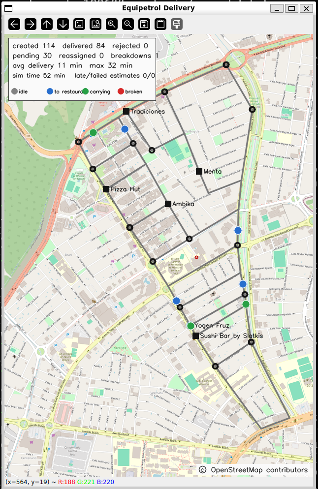
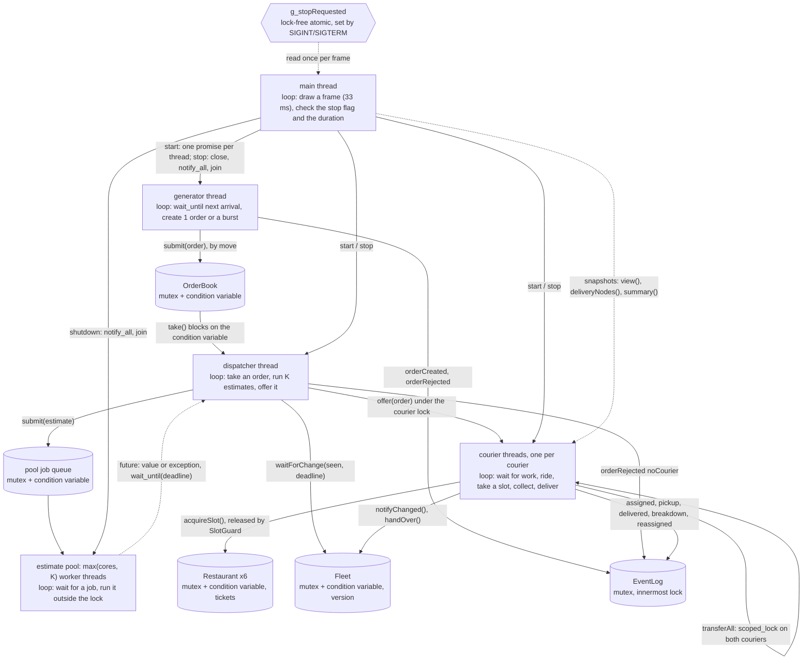

# Equipetrol Delivery

Map data © OpenStreetMap contributors (ODbL).

This program simulates couriers, restaurants, a dispatcher and orders in Zona Equipetrol, in accelerated time and drawn live over the real OpenStreetMap image of the zone. Every courier, the dispatcher and the order generator run at the same time on their own threads, and the estimates for each order are computed in parallel by a thread pool. The goal is to serve the orders without losing, duplicating or corrupting any, which is checked with ThreadSanitizer and a log checker.




## 1. Build and run

Dependencies (the versions I used):

| Tool / library | Version | Used for |
|---|---|---|
| Ubuntu (WSL2, kernel 6.6.87.2) | 26.04.1 LTS | build and run environment |
| g++ (includes ThreadSanitizer, AddressSanitizer, LeakSanitizer, UBSan) | 15.2.0 | compiler and the tools of section 6 |
| CMake | 4.2.3 | build |
| GNU make | 4.4.1 | build |
| OpenCV | 4.10.0 | the window only |
| Qt5 (OpenCV's window backend on this system) | 5.15.18 | pulled in by OpenCV, not used directly |
| nlohmann/json (vendored in `third_party/`) | 3.11.3 | reading the config, writing the log |
| Python | 3.14.4 | tools only (log checker, experiments) |

Build and run exactly as the brief says:

```sh
mkdir build && cd build
cmake .. && make
./delivery_sim ../config/equipetrol.json
./delivery_sim ../config/equipetrol.json --log run1.log
```

ThreadSanitizer build (same target, instrumented):

```sh
mkdir build-tsan && cd build-tsan
cmake -DENABLE_TSAN=ON .. && make
```

`-DENABLE_ASAN=ON` gives an AddressSanitizer + LeakSanitizer build the same way.

Stop the simulation with Ctrl+C (SIGINT), `kill` (SIGTERM), or by closing the window. The last line of stdout is the JSON summary.

### Experiment settings

The command line is exactly the one of the brief. The experiments change the design through environment variables, read once at start-up (`src/core/Settings.h`). With none set, the program runs the final design.

| Variable | Values | Default |
|---|---|---|
| `EQ_ESTIMATES` | `pool`, `async`, `deferred` | `pool` |
| `EQ_CANDIDATES` | couriers compared per order (K) | `8` |
| `EQ_FOOD_WAIT` | `before` (wait for food, then take a slot), `holding` | `before` |
| `EQ_SLOW_ESTIMATE_MS` | first estimate of each order sleeps this long (fault injection) | `0` |
| `EQ_FAIL_ESTIMATE` | probability that one estimate throws (fault injection) | `0` |
| `EQ_GRAPH_TASKS` | tasks for the shortest-path tables (0 = cores) | `0` |
| `EQ_GRAPH_GRAIN` | sources claimed at a time (0 = static chunks) | `4` |

### Tests

```sh
python3 tools/make_test_configs.py                     
tools/run_scenario.sh build-tsan/delivery_sim config/scenarios/stress.json stress 0
tools/run_scenario.sh build/delivery_sim config/equipetrol.json real 8 INT
python3 tools/check_log.py runs/real.log runs/real.summary config/equipetrol.json
```

`tools/check_log.py` checks a log and its summary against the rules of sections 4, 6 and 7: one final state per order, no order in two bags, bag capacity, pickup slots, time never decreasing for an order, valid JSON lines, and summary equal to the log.

## 2. Project layout

The sources are grouped by their role in the concurrency design. Each folder only uses the folders below it: `view`, `app` → `actors` → `parallel`, `shared` → `core`.

| Folder | What lives there | Files |
|---|---|---|
| `src/` | entry point: signals, start line, frame loop, summary | `main.cpp` |
| `src/core/` | data that is read-only during the run, or a plain value: no lock needed | `Config`, `Settings.h`, `Graph`, `SimClock.h`, `Order.h` |
| `src/shared/` | monitors: shared data together with its mutex (and condition variable) | `EventLog`, `OrderBook`, `Restaurant` |
| `src/actors/` | objects whose code runs on their own threads | `Courier`, `Fleet`, `Dispatcher`, `OrderGenerator` |
| `src/parallel/` | the thread pool for the estimates | `EstimatePool.h` |
| `src/app/` | owns every object and thread; start and stop | `Simulation`, `SanitizerSuppressions.cpp` |
| `src/view/` | the OpenCV window, drawn by the main thread from snapshots | `Window` |

## 3. Program schematic

Every thread of execution, what it loops over, and every channel through which two threads communicate or wait for each other.



**When a thread has nothing to do, it sleeps.** No thread ever loops asking "is there work yet?". Each one waits on something that wakes it up:

- A **courier** with an empty bag sleeps on its own condition variable (`Courier::nextTask()`). The dispatcher wakes it when it gives it an order.
- The **dispatcher** sleeps in `OrderBook::take()` until an order arrives. If no courier can take an order yet, it sleeps in `Fleet::waitForChange()` until a courier gets room in its bag or is repaired.
- The **order generator** sleeps until the moment of the next order (`wait_until`).
- The **pool workers** sleep until the dispatcher puts an estimate in their queue.
- The **main thread** draws one frame of the window every 33 ms.

**How the program stops.** On Ctrl+C, SIGTERM, the end of the run or closing the window, `Simulation::stop()` stops everything in this order:

1. It stops the order generator first, so no new orders appear while the rest is shutting down.
2. It wakes every sleeping thread: it closes the order book, stops the fleet and every courier, and stops the restaurants.
3. It waits for every thread to finish (`join`): the dispatcher, all couriers and the pool workers.
4. It writes `simulationStopping` as the last line of the log. Orders that were not finished are counted as `pending` in the summary.

## 4. Concept map

For every row: the file and the place in the code, and in one or two sentences why the concept is the right one there and what would go wrong without it.

| Folder | Concept that must be present | Where (file, place) | Why it is right here, and what goes wrong without it |
|---|---|---|---|
| 01 | Explicit thread creation and a deliberate fate for every thread | `Simulation::start()` creates the threads, `Simulation::stop()` joins them, `~Simulation()` calls `stop()`; `EstimatePool` constructor and `shutdown()` | Every courier must work on its own and at the same time as the others, so each one gets its own thread. Every thread is joined before the program ends; without that, a thread could be killed in the middle of its work, or the program would crash with `std::terminate`. |
| 01 | A decision that depends on the hardware's available parallelism | `Graph::Graph` (number of tasks), `poolSize()` in `Simulation.cpp` | More busy threads than cores do not make the work faster, so the number of tasks and pool workers comes from `hardware_concurrency()` (2 if it returns 0).The pool gets the larger of the cores and K, so that all K estimates of one order can run at the same time. A fixed number would waste cores on a big machine and overload a small one. |
| 02 | Data handed to a thread by value, by reference, and by move | by value: the estimate lambda in `Dispatcher::rankCouriers()`; by reference: `std::ref(dispatcher_)` in `Simulation::start()`, `std::ref(nextSource)` in `Graph::Graph`; by move: the promises and the orders | By value: each estimate works on its own copy of the courier, so it cannot see the courier change while it computes. By reference: the dispatcher and the counter are shared on purpose and live longer than the threads that use them. By move: a promise or an order must exist in only one place. |
| 02 | Orders by move semantics, in one place at a time | `OrderBook::submit/take`, `Courier::offer`, `Courier::transferAll`, `Order.h` | An order moves from the generator to the order book, to the dispatcher, to a courier's bag, and after a breakdown to another bag. It is never copied, so it can never be delivered twice or lost. |
| 03 | Member functions of shared objects on threads; containers of threads | `&Courier::run` with `courierThreads_` in `Simulation::start()`; `EstimatePool::workers_` | Each courier thread runs that courier's own `run()` method. All the threads are kept in one vector so they can be joined in a loop; threads cannot be copied, so they are added with `emplace_back`. |
| 03 | Shared ownership that guarantees lifetime; no owning raw pointers | `std::shared_ptr<Courier>` in `Fleet`, copied into each courier thread; `std::shared_ptr<Restaurant>` | Each courier thread holds a copy of its courier's `shared_ptr`, so the courier object stays alive as long as its thread runs. With a raw pointer, we would have to prove by hand that the object outlives the thread. |
| 04 | Tasks that return a result through a future, with a stated launch policy | `std::async(std::launch::async, ...)` in `Graph::Graph`; `EstimatePool::submit()` (`packaged_task`) | The shortest-path tables are built by tasks started with `std::launch::async`, which forces real new threads; the default policy could run them one after another. Each estimate returns its result, or its error, through a future. |
| 04 | A promise/future pair as a one-shot channel | Simulation::start(): one promise<void> for each courier thread, the dispatcher and the generator, before the start line  | Each thread fulfils its promise when it is ready, and the main thread waits for all of them before printing "Simulation has started...". Waiting with a sleep would be a guess: on a slow machine the line could appear too early. |
| 04 | A wait with a time limit, and an exception that crosses threads | `Dispatcher::rankCouriers()`: `wait_until(deadline)` and `get()` inside try/catch | The dispatcher waits for the estimates no longer than `quoteTimeoutMs` and ignores the late ones. If an estimate fails, its exception comes back through `get()` and is caught, so one bad estimate cannot crash the program. |
| 05 | Per shared object, why no data race is possible on it | section 5 below | See section 5: one row per shared object. |
| 05 | A type that is safe to copy or move | `Order.h` (copies deleted, moves `noexcept`); `Courier::View` (a plain copy) | `Order` cannot be copied, only moved, so a duplicate order does not even compile. `Courier::View` is a plain copy of a courier, so it can be read anywhere without a lock. |
| 06 | Mutual exclusion only through scope-bound locks; short critical sections | every `lock_guard` / `unique_lock`; `SlotGuard` in `shared/Restaurant.h` | Every lock is released automatically when its scope ends, even after an early `return` or an exception, and `SlotGuard` does the same for a pickup slot. Locks are held only while touching shared data, never while sleeping, so other threads wait very little. |
| 06 | One operation that needs two locks, and why it cannot deadlock | `Courier::transferAll()` with `std::scoped_lock` | When a courier breaks down, all its orders move to another courier at once, so nobody can see an order in both bags or in neither. `std::scoped_lock` takes both locks safely, so two breakdowns at the same moment cannot block each other; taking the locks one by one in opposite orders could deadlock. |
| 07 | Monitor objects | `EventLog`, `OrderBook`, `Restaurant`, `Courier`, `Fleet`, `EstimatePool` | Each shared object keeps its data private together with its mutex, and every method that touches data that can change takes the lock. Data that never changes after construction (a restaurant’s id, the list of couriers) is read without it. No thread can reach changing data without the lock, so nobody can forget it. |
| 07 | Threads that block until a condition holds, robust to empty wake-ups and to a final wake-up for shutdown | `OrderBook::take()`, `Courier::nextTask()` / `sleepUntil()`, `Restaurant::acquireSlot()`, `Fleet::waitForChange()`, `OrderGenerator::sleepUntil()`, `EstimatePool::workerLoop()`; every `stop()` / `close()` | Waiting threads sleep on a condition variable with a condition, so they use no CPU, and a wake-up with no news only makes them check again and go back to sleep. Every `stop()` or `close()` sets a flag and calls `notify_all()`, so all sleeping threads wake up at the end and the program stops in about a second. |

The project also uses folders 08 to 10 of the course. Folder 08: the flag set by Ctrl+C is a lock-free `std::atomic<bool>`, the only kind of shared variable that is safe to touch inside a signal handler, and the dispatcher's statistics are atomics with relaxed order because nobody uses them to order other data. Folder 09: the estimates run on a thread pool (example 55); experiment E1 shows why it is better than one `std::async` per estimate. Folder 10: at start-up, tasks take groups of nodes from an atomic counter to build the shortest-path tables in parallel, and every thread that makes random decisions has its own random generator, so there is no race and a seed always gives the same orders.


## 5. Why there is no data race

A data race needs two threads touching the same memory at the same time, with at least one of them writing, and nothing ordering them. For every shared object, one of these four reasons makes that impossible: it is **only read** during the run, it is **only touched while holding its lock**, each thread has **its own copy**, or it is an **atomic**.

| Shared object | Shared by | Why no data race is possible |
|---|---|---|
| `Config`, `Settings` | every thread | Filled once in `main` before any thread starts. After that, threads only read them, and reading alone can never race. |
| `Graph` | couriers, dispatcher, estimate tasks, generator, window | Built completely in the `Simulation` constructor before the simulation threads start. After that every method is `const`, so it is only read. |
| `SimClock` | every thread | Its two members are `const` and set in the constructor. Its methods only read them. |
| `EventLog` | generator, dispatcher, couriers, main | Every method takes the log's mutex before writing a line or changing a counter, and the summary is read under the same mutex. |
| `OrderBook` | generator, dispatcher, window | Every method (`submit`, `take`, `close`, `size`, `deliveryNodes`) takes its mutex before touching the queue. |
| `Restaurant` | couriers | The slots and the ticket counters change only under the restaurant's mutex. Its id, name and node never change after construction. |
| `Courier` (bag, position, state) | its own thread, dispatcher, other couriers (handover), window | Changed only under the courier's mutex. Other threads read a copy made under that mutex (`view()`), and a handover locks both couriers. The courier's own thread may read its own position without the lock, because it is the only thread that writes it. |
| `Order` | generator, dispatcher, couriers | An order has exactly one owner at a time. It is moved, never copied, and only while holding the lock of the place it moves into (the order book or a bag). |
| `Fleet` (change counter, courier list) | dispatcher, couriers | The change counter and the stop flag change only under the fleet's mutex. The list of couriers is filled in the constructor and never changes. |
| `EstimatePool` job queue | dispatcher, pool workers | Jobs are added and removed only under the pool's mutex. Each job then runs outside the lock, on its own copies. |
| `Courier::View` and the estimate inputs | estimate tasks, window | Copies made under the courier's lock. Each task owns its copies, and the only shared thing it reads is the `const` `Graph`. |
| `g_stopRequested`, dispatcher statistics | signal handler, main, dispatcher | `std::atomic`: every read and write is indivisible. The stop flag is lock-free, so it is safe even inside the signal handler. The statistics are written only by the dispatcher and read by the window. |
| random generators | generator thread, each courier thread, dispatcher | Each generator belongs to exactly one thread and is never shared. |
| rows of `dist_` / `next_` during start-up | shortest-path tasks | The tables are sized before the tasks start, and each row is written by exactly one task: the one that claimed that node with `fetch_add`. Different rows are different memory. Every task has finished (`get()`) before anyone reads the tables. |

ThreadSanitizer confirms it: after the fix described in section 6, it reported no race in any run.

## 6. Analysis with tools

I used two tools that come with g++ 15.2.0 (`analysis/versions.txt`):

- **ThreadSanitizer (TSan)**, which looks for **data races** and lock-order problems;
- **AddressSanitizer + LeakSanitizer + UndefinedBehaviorSanitizer (ASan)**, which look for **memory errors, leaks** and undefined behaviour.

Each one watched a **complete run of `config/equipetrol.json`** that had bursts of orders, a breakdown and a stop by signal. The unedited output of every run is in `analysis/`.

### What the full runs contained

| Run | Orders | Delivered | Pending | Bursts | Breakdowns | Stopped by |
|---|---|---|---|---|---|---|
| TSan full (`tsan_full`) | 127 | 90 | 37 | 29 orders arrived less than 200 simulated ms after the previous one | 1 | SIGINT after 55 s |
| ASan full (`asan_full`) | 127 | 90 | 37 | same 29 (same seed) | 1 | SIGINT after 55 s |

I also ran both tools on the hardest scenarios: `stress` (1933 orders, 162 breakdowns, 134 reassigned orders, bag of 1, one pickup slot) and, for ASan, `breakdowns` stopped with SIGTERM (470 orders, 37 breakdowns).

### ThreadSanitizer (data races)

**Version:** g++ (Ubuntu 15.2.0-16ubuntu1) 15.2.0, which includes TSan.

**Commands:**

```sh
mkdir build-tsan && cd build-tsan && cmake -DENABLE_TSAN=ON .. && make && cd ..
tools/run_scenario.sh build-tsan/delivery_sim config/equipetrol.json tsan_full 55 INT
```

**What it reported (before):** 5 warnings (`analysis/tsan_before.txt`): 4 data races and 1 lock-order inversion. All of them were **inside the libraries of the window**: 3 in `libQt5Core` and 2 in `libdbus`, in a thread called `QDBusConnection` that Qt starts by itself when OpenCV opens the window. None of them involved the simulation's own data; the only line of my code in those reports is the creation of the window in `main`.

**What I changed** (commit `9e7125a`):

1. `cv::setNumThreads(0)` in the `Window` constructor. OpenCV no longer starts its own hidden pool of worker threads (TBB) for image operations, so every thread that works on the simulation is one that my program creates and joins.
2. A short list of **suppressions** compiled into the TSan build only (`src/app/SanitizerSuppressions.cpp`). It tells TSan to ignore reports *inside* the GUI libraries (Qt, dbus, glib, GTK, X11). TSan cannot see how those libraries synchronise internally, because they were not compiled with it. A race in my own code would still be reported, because its stack would not be made only of those libraries.

**Result of the re-run:** **0 warnings** in the full run and in `stress` (`analysis/tsan_full.txt`, `analysis/tsan_stress.txt`). Both runs passed `tools/check_log.py`.

### AddressSanitizer + LeakSanitizer + UBSan (memory)

**Version:** g++ (Ubuntu 15.2.0-16ubuntu1) 15.2.0, which includes ASan, LSan and UBSan.

**Commands:**

```sh
mkdir build-asan && cd build-asan && cmake -DENABLE_ASAN=ON .. && make && cd ..
tools/run_scenario.sh build-asan/delivery_sim config/equipetrol.json asan_full 55 INT
```

**What it reported (before):** no memory errors and no undefined behaviour, but LeakSanitizer found **320 bytes leaked in 3 allocations**, and that made the exit status 1 (`analysis/asan_before.txt`). All three allocations were made by **`libfontconfig`** (`FcInit`), called by Qt's font database the first time the window draws text. Fontconfig loads its font list once and keeps it until the program ends; it is not memory my code allocated.

**What I changed** (same commit `9e7125a`): the same file, `src/app/SanitizerSuppressions.cpp`, also gives LeakSanitizer a list of the same GUI libraries, compiled into the ASan build only. A leak in my own code would still be reported.

**Result of the re-run:** exit status **0** and **no errors** in the full run (SIGINT), in `stress`, and in `breakdowns` (SIGTERM) (`analysis/asan_full.txt`, `asan_stress.txt`, `asan_bd.txt`). All three passed `tools/check_log.py`.

### What the tools still print, and why

The only thing left in the final version is this block at the end of the ASan output:

```
Suppressions used:
  count      bytes template
      3        320 libfontconfig.so
```

These are the same 3 allocations (320 bytes) that fontconfig keeps for its font list until the program exits, as explained above. Nothing else is reported: no data race, no memory error, no leak in the simulation's code.

## 7. Experiments

Every experiment changes **one** setting and keeps everything else the same: the configuration file, the seed (42) and the machine (12th Gen Intel Core i9-12900H, 20 hardware threads, WSL2). Each case ran **3 times**, and the tables show the average. Every run passed `tools/check_log.py`.

- Scripts: `tools/run_experiments.sh` runs every case, `tools/summarize_runs.py` makes the table.
- Raw data: the event log, summary and stderr of every run are in `experiments/`, and the full table is `experiments/results.md`.

What the columns mean:

- **avgRankUs / maxRankUs:** average and longest time, in real microseconds, that the dispatcher needed to compare the couriers for one order (from sending the estimates until it has the ranking).
- **late:** estimates that arrived after the `quoteTimeoutMs` deadline (200 ms), per run.
- **delivered:** orders delivered in the run.
- **avg / max delivery:** simulated minutes from the creation of an order to its delivery.

### E1: how the estimates are computed (this experiment changed the design)

- **Changed:** `EQ_ESTIMATES`:
  - `deferred`: the estimates run one after another, on the dispatcher's own thread;
  - `async`: one new thread per estimate (`std::async`);
  - `pool`: the estimates go to a pool of threads created once at start-up.

  Then `async` and `pool` again, with the first estimate of every order made slow on purpose (500 ms, `EQ_SLOW_ESTIMATE_MS=500`).
- **Kept equal:** `config/scenarios/fast.json`, seed 42, K = 8 couriers compared per order, `quoteTimeoutMs` = 200 ms.
- **Measured:** avgRankUs, maxRankUs, late estimates, delivered orders.

| Case | avgRankUs | maxRankUs | late | delivered |
|---|---|---|---|---|
| deferred | 4.0 | 149.0 | 0 | 54.0 |
| async | 165.0 | 2295.3 | 0 | 53.7 |
| pool | 55.3 | 526.7 | 0 | 53.3 |
| async, slow estimate | 500740.7 | 500961.0 | 6.7 | 5.0 |
| pool, slow estimate | 200248.0 | 200858.3 | 15.3 | 12.0 |

**What the numbers say:**

- With normal estimates, **`deferred` is the fastest** (4 µs). Each estimate only takes a few microseconds, so creating a thread costs more than the work itself (course folder 04, example 26). But `deferred` breaks the brief: the estimates of one order must run **at the same time**, and a slow estimate would block the dispatcher with no way to stop at the deadline.
- Between the two ways that do run the estimates at the same time, **the pool is 3 times faster than `async`** (55 µs against 165 µs), because its threads already exist.
- With one slow estimate per order, the difference becomes large. **`async` waits 500 ms per order**: the dispatcher stops waiting at 200 ms, but a `std::async` future that is destroyed blocks until its task finishes. **The pool stops at the 200 ms deadline**, because a pool future does not block when it is dropped. In the same time, the pool delivered 12 orders against 5.
- `late` is higher with the pool only because the pool ranked more orders in the same time; in both cases it is one late estimate per order.

**Design change.** Before: one `std::async` per estimate. After: the thread pool (`src/parallel/EstimatePool.h`, course folder 09, example 55). Numbers: with a slow estimate, the time to rank one order went from **500.7 ms to 200.2 ms** (the deadline), and delivered orders went from **5.0 to 12.0**. With normal estimates it is also 3 times faster (165 µs → 55 µs).

### E2: hold the pickup slot while the food cooks, or wait for the food first

- **Changed:** `EQ_FOOD_WAIT`:
  - `holding`: the courier takes a pickup slot and waits there until the food is ready;
  - `before`: the courier waits for the food first, and takes a slot only when it is ready.
- **Kept equal:** `config/scenarios/one_slot.json` (one pickup slot per restaurant), seed 42.
- **Measured:** delivered orders, average and longest delivery time.

| Case | delivered | avg delivery (min) | max delivery (min) |
|---|---|---|---|
| holding | 45.0 | 8.3 | 17.6 |
| before | 42.0 | 7.7 | 18.6 |

**What the numbers say:** the result is mixed. `before` has a shorter average delivery time, but `holding` delivered a few more orders and has a shorter maximum. The differences are small, about the size of the differences between the 3 runs of the same case. In this scenario the preparation times (1 to 4 simulated minutes) are short compared with the time couriers spend riding, so a slot is rarely held for long. **Conclusion:** this experiment does not show that one design is better, so it did not lead to a change. I kept `before`, because it never blocks a slot while nothing can be collected; a scenario with longer preparation times would be needed to measure that effect.

### E3: how many couriers are compared for each order (K)

- **Changed:** `EQ_CANDIDATES` = 1, 2, 4, 8, 16.
- **Kept equal:** `config/scenarios/fast.json` (8 couriers), seed 42, pool mode.
- **Measured:** avgRankUs, delivered orders, average delivery time.

| K | avgRankUs | delivered | avg delivery (min) |
|---|---|---|---|
| 1 | 60.3 | 54.7 | 13.1 |
| 2 | 59.7 | 56.3 | 13.2 |
| 4 | 57.0 | 54.7 | 13.0 |
| 8 | 59.0 | 54.3 | 13.6 |
| 16 | 64.3 | 52.3 | 13.5 |

**What the numbers say:** K has no visible effect here. The time to rank an order stays near 60 µs, and the deliveries stay between 52 and 56 orders at about 13 minutes. With only 8 couriers, and most of them busy, there are few free couriers to choose from, so comparing more of them changes little. Because the estimates run at the same time on the pool, comparing more couriers also costs almost nothing. **Conclusion:** K = 8 is a safe default; it neither helps nor hurts with this fleet.

### E4: building the shortest-path tables in parallel at start-up

- **Changed:** `EQ_GRAPH_TASKS` = 1, 2, 4, 8, 16 tasks (dynamic chunks of 4 nodes), and 8 tasks with static chunks (`EQ_GRAPH_GRAIN=0`).
- **Kept equal:** a 40 × 40 grid of streets (1600 nodes, 3120 streets, `config/scenarios/grid40.json`), the machine.
- **Measured:** time to build the tables (the `graph:` line printed at start-up), the speedup T(1) / T(n), and Amdahl's prediction 1 / (f + (1 − f) / n).

| Tasks | time (ms) | speedup | Amdahl (f = 0.13) |
|---|---|---|---|
| 1 | 304.9 | 1.00 | 1.00 |
| 2 | 149.3 | 2.04 | 1.77 |
| 4 | 82.9 | 3.68 | 2.89 |
| 8 | 72.1 | 4.23 | 4.21 |
| 16 | 55.8 | 5.46 | 5.46 |
| 8, static chunks | 68.9 | 4.43 | – |

**How I estimated f (the part that cannot run in parallel):** from the 16-task point, T(16) / T(1) = 55.8 / 304.9 = 0.183 = f + (1 − f) / 16, which gives f ≈ 0.13. So, according to Amdahl's law, no number of tasks can make this more than 1 / f ≈ 7.8 times faster.

**What the numbers say:**

- The speedup grows quickly up to 4 tasks, then flattens: 8 tasks are only a little faster than 4, and 16 give 5.5×, far from 16×. That is the curve Amdahl's law predicts.
- Up to 4 tasks the measurements are better than the prediction. One f estimated from a single point is only an approximation; the processor also has cores of two different speeds and hyper-threads that share a core, so the extra threads beyond the fastest cores add less.
- Static chunks (68.9 ms) were slightly faster than dynamic chunks (72.1 ms) here. On a regular grid, every node costs about the same, so equal static chunks are already balanced and the shared counter of the dynamic version only adds a little overhead. Dynamic chunks pay off when some nodes cost much more than others (course folder 10, example 60), which can happen on a real map with one-way streets.
- On the real map (32 nodes) the whole build takes about 2 ms, so the parallel start-up matters for the large maps the reviewers use, not for ours.

## 8. Map and data

All map data comes from **OpenStreetMap** (© OpenStreetMap contributors, data under the ODbL). The attribution is shown in the bottom-right corner of the window and in this report.

**The image** (`data/equipetrol.png`): exported from openstreetmap.org (Share → Image, Standard layer), PNG, 1248 × 1792 pixels, scale 1:5700, Web Mercator projection. It shows Zona Equipetrol from the **Cuarto Anillo** (Av. Antonio Vaca Díez, at the top) through the **Tercer Anillo** (Av. Noel Kempff Mercado) down to the **Segundo Anillo** (Av. Cristóbal de Mendoza, bottom right), with **Av. San Martín** crossing it, and Av. La Salle and Av. Busch.

**Bounding box** (decimal degrees, also in `map.bounds` of `config/equipetrol.json`):

| north | south | west | east |
|---|---|---|---|
| −17.750567044823004 | −17.77504707884483 | −63.205248240852164 | −63.187351138452286 |

The window turns a latitude and longitude into a pixel with these bounds: longitude linearly, latitude with the Web Mercator formula, the same projection as the image.

**Simulated zone.** As agreed with the teacher, the street network and the restaurants cover the east side of Av. San Martín (between Av. San Martín and Av. La Salle), from the Cuarto Anillo to the Segundo Anillo. The image is not cropped.

**Street network** (`config/equipetrol.json`): **32 intersections and 44 street segments**, 4 of them one-way, traced on the real streets of the image (`tools/pick_network.py`, checked with `tools/check_network.py`). The brief asks for at least 25 intersections, 40 segments and 6 restaurants. Every pair of intersections can reach each other through the streets.

**Restaurants:** 6 real places taken from OpenStreetMap (`data/restaurants_osm.csv`, exported with Overpass Turbo). Each one sits on the intersection closest to its real position, except Ambika (see the table).

| Restaurant | Intersection | Pickup slots | Distance from its real position |
|---|---|---|---|
| Tradiciones | n29 | 1 | 28 m |
| Pizza Hut | n10 | 2 | 17 m |
| Ambika | n24 | 1 | 60 m (moved to a nearby intersection, with the teacher's permission) |
| Menta | n27 | 2 | 17 m |
| Yogen Früz | n26 | 1 | 14 m |
| Sushi Bar by Slätkis | n25 | 2 | 20 m |

More notes on the export and the restaurant list are in `data/README.md`.
