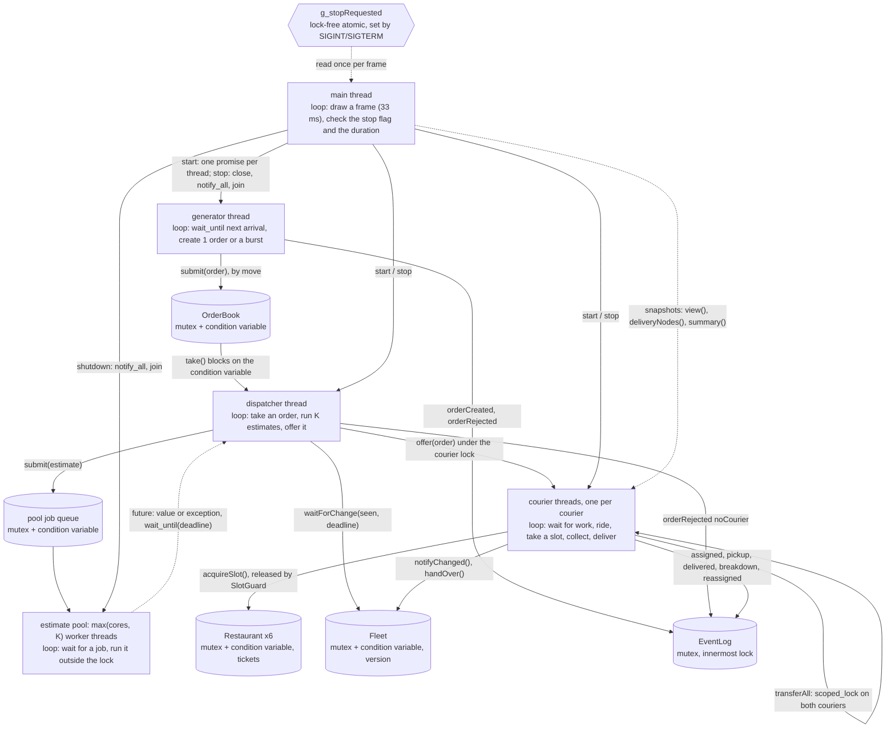

# Equipetrol Delivery

Map data © OpenStreetMap contributors (ODbL).

This program simulates couriers, restaurants, a dispatcher and orders in Zona Equipetrol, in accelerated time and drawn live over the real OpenStreetMap image of the zone. Every courier, the dispatcher and the order generator run at the same time on their own threads, and the estimates for each order are computed in parallel by a thread pool. The goal is to serve the orders without losing, duplicating or corrupting any, which is checked with ThreadSanitizer and a log checker.


## 1. Build and run

Dependencies (the versions I used):

| Tool / library | Version | Used for |
|---|---|---|
| Ubuntu (WSL2, kernel 6.6.87.2) | 26.04.1 LTS | build and run environment |
| g++ (includes ThreadSanitizer, AddressSanitizer, LeakSanitizer, UBSan) | 15.2.0 | compiler and the tools of section 6 |
| CMake | 4.2.3 | build |
| GNU make | 4.4.1 | build |
| OpenCV | 4.10.0 | the window only |
| Qt5 (OpenCV's window backend on this system) | 5.15.18 | pulled in by OpenCV, not used directly |
| nlohmann/json (vendored in `third_party/`) | 3.11.3 | reading the config, writing the log |
| Python | 3.14.4 | tools only (log checker, experiments) |

Build and run exactly as the brief says:

```sh
mkdir build && cd build
cmake .. && make
./delivery_sim ../config/equipetrol.json
./delivery_sim ../config/equipetrol.json --log run1.log
```

ThreadSanitizer build (same target, instrumented):

```sh
mkdir build-tsan && cd build-tsan
cmake -DENABLE_TSAN=ON .. && make
```

`-DENABLE_ASAN=ON` gives an AddressSanitizer + LeakSanitizer build the same way.

Stop the simulation with Ctrl+C (SIGINT), `kill` (SIGTERM), or by closing the window. The last line of stdout is the JSON summary.

### Experiment settings

The command line is exactly the one of the brief. The experiments change the design through environment variables, read once at start-up (`src/core/Settings.h`). With none set, the program runs the final design.

| Variable | Values | Default |
|---|---|---|
| `EQ_ESTIMATES` | `pool`, `async`, `deferred` | `pool` |
| `EQ_CANDIDATES` | couriers compared per order (K) | `8` |
| `EQ_FOOD_WAIT` | `before` (wait for food, then take a slot), `holding` | `before` |
| `EQ_SLOW_ESTIMATE_MS` | first estimate of each order sleeps this long (fault injection) | `0` |
| `EQ_FAIL_ESTIMATE` | probability that one estimate throws (fault injection) | `0` |
| `EQ_GRAPH_TASKS` | tasks for the shortest-path tables (0 = cores) | `0` |
| `EQ_GRAPH_GRAIN` | sources claimed at a time (0 = static chunks) | `4` |

### Tests

```sh
python3 tools/make_test_configs.py                     
tools/run_scenario.sh build-tsan/delivery_sim config/scenarios/stress.json stress 0
tools/run_scenario.sh build/delivery_sim config/equipetrol.json real 8 INT
python3 tools/check_log.py runs/real.log runs/real.summary config/equipetrol.json
```

`tools/check_log.py` checks a log and its summary against the rules of sections 4, 6 and 7: one final state per order, no order in two bags, bag capacity, pickup slots, time never decreasing for an order, valid JSON lines, and summary equal to the log.

## 2. Project layout

The sources are grouped by their role in the concurrency design. Each folder only uses the folders below it: `view`, `app` → `actors` → `parallel`, `shared` → `core`.

| Folder | What lives there | Files |
|---|---|---|
| `src/` | entry point: signals, start line, frame loop, summary | `main.cpp` |
| `src/core/` | data that is read-only during the run, or a plain value: no lock needed | `Config`, `Settings.h`, `Graph`, `SimClock.h`, `Order.h` |
| `src/shared/` | monitors: shared data together with its mutex (and condition variable) | `EventLog`, `OrderBook`, `Restaurant` |
| `src/actors/` | objects whose code runs on their own threads | `Courier`, `Fleet`, `Dispatcher`, `OrderGenerator` |
| `src/parallel/` | the thread pool for the estimates | `EstimatePool.h` |
| `src/app/` | owns every object and thread; start and stop | `Simulation`, `SanitizerSuppressions.cpp` |
| `src/view/` | the OpenCV window, drawn by the main thread from snapshots | `Window` |

## 3. Program schematic

Every thread of execution, what it loops over, and every channel through which two threads communicate or wait for each other.



**When a thread has nothing to do, it sleeps.** No thread ever loops asking "is there work yet?". Each one waits on something that wakes it up:

- A **courier** with an empty bag sleeps on its own condition variable (`Courier::nextTask()`). The dispatcher wakes it when it gives it an order.
- The **dispatcher** sleeps in `OrderBook::take()` until an order arrives. If no courier can take an order yet, it sleeps in `Fleet::waitForChange()` until a courier gets room in its bag or is repaired.
- The **order generator** sleeps until the moment of the next order (`wait_until`).
- The **pool workers** sleep until the dispatcher puts an estimate in their queue.
- The **main thread** draws one frame of the window every 33 ms.

**How the program stops.** On Ctrl+C, SIGTERM, the end of the run or closing the window, `Simulation::stop()` stops everything in this order:

1. It stops the order generator first, so no new orders appear while the rest is shutting down.
2. It wakes every sleeping thread: it closes the order book, stops the fleet and every courier, and stops the restaurants.
3. It waits for every thread to finish (`join`): the dispatcher, all couriers and the pool workers.
4. It writes `simulationStopping` as the last line of the log. Orders that were not finished are counted as `pending` in the summary.

## 4. Concept map

For every row: the file and the place in the code, and in one or two sentences why the concept is the right one there and what would go wrong without it.

| Folder | Concept that must be present | Where (file, place) | Why it is right here, and what goes wrong without it |
|---|---|---|---|
| 01 | Explicit thread creation and a deliberate fate for every thread | `Simulation::start()` creates the threads, `Simulation::stop()` joins them, `~Simulation()` calls `stop()`; `EstimatePool` constructor and `shutdown()` | TODO |
| 01 | A decision that depends on the hardware's available parallelism | `Graph::Graph` (number of tasks), `poolSize()` in `Simulation.cpp` | TODO |
| 02 | Data handed to a thread by value, by reference, and by move | by value: the estimate lambda in `Dispatcher::rankCouriers()`; by reference: `std::ref(dispatcher_)` in `Simulation::start()`, `std::ref(nextSource)` in `Graph::Graph`; by move: the promises and the orders | TODO |
| 02 | Orders by move semantics, in one place at a time | `OrderBook::submit/take`, `Courier::offer`, `Courier::transferAll`, `Order.h` | TODO |
| 03 | Member functions of shared objects on threads; containers of threads | `&Courier::run` with `courierThreads_` in `Simulation::start()`; `EstimatePool::workers_` | TODO |
| 03 | Shared ownership that guarantees lifetime; no owning raw pointers | `std::shared_ptr<Courier>` in `Fleet`, copied into each courier thread; `std::shared_ptr<Restaurant>` | TODO |
| 04 | Tasks that return a result through a future, with a stated launch policy | `std::async(std::launch::async, ...)` in `Graph::Graph`; `EstimatePool::submit()` (`packaged_task`) | TODO |
| 04 | A promise/future pair as a one-shot channel | `Simulation::start()`: one `promise<void>` per thread, before the start line | TODO |
| 04 | A wait with a time limit, and an exception that crosses threads | `Dispatcher::rankCouriers()`: `wait_until(deadline)` and `get()` inside try/catch | TODO |
| 05 | Per shared object, why no data race is possible on it | section 5 below | see section 5 |
| 05 | A type that is safe to copy or move | `Order.h` (copies deleted, moves `noexcept`); `Courier::View` (a plain copy) | TODO |
| 06 | Mutual exclusion only through scope-bound locks; short critical sections | every `lock_guard` / `unique_lock`; `SlotGuard` in `shared/Restaurant.h` | TODO |
| 06 | One operation that needs two locks, and why it cannot deadlock | `Courier::transferAll()` with `std::scoped_lock` | TODO |
| 07 | Monitor objects | `EventLog`, `OrderBook`, `Restaurant`, `Courier`, `Fleet`, `EstimatePool` | TODO |
| 07 | Threads that block until a condition holds, robust to empty wake-ups and to a final wake-up for shutdown | `OrderBook::take()`, `Courier::nextTask()` / `sleepUntil()`, `Restaurant::acquireSlot()`, `Fleet::waitForChange()`, `OrderGenerator::sleepUntil()`, `EstimatePool::workerLoop()`; every `stop()` / `close()` | TODO |

The project also uses folders 08 to 10 of the course: the lock-free stop flag and relaxed statistics counters (08), the thread pool and fan-out/fan-in of the estimates (09), and the parallel start-up with dynamic chunks and one random generator per thread (10).

> TODO (optional but useful for the oral defence): two or three sentences on why each of those is there.

## 5. Why there is no data race

| Shared object | Shared by | Why no data race is possible |
|---|---|---|
| `Config`, `Settings` | every thread | TODO |
| `Graph` | couriers, dispatcher, estimate tasks, generator, window | TODO |
| `SimClock` | every thread | TODO |
| `EventLog` | generator, dispatcher, couriers, main | TODO |
| `OrderBook` | generator, dispatcher, window | TODO |
| `Restaurant` | couriers | TODO |
| `Courier` (bag, position, state) | its own thread, dispatcher, other couriers (handover), window | TODO |
| `Fleet` (version counter, courier list) | dispatcher, couriers | TODO |
| `EstimatePool` job queue | dispatcher, pool workers | TODO |
| `Courier::View` and the estimate inputs | estimate tasks, window | TODO |
| `g_stopRequested`, dispatcher statistics | signal handler, main, dispatcher | TODO |
| random generators | generator thread, each courier thread, dispatcher | TODO |
| rows of `dist_` / `next_` during start-up | shortest-path tasks | TODO |

ThreadSanitizer reported no race in any scenario (section 6).

## 6. Analysis with tools

Each tool observed a complete run of `config/equipetrol.json` with bursts of orders, breakdowns and a stop by signal. The unedited output of every run is in `analysis/`.

### ThreadSanitizer (races)

- **Version:** TODO (`g++ --version`)
- **Command:** TODO (copy the exact command)
- **Run checked:** TODO (number of orders, bursts and breakdowns in that log; the signal used)
- **What it reported:** TODO
- **What I changed:** TODO
- **Result of the re-run:** TODO
- **Output files:** `analysis/TODO`

### AddressSanitizer + LeakSanitizer (memory)

- **Version:** TODO
- **Command:** TODO
- **Run checked:** TODO
- **What it reported:** TODO
- **What I changed:** TODO
- **Result of the re-run:** TODO
- **Output files:** `analysis/TODO`

> TODO: list and explain every report that remains in the final version (for example, memory held by OpenCV, GTK or fontconfig until exit). An unexplained report counts as a defect.

## 7. Experiments

Every experiment changes one setting and keeps the configuration, the seed and the machine the same, with 3 runs per case. The scripts are `tools/run_experiments.sh` and `tools/summarize_runs.py`. The raw logs, summaries and stderr of every run, and the full table, are in `experiments/`.

### E1: how the estimates are computed (design change)

- **Changed:** `EQ_ESTIMATES` = `deferred` (one after another) / `async` (one new thread per estimate) / `pool`; then `async` and `pool` with one estimate per order slowed to 500 ms.
- **Kept equal:** `config/scenarios/fast.json`, seed 42, K = 8, `quoteTimeoutMs` = 200.
- **Measured:** average and maximum time to rank one order (`avgRankUs`, `maxRankUs`), late estimates, delivered orders.

| Case | avgRankUs | maxRankUs | late | delivered |
|---|---|---|---|---|
| deferred | TODO | TODO | TODO | TODO |
| async | TODO | TODO | TODO | TODO |
| pool | TODO | TODO | TODO | TODO |
| async, slow estimate | TODO | TODO | TODO | TODO |
| pool, slow estimate | TODO | TODO | TODO | TODO |

> TODO: conclusion. Explain why `deferred` is the fastest with tiny estimates but breaks the brief, why the pool is faster than `async`, and why with a slow estimate `async` overshoots `quoteTimeoutMs` while the pool stays at the deadline.

**Design change.** TODO: before = `async`, after = `pool`, with the two numbers that justify it.

### E2: hold the pickup slot while the food cooks, or wait for the food first

- **Changed:** `EQ_FOOD_WAIT` = `holding` / `before`.
- **Kept equal:** `config/scenarios/one_slot.json` (one slot per restaurant), seed 42.
- **Measured:** delivered orders, average and maximum delivery time.

| Case | delivered | avg delivery (min) | max delivery (min) |
|---|---|---|---|
| holding | TODO | TODO | TODO |
| before | TODO | TODO | TODO |

> TODO: conclusion. Be honest if the difference is inside the run-to-run noise.

### E3: number of candidates compared per order (K)

- **Changed:** `EQ_CANDIDATES` = 1, 2, 4, 8, 16.
- **Kept equal:** `config/scenarios/fast.json`, seed 42, pool mode.
- **Measured:** `avgRankUs`, delivered orders, average delivery time.

| K | avgRankUs | delivered | avg delivery (min) |
|---|---|---|---|
| 1 | TODO | TODO | TODO |
| 2 | TODO | TODO | TODO |
| 4 | TODO | TODO | TODO |
| 8 | TODO | TODO | TODO |
| 16 | TODO | TODO | TODO |

> TODO: conclusion.

### E4: parallel start-up of the shortest-path tables

- **Changed:** `EQ_GRAPH_TASKS` = 1, 2, 4, 8, 16 (dynamic chunks), and 8 tasks with static chunks (`EQ_GRAPH_GRAIN=0`).
- **Kept equal:** a 40 x 40 grid (1600 nodes, 3120 streets, `config/scenarios/grid40.json`), the machine (TODO: cores / `hardware_concurrency()`).
- **Measured:** time to build the tables (`graph:` line on stderr), speedup = T(1) / T(n), Amdahl's prediction 1 / (f + (1 − f) / n).

| Tasks | time (ms) | speedup | Amdahl |
|---|---|---|---|
| 1 | TODO | 1.0 | 1.0 |
| 2 | TODO | TODO | TODO |
| 4 | TODO | TODO | TODO |
| 8 | TODO | TODO | TODO |
| 16 | TODO | TODO | TODO |
| 8, static chunks | TODO | TODO | – |

> TODO: conclusion. How you estimated the serial fraction f, why the speedup flattens, and what static vs dynamic chunks show on a grid where every source costs the same.

## 8. Map and data

The background image and the street network come from OpenStreetMap (© OpenStreetMap contributors, ODbL). Details of the bounding box, the tools used to trace the network, and the restaurant positions are in `data/README.md`.
