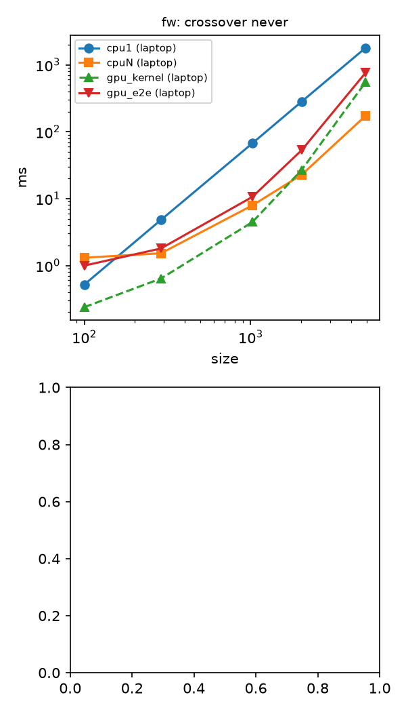

# Informe EC2: aplicaciones GPU en Equipetrol Delivery

## 3.1 Aplicación 1: tabla de distancias con Floyd–Warshall por tiles (03_memory_tiling)

### Tarea y por qué es data-parallel
- Cada ETA necesita la distancia entre dos intersecciones.
- El programa guarda una tabla all-pairs de n² entradas, en decímetros enteros.
- Referencia en CPU: Dijkstra desde cada nodo.
- En GPU: Floyd–Warshall. En la ronda k, cada par (i, j) se actualiza solo:
  `d[i][j] = min(d[i][j], d[i][k] + d[k][j])`.
- Cada ronda tiene n² actualizaciones independientes: es data-parallel.
- Las n rondas son secuenciales. La ronda k usa el resultado de la ronda k − 1.

### Dónde se usa en el programa
- El `Graph` calcula la tabla una sola vez, al arrancar.
- Con `EQ_GPU=1`, se calcula en la GPU a través del único hilo dueño de la GPU (commit de integración).

### Diseño
- **Datos.** Matriz densa de `int`, rellenada hasta un múltiplo de 32 con `kInf = 0x3fffffff`.
  Así `kInf + kInf` no desborda un `int`.
- **Movimiento.** La matriz se sube una vez. Todas las rondas corren en la GPU. Se baja una vez.
- **Block.** 32 × 32 = 1024 threads, un thread por celda. 32 es el ancho de un warp: cada fila del tile es un warp.
- **Grid por ronda k.** Tres kernels:
  - `diagonalTile`: 1 bloque, el tile (k, k).
  - `pivotRowAndColumn`: grid (bloques, 2), la fila y la columna k.
  - `remainingTiles`: grid (bloques, bloques), el resto.
- **Shared memory.** Cada bloque carga sus tiles una vez y reusa cada valor 32 veces (data reuse, sesión 13).
- **Tamaño.** Con n = 4900, N = 4928: 154 rondas × 3 = 462 launches. La fase 3 tiene 154 × 154 = 23 716 bloques por ronda.
- **CPU N threads.** `parallelFor` reparte los nodos origen en rangos contiguos. Cada thread corre Dijkstra para sus orígenes y escribe solo sus filas. No hay escrituras compartidas.

### Correctitud
- Los valores son enteros: la tabla GPU debe ser **exactamente igual** a `dijkstraOne`. Sin tolerancia.
- Los 5 tamaños dan `correct=yes` en las 450 filas del CSV.
- El grafo de prueba tiene calles de un solo sentido (una fila de cada tres). La tabla no es simétrica y se compara como grafo dirigido.
- Los pares sin camino quedan en `kInf`.
- compute-sanitizer (`results/sanitizer_laptop_fw.txt`): memcheck 0 errors, racecheck 0 hazards, synccheck 0 errors.
- En las fases 1 y 2 el tile se actualiza en el mismo lugar. Un `__syncthreads()` separa la lectura de la escritura.

### Resultados
Laptop: Intel i9-12900H (6P + 8E cores, 20 threads), RTX 3060 Laptop GPU, WSL2, Release (-O3).
Mediana de 10 repeticiones intercaladas, después de un warm-up. Tiempos en ms.
Fuente: `results/bench_laptop_fw.csv`, tabla de `analysis/report.ipynb`.

| size | CPU 1 | mejor CPU N | GPU kernel | GPU end to end | speedup kernel | speedup e2e | correct |
|---|---|---|---|---|---|---|---|
| n=100 | 0.518 | 0.376 (N=4) | 0.238 | 0.995 | 1.58 | 0.38 | yes |
| n=289 | 4.804 | 1.244 (N=14) | 0.638 | 1.798 | 1.95 | 0.69 | yes |
| n=1024 | 67.217 | 7.926 (N=20) | 4.458 | 10.617 | 1.78 | 0.75 | yes |
| n=2025 | 282.140 | 22.726 (N=20) | 26.838 | 52.956 | 0.85 | 0.43 | yes |
| n=4900 | 1791.033 | 172.834 (N=20) | 549.199 | 760.344 | 0.32 | 0.23 | yes |



**Copies vs kernel.** Parte del tiempo end to end que es kernel: 24 % (n=100), 35 % (n=289), 42 % (n=1024), 51 % (n=2025), 72 % (n=4900). En tamaños chicos dominan las copias y la preparación.


**Thread sweep (n = 4900, mediana).** 1 thread: 1791 ms · 2: 927 · 4: 501 · 8: 293 · 14: 220 · 20: 173 ms.
Speedup de 10.4× con 20 threads (eficiencia 52 %). No es lineal: 8 de los 14 cores son E-cores y solo 6 tienen hyper-threading.


### Profiler (Nsight Compute, `remainingTiles`, n = 1024)
| Métrica | Valor |
|---|---|
| Theoretical occupancy | 66.67 % |
| Achieved occupancy | 63.2–63.8 % |
| Registers per thread | 25 |
| Block limit: warps / shared mem / registers / SM | 1 / 1 / 2 / 16 bloques |
| Memory throughput (unidad más cargada) | 74.6–75.6 % |
| DRAM throughput | 81–82 GB/s (24 % de 336 GB/s) |

- Un bloque de 1024 threads son 32 warps. El SM admite 48 warps: solo cabe 1 bloque. Por eso la ocupación teórica es 32/48 = 66.67 %.
- El límite son los warps y la shared memory, no los registros (25 por thread permitirían 2 bloques).
- La achieved occupancy (63–64 %) está cerca de la teórica: los warps casi no se quedan esperando.
- La DRAM solo usa el 24 % de su ancho de banda. El 75 % viene de la memoria on-chip (shared/L1). Es el efecto buscado: los tiles leen de shared, no de la global.

### Roofline
- Conteo: 2 operaciones enteras (suma y min) por celda y ronda. Tráfico global: 2 tiles de 32 × 32 por bloque y ronda.
- Intensidad aritmética: **4.0 op/byte**. Rendimiento alcanzado con n = 4900: **4.36 × 10¹¹ op/s**.
- Ridge point de la RTX 3060 Laptop: 16.1 TFLOP/s ÷ 336 GB/s ≈ 48 op/byte. Con 4 op/byte el kernel queda a la izquierda: **memory-bound**.
- El techo de memoria en 4 op/byte es 4 × 336 GB/s = 1.34 × 10¹² op/s. El kernel llega al 32 % de ese techo.
- Son operaciones enteras, no FLOPs de punto flotante.


### Análisis
- **Paralelismo.** Con n = 100 la matriz es de 128 × 128: solo 16 bloques en la fase 3, menos que los 30 SMs de la GPU. La GPU no se llena. Con n = 4900 hay 23 716 bloques por ronda: sobra trabajo por launch, pero son 462 launches dependientes.
- **Overheads.** Con n = 4900, end to end − kernel = 760 − 549 = 211 ms. Incluye armar la matriz con relleno en la CPU, copiar unos 97 MB en cada sentido (4928² × 4 B) y quitar el relleno. En el programa se paga una sola vez, al arrancar.
- **Divergencia.** No hay divergencia dentro de un warp en la fase 3. Los bloques con `bi == k` o `bj == k` salen como bloque completo.
- **Contención y sincronización.** No hay atomics: cada thread es dueño de su celda. La fase 3 solo lee tiles que la fase 2 ya terminó. Por eso no necesita barreras dentro del bucle.
- **Correctitud en paralelo.** `min` entre enteros es exacto y no depende del orden. El resultado es determinista.
- **Algoritmo.** Floyd–Warshall hace N³ ≈ 1.2 × 10¹¹ actualizaciones con n = 4900. Dijkstra en una grilla de calles (m ≈ 4n aristas) hace unas n · m · log n ≈ 1.2 × 10⁹: unas 100 veces menos trabajo. Por eso la CPU con 20 threads (173 ms) le gana incluso al kernel solo (549 ms).

### Veredicto
- **Crossover end to end: nunca.** La GPU no le gana a la mejor CPU en ningún tamaño medido.
- El kernel solo gana hasta n = 1024 (1.6–1.9×). Desde n = 2025 pierde también.
- **Decisión: mantener la CPU** (Dijkstra multithread) para esta tabla. Se calcula una vez al arrancar y tarda milisegundos, tanto a la escala del brief (32 nodos) como en la ciudad (1600 nodos).

### Threats to validity
- **Dispersión de la GPU.** Con n = 4900, el end to end fue de 642 a 801 ms y el kernel de 404 a 562 ms.
- **Un valor atípico.** Con n = 2025 hubo una repetición de 233 ms end to end, contra una mediana de 53 ms. Por eso se reporta la mediana y no el promedio.
- La CPU va estable: con n = 4900 y 20 threads, de 167 a 179 ms.
- La CPU y la GPU de la laptop comparten potencia y temperatura.
- En WSL2 cada launch y cada copia pasa por la capa WDDM de Windows.

### Cómo reproducir
```bash
./build-gpu/delivery_sim config/equipetrol.json --bench results/bench_laptop_fw.csv --machine laptop --threads 1,2,4,8,14,20 --apps fw
for tool in memcheck racecheck synccheck; do
  compute-sanitizer --tool $tool ./build-gpu/delivery_sim config/equipetrol.json --bench /tmp/s.csv --size 0 --reps 1 --threads 2 --apps fw
done
ncu --set full -k regex:"remainingTiles" -c 2 --csv --page details ./build-gpu/delivery_sim config/equipetrol.json --bench /tmp/n.csv --size 2 --reps 1 --threads 2 --apps fw
cd analysis && jupyter nbconvert --to notebook --execute --allow-errors --inplace report.ipynb
```