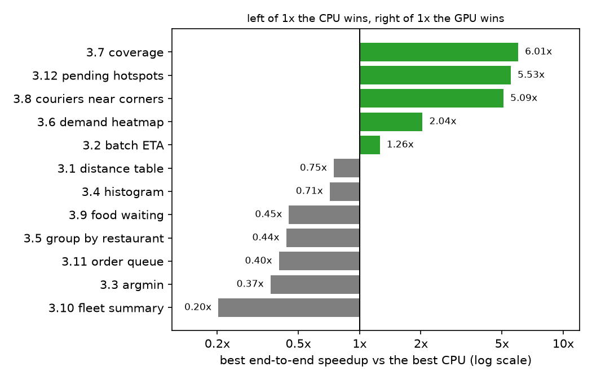
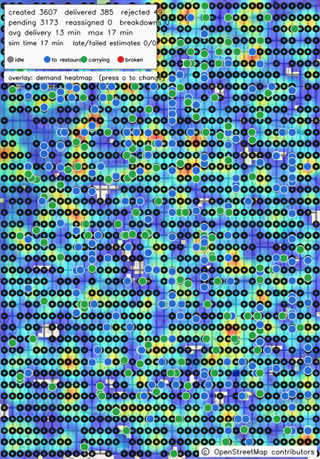
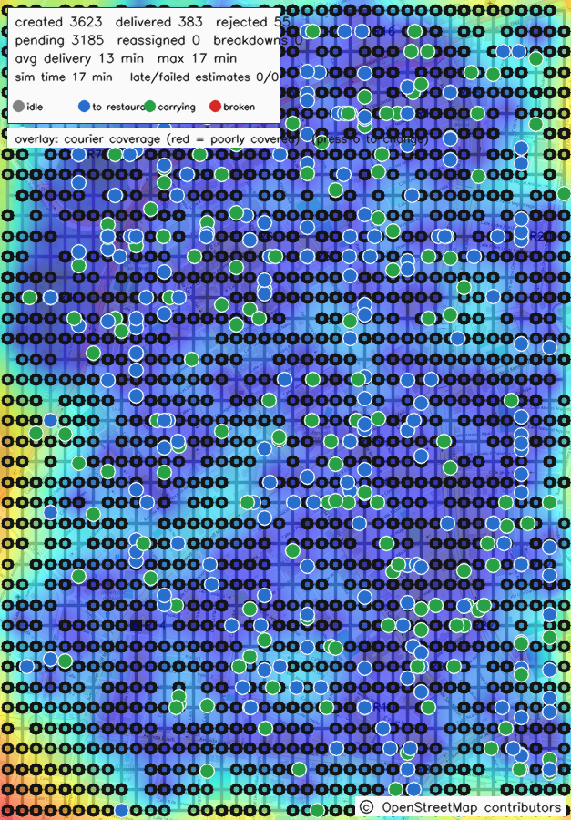

# Informe EC2: aplicaciones GPU en Equipetrol Delivery

## 1. Summary

Doce aplicaciones GPU dentro de Equipetrol Delivery, en los 7 conceptos que se evalúan (`ec2/03` a `ec2/09`). Los conceptos `10_filter`, `11_merge` y `12_sorting` no se evalúan, por indicación del docente.
«Crossover» es el tamaño desde el que la GPU **end to end** le gana a la **mejor CPU multithread** de la misma laptop. «Mejor speedup e2e» es el máximo medido (mejor CPU / GPU end to end). Cada sección tiene la tabla completa.

| Sección | Aplicación | Concepto (`ec2/`) | Aplicación del concepto | Crossover end to end | Mejor speedup e2e | Veredicto |
|---|---|---|---|---|---|---|
| 3.1 | Tabla de distancias con Floyd–Warshall por tiles | 03_memory_tiling | 1.ª | nunca | 0.75× | CPU |
| 3.8 | Repartidores cerca de cada esquina (tiles de repartidores) | 03_memory_tiling | 2.ª | 1.6–7.2 × 10⁶ pares | 5.1× | GPU desde unos 2 × 10⁶ pares (la ciudad) |
| 3.2 | ETA en lote con los repartidores como SoA | 04_performance | 1.ª | 1000 × 5000 (5 × 10⁶ pares) | 1.26× | GPU sobre ese umbral, encadenada con 3.3 |
| 3.9 | Comida esperando (SoA contra AoS) | 04_performance | 2.ª | nunca | 0.45× | CPU |
| 3.6 | Mapa de calor de demanda (gaussiano 5 × 5) | 05_conv | 1.ª | 5 m (2 × 10⁵ celdas) | 2.04× | CPU en el programa (celdas de 25 m) |
| 3.12 | Zonas con más pedidos pendientes (gaussiano 13 × 13) | 05_conv | 2.ª | 10 m (5 × 10⁴ celdas) | 5.53× | CPU en el programa; GPU desde 10 m |
| 3.7 | Cobertura de repartidores (stencil iterativo) | 06_stencil | 1.ª | 20 m (1.3 × 10⁴ celdas) | 6.0× | **GPU** |
| 3.4 | Histograma de tiempos de entrega (bins privatizados) | 07_histogram | 1.ª | nunca | 0.71× | CPU |
| 3.3 | Mejor repartidor por pedido (argmin) | 08_reduction | 1.ª | nunca, sola | 0.37× | GPU solo encadenada con 3.2 |
| 3.10 | Resumen de la flota en una pasada | 08_reduction | 2.ª | nunca | 0.20× | CPU |
| 3.5 | Entregas agrupadas por restaurante (counting sort + scan) | 09_scan | 1.ª | nunca | 0.44× | CPU |
| 3.11 | Cola de pedidos sin repartidor y su pico | 09_scan | 2.ª | nunca | 0.40× | CPU |

**Puntos reclamados: 12**, uno por aplicación: 03 (2), 04 (2), 05 (2), 06 (1), 07 (1), 08 (2) y 09 (2). Las doce funcionan dentro del programa en marcha (sección 5.2) y tienen su sección con mediciones.

**En una línea:** el kernel gana en casi todas las aplicaciones (hasta 91×), pero end to end la GPU solo conviene cuando los datos se quedan en la GPU o hay mucho trabajo por byte copiado. En la simulación completa (sección 5), despachar un pedido por vez en la GPU es más lento que con la CPU y entrega lo mismo.



**Cómo leer el gráfico.** Cada barra es una aplicación, y su largo dice cuánto más rápida (o más lenta) es la GPU que la mejor CPU de la laptop, de punta a punta, en el tamaño medido donde mejor le fue. La línea del medio es el empate (1×): las barras verdes, a la derecha, son las que gana la GPU; las grises, a la izquierda, las que gana la CPU. La escala es logarítmica para que «la mitad de rápido» y «el doble de rápido» se vean del mismo largo. La GPU gana solo en cinco, y por dos razones: o hacen mucho cálculo por cada byte que hay que copiar (los mapas de calor 3.6 y 3.12, las esquinas 3.8 y, apenas, el ETA en lote 3.2), o dejan los datos en la GPU entre pasos (la cobertura 3.7). En las otras siete, copiar los datos cuesta más de lo que la GPU ahorra calculando. El gráfico sale de los CSV, en la celda «Summary plot» de `analysis/report.ipynb`.

## 2. Set-up

### 2.1 Hardware y software
Fuente: `results/machine_laptop.txt` (`tools/machine_info.sh` y el comando `gcim` de la rúbrica).

| | |
|---|---|
| Laptop | Una sola laptop para todas las mediciones de CPU y de GPU |
| CPU | Intel Core i9-12900H: 14 cores (6 P + 8 E) y 20 threads. WSL2 la muestra como 10 × 2 (topología virtual) |
| Memoria | 15.7 GB (7.6 GiB visibles en WSL2) |
| GPU | NVIDIA GeForce RTX 3060 Laptop GPU: 30 SMs (3 840 CUDA cores), 6 GB, 2 100 MHz máximo, 336 GB/s, driver 610.91 |
| Sistema | Windows 11 Home 10.0.26300 con WSL2: Ubuntu 26.04.1 LTS, kernel 6.6.87.2 |
| Compiladores | g++ 15.2.0, CMake 4.2.3, CUDA 13.3 (`nvcc` V13.3.73) para `sm_86` |
| Flags | Release, `-O3 -DNDEBUG` para el C++ y para CUDA: los mismos para todas las versiones. Nunca se midió una compilación Debug ni sanitizer |
| Herramientas | CUDA events, `std::chrono::steady_clock`, el modo `--bench` (CSV), Nsight Compute, Nsight Systems, compute-sanitizer, ThreadSanitizer (`-DENABLE_TSAN=ON`), Python con pandas y matplotlib (`analysis/report.ipynb`) |

- **Todo se compiló y se midió en WSL2.** La rúbrica permite usar la propia computadora si tiene una GPU NVIDIA. Como esta laptop la tiene, la CPU y la GPU se midieron en la misma máquina: cada tabla es ya la comparación «same-machine», y no hizo falta Colab ni una segunda máquina.
- **Condiciones:** laptop enchufada, modo de energía «Máximo rendimiento» y las demás aplicaciones cerradas.

### 2.2 Configuraciones
| Configuración | Esquinas | Calles | Restaurantes | Repartidores | Uso |
|---|---|---|---|---|---|
| `config/equipetrol.json` (brief) | 32 | – | – | 8 | escala del brief, `check_log.py` |
| `config/city/city_40.json` | 1 600 | 3 120 | 24 | 400 | simulación con ventana y nsys |
| `config/city/city_60.json` | 3 600 | 7 080 | 40 | 2 000 | **escala de la rúbrica** (3 000–5 000 esquinas, 2 000–5 000 repartidores) |

Las dos ciudades salen de `tools/make_city_config.py` y duran una hora simulada (`durationS` = 3600, `timeScale` = 60).

### 2.3 Cómo se midió
- **Benchmark:** `--bench` corre cada aplicación con 5 tamaños de al menos dos órdenes de magnitud, con la misma entrada y semilla fija para todas las versiones, y comprueba la correctitud en cada corrida (columna `correct`).
- **Repeticiones:** un warm-up y 10 repeticiones **intercaladas** (todas las versiones en cada repetición, por el calor de la laptop). Se reporta la **mediana** y el rango mínimo–máximo.
- **Thread sweep:** la CPU multithread con 1, 2, 4, 8, 14 y 20 threads.
- **Relojes:** el kernel con CUDA events; la CPU y el end to end de la GPU con `steady_clock`, después de sincronizar.
- **Tablas y gráficos:** salen del CSV con `analysis/report.ipynb`, nunca se tipean a mano.

### 2.4 Cómo reproducir todo
```bash
# compilar: sin CUDA (por defecto), con CUDA y con ThreadSanitizer
mkdir -p build && cd build && cmake .. && make -j8 && cd ..
mkdir -p build-gpu && cd build-gpu && cmake -DCMAKE_BUILD_TYPE=Release -DUSE_CUDA=ON -DCMAKE_CUDA_ARCHITECTURES=86 .. && make -j8 && cd ..
mkdir -p build-tsan && cd build-tsan && cmake -DENABLE_TSAN=ON .. && make -j8 && cd ..
# la máquina
tools/machine_info.sh > results/machine_laptop.txt
powershell.exe -Command "gcim Win32_Processor | select Name, NumberOfCores, NumberOfLogicalProcessors" >> results/machine_laptop.txt
# las ciudades
python3 tools/make_city_config.py 40 400 24 300 3600 config/city/city_40.json
python3 tools/make_city_config.py 60 2000 40 100 3600 config/city/city_60.json
# el benchmark de una aplicación (los nombres: fw, eta, argmin, hist, group, conv, stencil, near, foodwait, fleetsum, backlog, hotspots)
./build-gpu/delivery_sim config/equipetrol.json --bench results/bench_laptop_<app>.csv --machine laptop --threads 1,2,4,8,14,20 --apps <app>
# compute-sanitizer de una aplicación (la 3.12 usa --size 1)
for tool in memcheck racecheck synccheck; do
  compute-sanitizer --tool $tool ./build-gpu/delivery_sim config/equipetrol.json --bench /tmp/s.csv --size 0 --reps 1 --threads 2 --apps <app>
done
# tablas y gráficos
cd analysis && jupyter nbconvert --to notebook --execute --allow-errors --inplace report.ipynb
```
Cada aplicación agrega en su «Cómo reproducir» solo su comando de `ncu` y sus pruebas extra; los de la simulación completa están en la sección 5.6.

### 2.5 Gráficos de todas las aplicaciones
Los tres gráficos de la rúbrica (2.4) tienen un panel por aplicación y salen de `analysis/report.ipynb`. Cada sección 3.x da sus números en el texto (copias contra kernel y thread sweep) y se refiere a estas figuras.

**Tiempo contra tamaño** (las cuatro versiones, ejes log–log; el título de cada panel marca el crossover):


**Parte del end to end de la GPU que es copia y parte que es kernel, por tamaño:**


**Thread sweep de la CPU multithread (speedup contra 1 thread):**


## 3.1 Aplicación 1: tabla de distancias con Floyd–Warshall por tiles (03_memory_tiling)

**Qué hace y por qué es paralela.** Para estimar cuánto tarda un repartidor, el programa necesita la distancia entre cualquier par de esquinas, así que al arrancar arma una tabla con todas (`Graph`, a través de `Accel::allPairs`). La CPU la calcula con Dijkstra desde cada esquina. La GPU usa Floyd–Warshall: en cada ronda pregunta, para cada par de esquinas, «¿es más corto pasar por la esquina k?». Las preguntas de una ronda no dependen entre sí y miles de threads las responden a la vez; las rondas, en cambio, van una tras otra.

**Cómo está diseñada.** La tabla se parte en cuadros de 32 × 32, como cuando se multiplica una matriz por partes (tiling, sesión 13). Cada bloque de 32 × 32 threads copia sus cuadros a la memoria compartida, una mesa de trabajo pequeña y rápida, y usa cada valor 32 veces sin volver a buscarlo a la memoria global. Cada ronda lanza tres kernels: el cuadro de la diagonal, la fila y la columna de la ronda, y todo el resto. La tabla se sube una vez, todas las rondas corren en la GPU y se baja una vez. En la CPU, cada thread corre Dijkstra para un grupo de esquinas y escribe solo sus filas. No hay atomics: cada thread es dueño de su celda. Los tres kernels de una ronda van en orden (el fin de uno hace de barrera para el siguiente), y dentro de los dos primeros un `__syncthreads()` separa la lectura de la escritura del cuadro.

**¿Da lo mismo?** Sí, exactamente. Son números enteros y la tabla de la GPU coincide con la de Dijkstra en los cinco tamaños, con calles de un solo sentido y pares sin camino incluidos. Como el mínimo entre enteros no depende del orden, el resultado es siempre el mismo. compute-sanitizer no encontró errores ni carreras (`results/sanitizer_laptop_fw.txt`), y ThreadSanitizer tampoco (sección 5.5).

Fuente: `results/bench_laptop_fw.csv` (ms, mediana de 10).

| size | CPU 1 | mejor CPU N | GPU kernel | GPU end to end | speedup kernel | speedup e2e | correct |
|---|---|---|---|---|---|---|---|
| n=100 | 0.518 | 0.376 (N=4) | 0.238 | 0.995 | 1.58 | 0.38 | yes |
| n=289 | 4.804 | 1.244 (N=14) | 0.638 | 1.798 | 1.95 | 0.69 | yes |
| n=1024 | 67.217 | 7.926 (N=20) | 4.458 | 10.617 | 1.78 | 0.75 | yes |
| n=2025 | 282.140 | 22.726 (N=20) | 26.838 | 52.956 | 0.85 | 0.43 | yes |
| n=4900 | 1791.033 | 172.834 (N=20) | 549.199 | 760.344 | 0.32 | 0.23 | yes |

**Qué muestran los números.** La GPU nunca gana de punta a punta, y desde 2 025 esquinas pierde incluso el kernel solo. El problema no es la GPU sino el algoritmo. Floyd–Warshall revisa todos los caminos posibles; Dijkstra, en una red de calles donde cada esquina tiene pocas vecinas, hace unas 100 veces menos trabajo. Es como un equipo grande que revisa todas las rutas del mapa contra una persona que solo sigue las calles que salen de cada esquina: el equipo es rápido, pero hace demasiado. Con 100 esquinas, además, la GPU ni siquiera se llena (16 bloques para 30 SMs). Las copias pesan mucho en los tamaños chicos y menos en los grandes, donde el kernel ya es el 72 % del tiempo. La CPU escala bien: 10 veces más rápida con 20 threads.

**Qué dice el profiler.** El tiling funciona: la memoria global trabaja al 24 % y la compartida al 75 %, porque los datos se leen de la mesa de trabajo. Cada bloque usa 1 024 threads y cabe uno solo por SM, así que la ocupación es de dos tercios; no hay divergencia, porque los bloques que no trabajan en una ronda salen enteros. En el roofline queda del lado de la memoria (4 operaciones por byte), al 32 % de su techo.

**Veredicto.** Mantener la CPU. Dentro del programa, en la ciudad grande (`city_60`, sección 5), la tabla tarda 208 ms con la CPU y 658 ms con la GPU, y se calcula una sola vez. La GPU tuvo bastante dispersión y una repetición atípica (233 ms contra una mediana de 53 ms), por eso se usa la mediana.

**Cómo reproducir.**
```bash
ncu --set full -k regex:"remainingTiles" -c 2 --csv --page details ./build-gpu/delivery_sim config/equipetrol.json --bench /tmp/n.csv --size 2 --reps 1 --threads 2 --apps fw
```

## 3.2 Aplicación 2: ETA en lote con los repartidores como SoA (04_performance)

**Qué hace y por qué es paralela.** El ETA dice cuándo llegaría la comida si un repartidor toma el pedido: cuándo queda libre, cuánto tarda hasta el restaurante, cuánto espera la comida y cuánto tarda en entregar. Con m pedidos y k repartidores hay m × k ETA, y cada uno se calcula solo, sin esperar a los demás: un thread por par. Es lo que el `Dispatcher` necesita para elegir repartidor; con la GPU, `rankOnGpu` calcula el ETA de todos los disponibles y la aplicación 3.3 elige el mejor sin que la matriz vuelva a la CPU.

**Cómo está diseñada.** El concepto aquí es el orden de los datos en memoria (coalescing, sesión 14). En la versión SoA cada dato del repartidor vive en su propio arreglo: todos los nodos juntos, todas las horas juntas. En la versión AoS, para comparar, cada repartidor es una ficha de 32 bytes de la que solo se usan 12. La diferencia es como leer una columna de una planilla contra sacar fichas enteras de un archivador para mirar dos casilleros. Cuando los 32 threads de un warp leen 32 repartidores seguidos, en SoA todo lo que traen se usa; en AoS traen 1 KB para usar menos de 400 B. La tabla de distancias se sube una vez y se queda en la GPU. Los bloques son de 256 threads, que llenan la GPU con seis bloques por SM. En la CPU, cada thread calcula un grupo de pedidos.

**¿Da lo mismo?** Sí, exactamente: los ETA son enteros, y SoA y AoS coinciden con la CPU en todos los tamaños. No hay memoria compartida ni barreras, cada thread escribe su propia celda y el resultado no depende del orden. compute-sanitizer no encontró errores (`results/sanitizer_laptop_eta.txt`), y ThreadSanitizer tampoco (sección 5.5).

Fuente: `results/bench_laptop_eta.csv` (ms, mediana de 10; GPU = SoA).

| size (pedidos × repartidores) | CPU 1 | mejor CPU | GPU kernel | GPU end to end | speedup kernel | speedup e2e | correct |
|---|---|---|---|---|---|---|---|
| 10×50 | 0.005 | 0.005 (CPU 1) | 0.011 | 0.577 | 0.42 | 0.01 | yes |
| 100×500 | 0.350 | 0.275 (N=4) | 0.020 | 0.698 | 13.8 | 0.39 | yes |
| 500×2000 | 8.255 | 2.172 (N=14) | 0.080 | 2.209 | 27.2 | 0.98 | yes |
| 1000×5000 | 38.822 | 6.690 (N=20) | 0.341 | 5.321 | 19.6 | 1.26 | yes |
| 2000×5000 | 90.061 | 30.497 (N=20) | 0.665 | 25.748 | 45.9 | 1.18 | yes |

| size | SoA kernel (ms) | AoS kernel (ms) | AoS / SoA | ancho de banda efectivo SoA | AoS |
|---|---|---|---|---|---|
| 500×2000 | 0.080 | 0.086 | 1.08 | 250 GB/s | 233 GB/s |
| 1000×5000 | 0.341 | 0.467 | 1.37 | 293 GB/s | 214 GB/s |
| 2000×5000 | 0.665 | 0.878 | 1.32 | 301 GB/s | 228 GB/s |

**Qué muestran los números.** El kernel es entre 14 y 46 veces más rápido que la mejor CPU, pero el viaje de los datos se lleva más del 93 % del tiempo: subir los repartidores, reservar memoria y bajar la matriz de ETA, que con 2000 × 5000 pesa 40 MB. Por eso la GPU recién gana de punta a punta desde unos 5 millones de pares (1.26×), y por poco. El orden de los datos sí se nota: en los tamaños grandes SoA es entre 32 y 37 % más rápido que AoS, porque mueve menos bytes inútiles. La CPU, en cambio, apenas escala (3× con 20 threads), porque también está limitada por la memoria.

**Qué dice el profiler.** Con 500 × 2000 los dos kernels llenan la GPU (ocupación de 86–87 %, limitada solo por la cantidad de warps), y la diferencia está en la memoria: AoS hace trabajar la caché L2 al 70 % contra 50 % en SoA, por las fichas que se traen enteras. Hay algo de divergencia (unos 24 de 32 threads activos): lo más probable son las dos divisiones de 64 bits, que la GPU hace con una rutina con saltos. En el roofline está muy del lado de la memoria (0.6 operaciones por byte), al 89 % de su techo.

**Veredicto.** GPU solo por encima de unos 5 millones de pares por lote, y encadenada con el argmin (3.3) para que la matriz no vuelva a la CPU. En el programa, cada ranking es un pedido contra 8 repartidores (brief) o contra 400–2000 (ciudad), muy por debajo de ese umbral: ahí conviene la CPU (sección 5). Ojo: en los tamaños chicos el kernel dura 10–20 µs y la comparación SoA/AoS es ruido, y en 2000 × 5000 los rangos de la GPU y la CPU casi se tocan.

**Cómo reproducir.**
```bash
ncu --set full -k regex:"etaSoA|etaAoS" -c 2 --csv --page details ./build-gpu/delivery_sim config/equipetrol.json --bench /tmp/n.csv --size 2 --reps 1 --threads 2 --apps eta
```

## 3.3 Aplicación 3: el mejor repartidor por pedido con argmin (08_reduction)

**Qué hace y por qué es paralela.** Después del ETA, cada pedido tiene una fila con el ETA de cada repartidor, y hay que quedarse con el menor: un argmin por fila. Es una reducción: muchos valores se combinan en uno con una operación que no depende del orden (el mínimo). Las filas son independientes y, dentro de cada fila, el mínimo se busca como en un torneo por eliminación, de a pares, en paralelo. En el programa se usa justo después del ETA, dentro de `rankOnGpu`, y solo vuelve a la CPU el ganador: 8 bytes.

**Cómo está diseñada.** Cada ETA se empaqueta con el número del repartidor en una sola clave de 64 bits (ETA arriba, número abajo). Así, el mínimo de la clave da el menor ETA y, si dos empatan, el repartidor de número menor: el desempate sale solo, igual en CPU y GPU. Hay un bloque de 256 threads por fila. Cada thread primero recorre unas 20 columnas y se queda con su mínimo (coarsening); después el bloque hace el torneo en la memoria compartida, y los últimos 32 valores los resuelve un warp pasándoselos por registros (warp shuffle), sin barreras. Son las técnicas de la sesión 18. No hay atomics, porque cada fila es de un solo bloque.

**¿Da lo mismo?** Sí, exactamente: las claves son enteras. El bench fuerza empates a propósito (miles de repartidores con ETA entre 0 y 2 000 ms) y un 2 % de repartidores inalcanzables, y la GPU elige siempre el mismo que la CPU. compute-sanitizer revisó el torneo en memoria compartida sin encontrar errores (`results/sanitizer_laptop_argmin.txt`), y ThreadSanitizer tampoco (sección 5.5).

Fuente: `results/bench_laptop_argmin.csv` (ms, mediana de 10).

| size (pedidos × repartidores) | CPU 1 | mejor CPU | GPU kernel | GPU end to end | speedup kernel | speedup e2e | correct |
|---|---|---|---|---|---|---|---|
| 10×50 | 0.001 | 0.001 (CPU 1) | 0.028 | 1.474 | 0.04 | 0.001 | yes |
| 100×500 | 0.062 | 0.062 (CPU 1) | 0.013 | 1.653 | 4.7 | 0.04 | yes |
| 500×2000 | 1.266 | 0.809 (N=2) | 0.024 | 2.995 | 34.3 | 0.27 | yes |
| 1000×5000 | 6.809 | 2.143 (N=4) | 0.089 | 7.772 | 24.1 | 0.28 | yes |
| 2000×5000 | 13.840 | 4.192 (N=4) | 0.170 | 11.484 | 24.6 | 0.37 | yes |

**Qué muestran los números.** Solo, el argmin nunca gana: subir la matriz de ETA cuesta entre 50 y 120 veces más que reducirla, y el kernel es menos del 2 % del tiempo. Es como mandar por correo una caja enorme para que alguien la revise en un segundo. El bench mide justamente ese peor caso; en el programa la matriz ya está en la GPU porque la acaba de calcular la 3.2, y la caja no viaja. La CPU tampoco escala: su mejor marca es con 4 threads, porque ya satura la memoria.

**Qué dice el profiler.** Es memory-bound de manual: la memoria trabaja al 72 % y el cómputo al 22 %, y cada ETA se lee una sola vez. La ocupación es casi total y la divergencia, casi nula (lo poco que hay viene de la última vuelta de cada thread). En el roofline queda muy del lado de la memoria (0.5 operaciones por byte), al 70 % de su techo.

**Veredicto.** Usar la GPU solo encadenada con el ETA (3.2 + 3.3), para que la matriz no cruce entre CPU y GPU; por separado, la CPU. Su efecto en el programa se mide en la sección 5. En los tamaños chicos el kernel dura 13–28 µs y tiene mucha dispersión.

**Cómo reproducir.**
```bash
ncu --set full -k regex:"rowMin" -c 2 --csv --page details ./build-gpu/delivery_sim config/equipetrol.json --bench /tmp/n.csv --size 2 --reps 1 --threads 2 --apps argmin
```

## 3.4 Aplicación 4: histograma de tiempos de entrega con bins privatizados (07_histogram)

**Qué hace y por qué es paralela.** Al final de la simulación se cuenta cuántas entregas tardaron 0–1 minuto, 1–2 minutos y así hasta 120 casilleros (`statsJson`, a través de `Accel::deliveryHistogram`). Cada entrega se clasifica sola, pero muchas caen en el mismo casillero a la vez, y si dos threads suman al mismo tiempo se puede perder una cuenta. Para eso están los atomics: sumas que la GPU hace de a una por casillero.

**Cómo está diseñada.** Usa la privatización de la sesión 17. Si todos los threads de la GPU sumaran en los mismos 120 casilleros de la memoria global, harían fila como en una sola caja de supermercado. En cambio, cada bloque tiene su propia copia de los 120 casilleros en memoria compartida, cuenta ahí y al final vuelca sus totales a la global. Las sumas que compiten en la memoria global bajan de 32 millones a menos de 29 000. Los bloques son de 256 threads y se limitan a 240 en total, porque más bloques solo agregarían copias que volcar. En la CPU es la misma idea: una copia privada por thread y una suma final, sin atomics ni locks.

**¿Da lo mismo?** Sí, exactamente: son conteos enteros, y el orden de las sumas no cambia el total. compute-sanitizer revisó la copia en memoria compartida y sus dos barreras sin encontrar errores (`results/sanitizer_laptop_hist.txt`), y ThreadSanitizer tampoco (sección 5.5).

Fuente: `results/bench_laptop_hist.csv` (ms, mediana de 10; tiempos de entrega sintéticos con semilla fija, media de unos 28 minutos).

| size (entregas) | CPU 1 | mejor CPU | GPU kernel | GPU end to end | speedup kernel | speedup e2e | correct |
|---|---|---|---|---|---|---|---|
| 10⁴ | 0.026 | 0.026 (CPU 1) | 0.016 | 0.883 | 1.6 | 0.03 | yes |
| 10⁵ | 0.254 | 0.254 (CPU 1) | 0.008 | 1.301 | 31.0 | 0.20 | yes |
| 10⁶ | 2.625 | 1.117 (N=4) | 0.025 | 2.710 | 45.4 | 0.41 | yes |
| 10⁷ | 28.130 | 7.442 (N=20) | 0.199 | 11.446 | 37.4 | 0.65 | yes |
| 3.2 × 10⁷ | 81.856 | 17.523 (N=20) | 0.624 | 24.560 | 28.1 | 0.71 | yes |

**Qué muestran los números.** Contar es casi gratis para la GPU (hasta 45 veces más rápida que la mejor CPU), pero subir los tiempos de entrega se lleva más del 97 % del viaje: con 32 millones de entregas son 128 MB para devolver 480 bytes. Por eso nunca gana de punta a punta. La CPU mejora hasta 20 threads (4.7×), sin llegar a lo lineal, porque leer 128 MB de memoria es su límite.

**Qué dice el profiler.** El kernel va al ritmo de la memoria (DRAM al 70 %), no de los atomics: la privatización cumple su objetivo. La ocupación alcanzada es 83 %: con 240 bloques, la segunda tanda solo ocupa un tercio de la GPU. La divergencia es baja y viene de la última vuelta de cada thread y del volcado. En el roofline queda del lado de la memoria (0.75 operaciones por byte), al 61 % de su techo.

**Veredicto.** Mantener la CPU. A la escala del brief hay unas decenas de entregas, y en la ciudad grande unas 5 700 por hora simulada: la CPU las cuenta en microsegundos, y los datos no están en la GPU (los registra el `EventLog`). Ojo: los tiempos son sintéticos, y en una corrida real la contención depende de cuánto se concentren en pocos casilleros.

**Cómo reproducir.**
```bash
ncu --set full -k regex:"privatized" -c 2 --csv --page details ./build-gpu/delivery_sim config/equipetrol.json --bench /tmp/n.csv --size 2 --reps 1 --threads 2 --apps hist
```

## 3.5 Aplicación 5: entregas agrupadas por restaurante con counting sort y exclusive scan (09_scan)

**Qué hace y por qué es paralela.** El resumen final muestra, por restaurante, cuántas entregas tuvo y su tiempo promedio (`perRestaurant`, a través de `Accel::groupByRestaurant`). Para eso las entregas se agrupan por restaurante con un counting sort estable, en tres pasos: contar cuántas tiene cada restaurante, calcular dónde empieza cada grupo y copiar cada entrega a su lugar. El paso del medio es un exclusive scan: una suma acumulada. Parece secuencial, porque cada total depende del anterior, pero como sumar es asociativo se puede hacer en árbol, como una cadena de personas que se pasan subtotales de a pares.

**Cómo está diseñada.** Las entregas se parten en trozos de 1 024, uno por bloque. El bloque copia su trozo a la memoria compartida y cada thread cuenta un solo restaurante: cada contador tiene un único dueño, así que no hace falta ningún atomic (es la alternativa al histograma de la 3.4). Después, un scan de Blelloch en árbol dice dónde escribe cada trozo sus entregas de cada restaurante, y eso mantiene el orden original dentro de cada grupo. Los bloques son de 256 threads para 64 restaurantes: todos cargan el trozo, pero solo cuentan los dos primeros warps; los otros seis terminan enteros, sin partir ningún warp. En la CPU, cada thread cuenta su rango en un arreglo propio y luego copia sus entregas.

**¿Da lo mismo?** Sí, exactamente, incluido el orden dentro de cada restaurante: la comparación revisa que el sort sea estable. Cada posición de la salida la escribe un solo thread, así que el resultado es determinista. compute-sanitizer revisó el trozo en memoria compartida y el árbol del scan sin encontrar errores (`results/sanitizer_laptop_group.txt`), y ThreadSanitizer tampoco (sección 5.5).

Fuente: `results/bench_laptop_group.csv` (ms, mediana de 10; 64 restaurantes, la mitad de las entregas en 8 «populares»; «GPU kernel» suma los 6 launches).

| size (entregas) | CPU 1 | mejor CPU | GPU kernel | GPU end to end | speedup kernel | speedup e2e | correct |
|---|---|---|---|---|---|---|---|
| 10³ | 0.004 | 0.004 (CPU 1) | 0.090 | 1.404 | 0.05 | 0.003 | yes |
| 10⁴ | 0.021 | 0.021 (CPU 1) | 0.046 | 1.190 | 0.45 | 0.02 | yes |
| 10⁵ | 0.211 | 0.211 (CPU 1) | 0.189 | 1.377 | 1.1 | 0.15 | yes |
| 10⁶ | 2.426 | 1.695 (N=4) | 0.333 | 5.273 | 5.1 | 0.32 | yes |
| 4 × 10⁶ | 9.362 | 4.237 (N=4) | 1.131 | 9.721 | 3.7 | 0.44 | yes |

**Qué muestran los números.** Agrupar es barato para la CPU, y la GPU tiene que subir las claves y bajar el resultado (16 MB de ida y 16 MB de vuelta con 4 millones de entregas). Además son seis lanzamientos: con pocas entregas cuesta más lanzar que calcular. Por eso nunca gana de punta a punta, y el kernel solo gana desde un millón de entregas, y por poco (4–5×). Dos optimizaciones se probaron con números. En la GPU, bloques de 64 threads salieron más lentos que los de 256, y quedó 256. En la CPU, la primera versión sumaba en contadores vecinos de memoria y los threads se pisaban la caché (false sharing): con 20 threads tardaba 63.6 ms, y con un arreglo propio por thread bajó a 5.7 ms.

**Qué dice el profiler.** La ocupación alcanzada es baja (18–26 %) por diseño: después de cargar el trozo, seis de los ocho warps terminan, y con 100 000 entregas la GPU ni se llena. No está limitada por la memoria ni por el cálculo, sino por la espera: cada thread recorre las 1 024 claves del trozo una por una, con pocos warps para esconder la latencia. La memoria compartida no tiene conflictos (todo el warp lee la misma clave a la vez) y no hay divergencia. En el roofline llega solo al 13 % de su techo.

**Veredicto.** Mantener la CPU. En el brief y en la ciudad hay entre mil y diez mil entregas, que la CPU agrupa en milésimas de milisegundo. Ojo: con más de 256 restaurantes este diseño no sirve (un thread por restaurante en un bloque), y `groupGpu` lo rechaza.

**Cómo reproducir.**
```bash
ncu --set full -k regex:"countChunks|scatterChunks" -c 4 --csv --page details ./build-gpu/delivery_sim config/equipetrol.json --bench /tmp/n.csv --size 2 --reps 1 --threads 2 --apps group
```

## 3.6 Aplicación 6: mapa de calor de demanda con una convolución gaussiana (05_conv)

**Qué hace y por qué es paralela.** La ventana divide el mapa en una grilla y cuenta, en cada celda, las entregas recientes y los pedidos pendientes. Ese conteo es ralo, con muchas celdas en cero, así que se suaviza con un filtro gaussiano de 5 × 5: cada celda pasa a ser un promedio ponderado de sus 25 vecinas, como una mancha de tinta que se difumina. Es una convolución: cada celda de salida solo lee la entrada, así que todas se calculan a la vez. Se dibuja como la capa `demand` de la ventana, recalculada cada 30 cuadros (`Accel::smooth`); la ventana recibe un `future` y nunca se queda esperando.



**Cómo está diseñada.** Un thread por celda, en bloques de 16 × 16. Los 25 pesos del filtro van a la memoria constante: en cada paso, los 32 threads de un warp leen el mismo peso y la GPU lo reparte una sola vez a todos, como un profesor que dicta un número a la clase entera. Como el filtro es chico, las lecturas repetidas de las vecinas las resuelve sola la caché L1, sin tiling. Las vecinas fuera del mapa se saltan. En la CPU, cada thread procesa un grupo de filas.

**¿Da lo mismo?** Casi: son decimales (`float`) y la GPU multiplica y suma en una sola instrucción (FMA), con un solo redondeo, así que difiere en los últimos dígitos. Por eso se acepta un error de hasta una cienmilésima del valor máximo del mapa, sumando en el mismo orden en los dos lados. Los cinco tamaños pasan. compute-sanitizer revisó los bordes sin encontrar errores (`results/sanitizer_laptop_conv.txt`), y ThreadSanitizer tampoco (sección 5.5).

Fuente: `results/bench_laptop_conv.csv` (ms, mediana de 10; el mapa con celdas de 20 m a 1 m y un punto en una de cada 50 celdas).

| size (celda, grilla) | celdas | CPU 1 | mejor CPU | GPU kernel | GPU end to end | speedup kernel | speedup e2e | correct |
|---|---|---|---|---|---|---|---|---|
| 20 m, 95×136 | 1.3 × 10⁴ | 0.260 | 0.260 (CPU 1) | 0.015 | 0.691 | 17 | 0.38 | yes |
| 10 m, 190×271 | 5.1 × 10⁴ | 1.030 | 0.465 (N=4) | 0.016 | 0.770 | 28 | 0.60 | yes |
| 5 m, 380×542 | 2.1 × 10⁵ | 4.270 | 1.402 (N=4) | 0.015 | 1.397 | 91 | 1.00 | yes |
| 2 m, 949×1354 | 1.3 × 10⁶ | 25.806 | 4.978 (N=20) | 0.079 | 3.537 | 63 | 1.41 | yes |
| 1 m, 1898×2707 | 5.1 × 10⁶ | 102.811 | 15.884 (N=20) | 0.269 | 7.793 | 59 | 2.04 | yes |

**Qué muestran los números.** Aquí la GPU sí gana, desde unas 200 000 celdas (empate con celdas de 5 m) y hasta 2× con celdas de 1 m. La razón es que hay mucho trabajo por cada byte copiado: 50 operaciones por celda. El kernel termina en 0.27 ms y lo demás es copiar la grilla de ida y vuelta. La CPU también escala bien (6.5× con 20 threads), justamente porque tiene cálculo de sobra por cada dato que lee. Con grillas de 20 m la GPU ni se llena y el kernel dura lo que cuesta lanzarlo.

**Qué dice el profiler.** El kernel está balanceado: cálculo al 66 % y memoria al 69 %. El reuso lo da la caché L1, con 92 % de aciertos, y por eso la memoria global trabaja solo al 28 %. La ocupación alcanzada es 78 % y casi no hay divergencia (solo en los bordes). En el roofline queda del lado de la memoria (6.25 operaciones por byte), al 45 % de su techo. No se probó una versión con tiling: con ese nivel de aciertos de caché el margen es chico, y es justo lo que mide la aplicación 3.12 con un filtro más grande.

**Veredicto.** En el programa, la CPU: la ventana usa celdas de 25 m (unas 8 300), por debajo de la grilla más chica medida, y la CPU las suaviza en unos 0.2 ms. La GPU convendría con mapas de 2 m o más finos, o con un filtro más grande. Ojo: con grillas chicas el kernel dura lo mismo en los tres tamaños, porque se mide el costo de lanzarlo y no el cálculo.

**Cómo reproducir.**
```bash
ncu --set full -k regex:"convolve" -c 2 --csv --page details ./build-gpu/delivery_sim config/equipetrol.json --bench /tmp/n.csv --size 2 --reps 1 --threads 2 --apps conv
```

## 3.7 Aplicación 7: mapa de cobertura de repartidores con un stencil iterativo (06_stencil)

**Qué hace y por qué es paralela.** La pregunta es qué zonas están lejos de todo repartidor. Las celdas con un repartidor valen 1, y se repite 100 veces un stencil: cada celda pasa a ser casi el promedio de sus cuatro vecinas. Es como el calor que se esparce desde varias estufas: cerca de un repartidor el valor es alto, y lejos de todos, casi cero. Dentro de una pasada cada celda se calcula sola; entre pasadas hay que esperar a que termine la anterior. Se usa en el resumen final (`leastCoveredNodes`, las 3 esquinas peor cubiertas, con celdas de 10 m) y en la capa `coverage` de la ventana; las dos pasan por `Accel::coverage`.



**Cómo está diseñada.** Un thread por celda en bloques de 16 × 16, y un lanzamiento por pasada. Se usan dos grillas en la GPU, que se turnan: cada pasada lee de una y escribe en la otra, así nadie lee una celda mientras otra la cambia (double buffering). El fin de cada lanzamiento hace de barrera para toda la GPU, gratis. Y lo más importante: los datos se quedan en la GPU las 100 pasadas, con una sola subida y una sola bajada. En la CPU, cada thread tiene una franja de filas y todos se esperan en una barrera (mutex y variable de condición) después de cada pasada.

**¿Da lo mismo?** Casi: son decimales, pero la suma se escribe con paréntesis explícitos para que la CPU y la GPU sumen en el mismo orden. Después de 100 pasadas, el error es menor que una millonésima del máximo. compute-sanitizer revisó los accesos de los bordes sin encontrar errores (`results/sanitizer_laptop_stencil.txt`), y ThreadSanitizer tampoco (sección 5.5).

Fuente: `results/bench_laptop_stencil.csv` (ms para las 100 pasadas, mediana de 10; una celda de cada 100 tiene un repartidor).

| size (celda, grilla) | celdas | CPU 1 | mejor CPU | GPU kernel | GPU end to end | speedup kernel | speedup e2e | correct |
|---|---|---|---|---|---|---|---|---|
| 20 m, 95×136 | 1.3 × 10⁴ | 2.379 | 2.379 (CPU 1) | 0.841 | 2.021 | 2.8 | 1.18 | yes |
| 10 m, 190×271 | 5.1 × 10⁴ | 9.331 | 6.552 (N=2) | 0.895 | 2.079 | 7.3 | 3.15 | yes |
| 5 m, 380×542 | 2.1 × 10⁵ | 36.756 | 21.076 (N=2) | 1.404 | 3.506 | 15.0 | 6.01 | yes |
| 2 m, 949×1354 | 1.3 × 10⁶ | 228.675 | 62.466 (N=20) | 5.729 | 10.942 | 10.9 | 5.71 | yes |
| 1 m, 1898×2707 | 5.1 × 10⁶ | 924.235 | 208.815 (N=20) | 211.447 * | 238.362 * | 0.99 * | 0.88 * | yes |

\* La fila de 1 m está afectada por el reloj de la GPU: en las repeticiones lentas la GPU estaba ocupada pero a 210–382 MHz, su velocidad de reposo (`results/gpu_clocks_laptop_stencil_1m.txt`). Una corrida corta solo de ese tamaño (`results/probe_laptop_stencil_1m_t20.csv`) dio 8 de 10 repeticiones normales: kernel de 21.8 ms y end to end de 33.2 ms, 6.3 veces más rápido que la mejor CPU.

**Qué muestran los números.** Es la aplicación que más gana, y desde la grilla más chica: de 1.2× con 20 m a unas 6× con 5 m y 1 m. La clave es que los datos no viajan entre pasadas: las copias se pagan una vez para 100 pasadas, y el kernel ya es casi la mitad del tiempo total. En las otras aplicaciones se copiaba todo para un solo paso. La CPU muestra el problema contrario: con grillas chicas, más threads son más lentos (con 20 m, 2.4 ms con 1 thread y 22.4 ms con 20), porque las 100 barreras, donde 20 threads se duermen y se despiertan, cuestan más que el trabajo. Con grillas grandes llega a 4.4×, limitada por la memoria.

**Qué dice el profiler.** Es memory-bound: la memoria trabaja al 63 % y el cálculo al 27 %, y parte de las lecturas repetidas de las vecinas sale de caché. La ocupación alcanzada es 84 %. Es la aplicación base con más divergencia: las celdas con un repartidor terminan antes (un `if`), lo mismo que los bordes, pero cuesta poco, porque el thread que se desvía hace menos trabajo y no más. En el roofline llega a un 80–84 % de su techo de memoria con el reloj normal; el punto del gráfico usa la mediana oficial de 1 m, más baja por el reloj.

**Veredicto.** Usar la GPU para la cobertura: es la única aplicación base que conviene al tamaño real de la ciudad. El resumen final, con celdas de 10 m, tarda 6.6 ms en la CPU y 2.1 ms en la GPU (3.2×). La capa de la ventana, con celdas de 25 m, queda cerca del empate, y como es asíncrona sirve cualquiera de los dos. Ojo: el reloj de la GPU de la laptop afectó la fila de 1 m y una repetición de 2 m. Con 5 m los datos caben en la caché L2 y con 1 m no, así que el perfil de 1 m podría ser distinto.

**Cómo reproducir.**
```bash
./build-gpu/delivery_sim config/equipetrol.json --apps stencil --size 4 --bench results/probe_laptop_stencil_1m_t20.csv --machine laptop --threads 20 --reps 10
nvidia-smi --query-gpu=timestamp,clocks.sm,clocks.mem,pstate,power.draw,utilization.gpu --format=csv -lms 50   # en otra terminal, durante el bench
ncu --set full -k regex:"sweep" -c 2 --csv --page details ./build-gpu/delivery_sim config/equipetrol.json --bench /tmp/n.csv --size 2 --reps 1 --threads 2 --apps stencil
```

## 3.8 Aplicación 8 (2ª de 03_memory_tiling): repartidores cerca de cada esquina, con tiles en shared memory

**Qué hace y por qué es paralela.** Para cada esquina se cuenta cuántos repartidores hay a menos de 500 m, y así se encuentran las esquinas sin nadie cerca. En la ciudad grande son 3 600 esquinas por 2 000 repartidores: 7.2 millones de comparaciones, y cada esquina se calcula sola. Las posiciones van en metros enteros, así que el conteo es exacto. Se usa en el resumen final (`Accel::couriersNear`). En `city_60` dio cero esquinas sin un repartidor a menos de 500 m: con 2 000 repartidores, toda la ciudad queda cubierta a esa distancia.

**Cómo está diseñada.** Es tiling (sesión 13), como en el producto de matrices: todas las esquinas necesitan **los mismos** repartidores. Sin tiles, cada thread lee los 2 000 repartidores por su cuenta. Con tiles, el bloque de 128 threads los trae de a 128: cada thread copia uno a la memoria compartida, todos esperan, cada uno compara su esquina con los 128, y vuelven a esperar antes de traer el siguiente grupo. Es como un grupo que pide una pizza para compartir en vez de una por persona: cada repartidor se lee de la memoria global una vez por bloque, no una vez por thread. Las esquinas no cambian, así que se suben una sola vez; en cada consulta solo viajan los repartidores (16 KB). La mejor CPU no compara todo: reparte los repartidores en una grilla de celdas de 500 m, y cada esquina mira solo las 9 celdas de alrededor.

**¿Da lo mismo?** Sí, exactamente: son conteos enteros, sin atomics (cada thread es dueño de su esquina), y las tres versiones de GPU y la CPU con grilla coinciden siempre. compute-sanitizer revisó el tile y sus dos barreras sin encontrar errores (`results/sanitizer_laptop_near.txt`), y ThreadSanitizer tampoco (sección 5.5).

Fuente: `results/bench_laptop_near.csv` (ms, mediana de 10; esquinas y repartidores al azar sobre el mapa).

| size (esquinas × repartidores) | pares | CPU 1 | mejor CPU | GPU kernel | GPU end to end | speedup kernel | speedup e2e | correct |
|---|---|---|---|---|---|---|---|---|
| 100 × 50 | 5 × 10³ | 0.007 | 0.007 (CPU 1) | 0.013 | 0.263 | 0.5 | 0.03 | yes |
| 400 × 200 | 8 × 10⁴ | 0.092 | 0.092 (CPU 1) | 0.011 | 0.208 | 8.2 | 0.44 | yes |
| 1600 × 1000 | 1.6 × 10⁶ | 1.781 | 0.361 (N=4) | 0.020 | 0.314 | 17.6 | 1.15 | yes |
| **3600 × 2000 (ciudad)** | 7.2 × 10⁶ | 8.195 | 0.771 (N=4) | 0.030 | 0.311 | 25.9 | **2.48** | yes |
| 10000 × 5000 | 5 × 10⁷ | 55.701 | 4.599 (N=14) | 0.116 | 0.903 | 39.7 | 5.09 | yes |

**Qué muestran los números.** La GPU gana desde unos 2 millones de pares, y en la ciudad gana aunque la CPU use la grilla, que se salta más de la mitad de las comparaciones: la GPU hace todas y le alcanzan 30 µs. El tiempo total de la GPU es casi solo el costo fijo de cada llamada (reservar, copiar y lanzar, 0.2–0.3 ms), y por eso el resultado varía entre corridas. El bench completo se repitió tres veces: en la ciudad, la GPU ganó 2.48×, 1.28× y 1.21×; la tabla muestra la más favorable, pero gana en las tres. Los tiles valen la pena: el kernel es 2.0 a 2.3 veces más rápido que sin tiles, y 3.5 veces según Nsight Compute.

**Qué dice el profiler.** El límite es la cantidad de trabajo paralelo, no la memoria: 3 600 esquinas son solo 116 warps en una GPU que admite 1 440, así que la ocupación alcanzada es 8 %. Los datos (45 KB) caben en la caché L2 y la memoria global casi no trabaja. Con tiles, el cálculo sube del 20 % al 38 % del tiempo, porque los warps comparan más y esperan menos. No hay divergencia. Y es la única aplicación del lado del cálculo en el roofline: cada repartidor se lee una vez y lo usan 128 threads, así que hay 112 operaciones por byte. Sin tiles serían menos de 1: los tiles la cruzan de un lado al otro del roofline.

**Veredicto.** Usar la GPU desde unos 2 millones de pares, que es el tamaño de la ciudad; por debajo, la CPU. A la escala del brief (25 esquinas) la CPU tarda microsegundos. Ojo: la primera versión de GPU que corre después de las de CPU paga unos 0.15–0.2 ms extra (se comprobó invirtiendo el orden, `results/probe_laptop_near_order.csv`), y en la tabla la versión con tiles va primera: es el número pesimista. Las posiciones al azar y el radio fijo de 500 m cambian el trabajo de la grilla de la CPU, no el de la GPU.

**Cómo reproducir.**
```bash
./build-gpu/delivery_sim config/equipetrol.json --bench results/probe_laptop_near_run2.csv --machine laptop --threads 1,2,4,8,14,20 --apps near   # y run3
ncu --set full -k regex:"countTiled|countNaive" -c 4 --csv --page details ./build-gpu/delivery_sim config/equipetrol.json --bench /tmp/n.csv --size 3 --reps 1 --threads 2 --apps near
```
La prueba del orden invierte temporalmente los `addGpu` de `BenchNearby.cpp` (`--size 3 --threads 4`).

## 3.9 Aplicación 9 (2ª de 04_performance): comida esperando, con los pedidos de las bolsas como SoA

**Qué hace y por qué es paralela.** Un pedido que ya tiene repartidor puede estar listo en el restaurante y todavía no recogido: la comida espera y se enfría. Para cada pedido de las bolsas se calcula cuánto tiempo lleva lista sin recogerse (cero si ya se recogió o si aún no está lista). Cada pedido se evalúa solo. Es el mismo patrón de la 3.2 (coalescing, SoA contra AoS), pero casi sin cálculo, para ver solo el efecto de cómo están ordenados los datos. Se usa en el resumen final (`Accel::foodWaiting`), con las bolsas que da `Courier::view()`. En `city_60`, de 5 999 pedidos en las bolsas, 2 524 tenían la comida lista esperando: 15 minutos en promedio y hasta 42. Cuenta solo pedidos ya asignados, y también la comida que el repartidor está recogiendo en ese momento, porque la vista no distingue ese paso.

**Cómo está diseñada.** En SoA, la GPU recibe solo los dos datos que mira: la hora en que estuvo lista (8 bytes) y si ya se recogió (1 byte), cada uno en su arreglo. En AoS recibe la ficha completa de 24 bytes del programa, de la que usa 9. Un thread por pedido, en bloques de 256. Cuando un warp lee 32 pedidos seguidos, en SoA todo lo que trae se usa; en AoS trae 768 bytes para usar 288, como fotocopiar la ficha entera para leer dos casilleros. No hay memoria compartida, barreras ni atomics. El resultado es una foto informativa del momento: no cambia ningún pedido ni toca ningún invariante.

**¿Da lo mismo?** Sí, exactamente: son enteros, y las dos versiones de GPU y la CPU con varios threads coinciden en todos los tamaños. compute-sanitizer no encontró errores (`results/sanitizer_laptop_foodwait.txt`), y ThreadSanitizer tampoco (sección 5.5).

Fuente: `results/bench_laptop_foodwait.csv` (ms, mediana de 10; GPU = SoA; 6 000 pedidos son las bolsas llenas de `city_60`).

| size (pedidos en bolsas) | CPU 1 | mejor CPU | GPU kernel | GPU end to end | speedup kernel | speedup e2e | correct |
|---|---|---|---|---|---|---|---|
| 10³ | 0.008 | 0.008 (CPU 1) | 0.027 | 0.745 | 0.28 | 0.010 | yes |
| **6 × 10³ (ciudad)** | 0.043 | 0.043 (CPU 1) | 0.009 | 0.668 | 4.7 | **0.064** | yes |
| 10⁵ | 0.660 | 0.365 (N=4) | 0.048 | 0.931 | 7.6 | 0.39 | yes |
| 10⁶ | 6.804 | 1.866 (N=14) | 0.125 | 4.149 | 14.9 | 0.45 | yes |
| 4 × 10⁶ | 26.601 | 4.348 (N=20) | 0.217 | 9.925 | 20.0 | 0.44 | yes |

| size | SoA kernel | AoS kernel | AoS / SoA | SoA e2e | AoS e2e | AoS / SoA |
|---|---|---|---|---|---|---|
| 10⁵ | 0.048 | 0.044 | 0.92 | 0.931 | 1.294 | 1.39 |
| 10⁶ | 0.125 | 0.136 | 1.09 | 4.149 | 5.050 | 1.22 |
| 4 × 10⁶ | 0.217 | 0.412 | **1.90** | 9.925 | 16.788 | **1.69** |

**Qué muestran los números.** La GPU nunca gana de punta a punta: el kernel es menos del 5 % del tiempo y copiar los datos cuesta hasta 74 veces más que calcular. En la ciudad, la CPU lo hace en 0.04 ms. Lo que sí deja esta aplicación es la comparación de layouts: con 4 millones de pedidos, SoA es 1.9 veces más rápido en el kernel y 1.7 veces end to end, porque mueve menos bytes y además copia menos. En los tamaños chicos el kernel dura unos microsegundos y la comparación es ruido. Que AoS parezca ganar con 1 000 y 6 000 pedidos es un efecto del orden: la primera versión de GPU que corre paga unos 0.1–0.2 ms extra, y al invertir el orden (`results/probe_laptop_foodwait_order.csv`) las dos empatan.

**Qué dice el profiler.** Con un millón de pedidos, Nsight Compute lo muestra limpio: las dos versiones usan casi todo el ancho de banda de la memoria (87–89 %), pero AoS mueve 2.2 veces más bytes y tarda 2.2 veces más (95 µs contra 43 µs). Lee la ficha entera aunque use 9 bytes, porque los campos que no usa están en los mismos bloques de memoria. La ocupación es 89 % y no hay divergencia. En el roofline queda muy del lado de la memoria (0.31 operaciones por byte).

**Veredicto.** Mantener la CPU, tanto en el brief (como mucho 24 pedidos) como en la ciudad (unos 6 000). Si algún día se calcula en la GPU, SoA es el layout correcto. Ojo: el tiempo del kernel por eventos (125 µs con un millón) es mayor que el de Nsight Compute (43 µs), porque incluye el lanzamiento y el reloj variable de la GPU de la laptop.

**Cómo reproducir.**
```bash
ncu --set full -k regex:"foodWaitSoA|foodWaitAoS" -c 4 --csv --page details ./build-gpu/delivery_sim config/equipetrol.json --bench /tmp/n.csv --size 3 --reps 1 --threads 2 --apps foodwait
```
La prueba del orden invierte temporalmente los `addGpu` de `BenchFoodWait.cpp` (`--size 0`, `1` y `3`, `--threads 4`).

## 3.10 Aplicación 10 (2ª de 08_reduction): resumen de la flota en una pasada

**Qué hace y por qué es paralela.** El resumen de la flota dice, en un instante, cuántos repartidores hay en cada estado (libre, yendo al restaurante, llevando pedidos, averiado), cuántos pueden tomar otro pedido, cuántos pedidos hay en las bolsas y cuántos ya se recogieron, quién tiene la bolsa más llena y a quién le termina más tarde su tramo. Son sumas, conteos y dos «quién tiene el máximo», todos sobre los mismos datos: una reducción con un operador compuesto, en una sola pasada. Se basa en tres programas del curso (`bikeshare_daily_summary.cu`, `bikeshare_kpis.cu` y `bikeshare_bike_totals.cu`, en `ec2/08_reduction`) y se usa en el resumen final (`Accel::fleetSummary`). En `city_60`, al terminar, 1 595 repartidores iban al restaurante y 405 llevaban pedidos; ninguno estaba libre, y solo uno tenía lugar en la bolsa: la flota estaba saturada.

**Cómo está diseñada.** Cada repartidor es un registro de 12 bytes. El operador `combine` junta dos resúmenes: suma los conteos y, para el máximo, gana el mayor y, si empatan, el de número menor. Es como contar votos por mesa y después juntar las actas: no importa en qué orden se junten. Cada thread resume unos 4 repartidores, cada warp junta sus 32 resúmenes pasándoselos por registros, y un warp junta los del bloque. Entre bloques no hay atomics: un segundo kernel junta los resúmenes de los bloques en un orden fijo, y el resultado sale idéntico en cada corrida. Hay dos versiones del kernel, como en la diapositiva 21 de la sesión 12: una con `if` y `switch` por repartidor y otra sin ramas, donde cada estado suma un 0 o un 1.

**¿Da lo mismo?** Sí, exactamente: son enteros. El bench fuerza empates (tres repartidores con el mismo tramo máximo y muchos con la bolsa llena) y siempre gana el de número menor. Además, los cuatro estados suman exactamente el tamaño de la flota: dos cuentas independientes que tienen que coincidir. compute-sanitizer no encontró errores (`results/sanitizer_laptop_fleetsum.txt`), y ThreadSanitizer tampoco (sección 5.5). Es una foto informativa: no cambia ningún pedido.

Fuente: `results/bench_laptop_fleetsum.csv` (ms, mediana de 10; GPU = sin ramas; 2 000 repartidores es la flota de `city_60`).

| size (repartidores) | CPU 1 | mejor CPU | GPU kernel | GPU end to end | speedup kernel | speedup e2e | correct |
|---|---|---|---|---|---|---|---|
| 100 | 0.0005 | 0.0005 (CPU 1) | 0.015 | 0.623 | 0.03 | 0.001 | yes |
| **2000 (ciudad)** | 0.004 | 0.004 (CPU 1) | 0.015 | 0.641 | 0.28 | **0.007** | yes |
| 10⁴ | 0.021 | 0.021 (CPU 1) | 0.042 | 0.635 | 0.49 | 0.033 | yes |
| 10⁵ | 0.198 | 0.177 (N=2) | 0.050 | 0.874 | 3.5 | 0.20 | yes |
| 10⁶ | 1.966 | 0.532 (N=4) | 0.106 | 3.157 | 5.0 | 0.17 | yes |

**Qué muestran los números.** Es la aplicación donde la GPU pierde por más: resumir un repartidor le cuesta a la CPU unos 2 nanosegundos, y la GPU paga más de medio milisegundo solo en copiar y lanzar dos kernels. Incluso con un millón de repartidores, el kernel es menos del 7 % del tiempo total. La CPU tampoco gana con muchos threads: su mejor marca es con 4, porque con más, crear y juntar los threads cuesta más que el trabajo. Las dos versiones del kernel tardan lo mismo; que la versión con ramas parezca mejor de punta a punta es otra vez el efecto del orden (`results/probe_laptop_fleetsum_order.csv`).

**Qué dice el profiler.** Aquí el límite de la ocupación son los registros: cada thread usa 48, así que solo caben 5 bloques por SM y la ocupación teórica es 83 % (alcanzada 75–77 %). La versión sin ramas tiene 8 veces menos ramas divergentes (594 a 73) y más threads activos por warp, pero tarda lo mismo. El kernel no está limitado por los threads que se apagan sino por la cantidad de instrucciones: juntar resúmenes de 11 campos por registros es mucho trabajo, y el procesador está al 75 %. En el roofline, el conteo abstracto (1.7 operaciones por byte) lo ubica lejos de su techo, pero las instrucciones reales son más.

**Veredicto.** Mantener la CPU: en el brief (8 repartidores) y en la ciudad (2 000) tarda microsegundos. Lo que deja esta aplicación es el operador compuesto con desempate por número y la comparación con ramas contra sin ramas: menos divergencia no siempre significa menos tiempo.

**Cómo reproducir.**
```bash
ncu --set full -k regex:"fleetBranchFree|fleetBranchy" -c 4 --csv --page details ./build-gpu/delivery_sim config/equipetrol.json --bench /tmp/n.csv --size 4 --reps 1 --threads 2 --apps fleetsum
```
La prueba del orden invierte temporalmente los `addGpu` de `BenchFleetSummary.cpp` (`--size 1`, `3` y `4`, `--threads 4`).

## 3.11 Aplicación 11 (2ª de 09_scan): cola de pedidos sin repartidor y su pico

**Qué hace y por qué es paralela.** Cada pedido suma 1 a la cola cuando se crea y resta 1 cuando se asigna o se rechaza. Si se ordenan esos +1 y −1 por tiempo y se van sumando (un scan), se obtiene cuántos pedidos esperan en cada momento; el valor más alto es el pico de la cola, y el primer evento que lo alcanza dice a qué hora ocurrió. En la ciudad grande se rechazó el 53 % de los pedidos por falta de repartidor, y la cola muestra cuándo y cuánto se acumulan. Es el patrón de `bikeshare_rentals_in_progress.cu` del curso (sacar y devolver una bicicleta es aquí crear y asignar un pedido), y en la CPU el scan de tres fases del ejercicio 9.2. Se usa en el resumen final: `main` llama a `statsJson` con la ruta del `events.log` después de `sim.stop()`, sin tocar ninguna clase. En `city_60` la cola llegó a 5 002 pedidos a los 18 minutos y casi no bajó: quedaban 5 001 al terminar.

**Cómo está diseñada.** Una suma acumulada parece serial, porque cada total depende del anterior, pero se hace en tres fases, como una fila de personas que suman su tramo, se pasan los subtotales y cada una corrige el suyo. Cada bloque de 256 threads toma 2 048 eventos: cada thread suma sus 8, los subtotales se combinan en la memoria compartida (Kogge–Stone) y cada thread agrega lo que le corresponde. Para cualquier largo, se hace lo mismo con los totales de los bloques. El pico se busca con `atomicMax`, primero dentro de cada bloque y después una vez por bloque, y el primer evento que lo alcanza, con `atomicMin` sobre la posición. El pico se queda en la GPU entre los dos kernels, así la CPU no espera en el medio. En la CPU, cada thread suma su trozo y su pico local, se calculan los saltos entre trozos y cada uno corrige el suyo.

**¿Da lo mismo?** Sí, exactamente: la curva, el pico y su primer evento coinciden con la suma simple de la CPU. Se agregaron los controles del curso: la curva nunca es negativa y termina donde dice una suma independiente. Con el log real de `city_60` (65 936 eventos) termina en 4 968, que es exactamente creados menos asignados menos rechazados, y coincide con un cálculo aparte en Python (`results/probe_laptop_backlog_citylog.csv`). compute-sanitizer revisó la suma en memoria compartida y sus barreras sin encontrar errores (`results/sanitizer_laptop_backlog.txt`), y ThreadSanitizer tampoco (sección 5.5). Como se lee con la simulación ya detenida, no hay ventana check-then-act.

Fuente: `results/bench_laptop_backlog.csv` (ms, mediana de 10; un día sintético de 24 h con las dos horas pico del curso).

| size (eventos) | CPU 1 | mejor CPU | GPU kernel | GPU end to end | speedup kernel | speedup e2e | correct |
|---|---|---|---|---|---|---|---|
| 998 | 0.002 | 0.002 (CPU 1) | 0.117 | 1.652 | 0.02 | 0.001 | yes |
| 9 994 | 0.013 | 0.013 (CPU 1) | 0.050 | 1.429 | 0.26 | 0.009 | yes |
| 99 944 | 0.115 | 0.115 (CPU 1) | 0.178 | 1.789 | 0.65 | 0.064 | yes |
| 999 355 | 1.330 | 1.153 (N=2) | 0.199 | 5.194 | 5.8 | 0.22 | yes |
| 7 994 880 | 9.763 | 6.433 (N=4) | 1.117 | 16.028 | 5.8 | 0.40 | yes |

**Qué muestran los números.** La GPU nunca gana de punta a punta: hay que subir y bajar 4 bytes por evento y lanzar 5 o 6 kernels, y el kernel es menos del 10 % del tiempo. Con el log real de una hora la CPU tarda 0.08 ms, contra 1.8 ms de la GPU. La CPU paralela también gana poco (1.5× con 4 threads), por lo que explica el ejercicio 9.2: el scan de tres fases hace el doble de trabajo que el simple, así que necesita al menos 2 threads para empatar, y con 4 la memoria ya está saturada. El paralelo empieza a ganar recién entre 100 000 y un millón de eventos.

**Qué dice el profiler.** Los cuatro kernels están limitados por la memoria (70–82 %), y el scan además carga la memoria compartida. En el scan, tres límites empatan (warps, registros y memoria compartida permiten 6 bloques por SM), con ocupación alcanzada de 88 %. La divergencia es baja: la última sección queda a medias y hay una condición en cada paso del Kogge–Stone. Se mueven 24 bytes por evento cuando el mínimo serían 8, lo que el README del curso explica para el scan jerárquico. En el roofline queda muy del lado de la memoria (0.21 operaciones por byte).

**Veredicto.** Mantener la CPU: analizar el log al cerrar tarda menos de 0.1 ms con una hora de la ciudad. Lo que aporta a la operación es el dato: la cola llega a unos 5 000 pedidos entre los 18 y los 19 minutos y no baja, así que la capacidad no alcanza desde el principio, y eso es coherente con el 53 % de rechazos. Ojo: hay una sola versión de GPU, así que no se puede invertir el orden, y el end to end de los tamaños chicos puede ser pesimista.

**Cómo reproducir.**
```bash
ncu --set full -k regex:"backlog(Scan|Add|Max|First)" -c 8 --csv --page details ./build-gpu/delivery_sim config/equipetrol.json --bench /tmp/n.csv --size 3 --reps 1 --threads 2 --apps backlog
./build/delivery_sim config/city/city_60.json --log /tmp/ov_city_60.log --headless
EQ_BACKLOG_LOG=/tmp/ov_city_60.log ./build-gpu/delivery_sim config/equipetrol.json --bench results/probe_laptop_backlog_citylog.csv --machine laptop --threads 1,2,4,8,14,20 --apps backlog
```

## 3.12 Aplicación 12 (2ª de 05_conv): zonas con más pedidos pendientes y su repartidor más cercano

**Qué hace y por qué es paralela.** Los pedidos sin resolver se cuentan por celda del mapa y ese conteo se suaviza con un filtro gaussiano grande, de 13 × 13 (169 pesos). Sobre el mapa suavizado salen las 5 zonas con más demanda, separadas entre sí, cada una con su repartidor más cercano; si está a más de 500 m, la zona queda sin cobertura. Sirve para decidir adónde mandar repartidores. El conteo usa un thread por pedido, y el suavizado es una convolución: cada celda se calcula sola. Sigue el programa `bikeshare_demand_heatmap.cu` del curso, con el mismo filtro, el mismo tile y la regla «nueva estación a más de 500 m», que aquí es «zona sin cobertura». Se usa en el resumen final (`Accel::pendingDemand`, con celdas de 25 m). En `city_60` había 5 000 pedidos en espera, el máximo que admite el libro de pedidos, y las 5 zonas más fuertes tenían un repartidor a menos de 105 m: el problema no era dónde estaban los repartidores, sino que no tenían lugar en la bolsa (sección 3.10).

**Cómo está diseñada.** El conteo suma 1 con `atomicAdd` en la celda de cada pedido; con números enteros la suma es exacta en cualquier orden. El suavizado tiene dos versiones. La del curso usa tiles: un bloque de 32 × 32 threads copia un cuadro del mapa a la memoria compartida, con un borde de 6 celdas, y solo los 20 × 20 threads del centro calculan, cada uno con 169 multiplicaciones y sumas. Los 169 pesos están en la memoria constante, que los reparte a todo el warp de una vez. La otra versión es directa: bloques de 16 × 16 donde todos los threads calculan y leen la grilla de la memoria global, dejando que la caché haga el reuso. En la CPU el conteo es secuencial y el suavizado se reparte por filas. Las 5 zonas se buscan en la CPU, igual para todas las versiones.

**¿Da lo mismo?** El conteo, exactamente. El suavizado usa decimales y difiere en los últimos dígitos por la FMA de la GPU, así que se acepta un error de hasta una cienmilésima del máximo, sumando en el mismo orden; los cinco tamaños pasan en las dos versiones. Un test aparte, que no se sube, confirmó que la CPU con varios threads da el mismo mapa bit a bit y que la búsqueda de zonas respeta el orden, la separación y los desempates. compute-sanitizer revisó el tile, su barrera y los bordes sin encontrar errores (`results/sanitizer_laptop_hotspots.txt`), y ThreadSanitizer tampoco (sección 5.5).

Fuente: `results/bench_laptop_hotspots.csv` (ms, mediana de 10; los mismos 5 000 pedidos sintéticos en todos los tamaños, cambia solo la celda).

| size (celda, grilla) | celdas | CPU 1 | mejor CPU | GPU kernel (tile) | GPU end to end (tile) | speedup kernel | speedup e2e | correct |
|---|---|---|---|---|---|---|---|---|
| 20 m, 95×136 | 1.3 × 10⁴ | 2.875 | 1.131 (N=4) | 0.049 | 1.465 | 23 | 0.77 | yes |
| 10 m, 190×271 | 5.1 × 10⁴ | 7.532 | 2.274 (N=4) | 0.061 | 1.473 | 37 | 1.54 | yes |
| 5 m, 380×542 | 2.1 × 10⁵ | 28.741 | 7.388 (N=14) | 0.157 | 1.580 | 47 | 4.67 | yes |
| 2 m, 949×1354 | 1.3 × 10⁶ | 175.323 | 36.404 (N=20) | 0.836 | 7.210 | 44 | 5.05 | yes |
| 1 m, 1898×2707 | 5.1 × 10⁶ | 715.402 | 119.557 (N=20) | 2.546 | 21.628 | 47 | 5.53 | yes |

| celda | kernel tile | kernel directa | tile / directa | e2e tile | e2e directa |
|---|---|---|---|---|---|
| 20 m | 0.049 | 0.042 | 1.17 | 1.465 | 1.505 |
| 10 m | 0.061 | 0.055 | 1.11 | 1.473 | 1.248 |
| 5 m | 0.157 | 0.102 | 1.54 | 1.580 | 1.542 |
| 2 m | 0.836 | 0.475 | 1.76 | 7.210 | 7.053 |
| 1 m | 2.546 | 1.675 | 1.52 | 21.628 | 20.454 |

**Qué muestran los números.** La GPU gana desde celdas de 10 m (unas 50 000 celdas) y llega a 5.5× con celdas de 1 m: con 169 operaciones por celda hay mucho cálculo por cada byte copiado, y solo suben 20 KB de pedidos. La sorpresa es que la versión directa es entre 1.1 y 1.8 veces más rápida que la del tile en el kernel; de punta a punta empatan, porque pesa más copiar y reservar memoria. La CPU escala bien (6× con 20 threads).

**Qué dice el profiler.** Explica por qué el tile pierde. Con bloques de 1 024 threads cabe uno solo por SM, y como solo calculan 400 de los 1 024, cada warp tiene en promedio 21 de 32 threads trabajando. La caché L1 ya resolvía el reuso de la versión directa (98 % de aciertos), así que el tile agrega trabajo (la copia, el borde, la barrera) sin ahorrar nada. Es como armar una mesa de trabajo para un equipo que ya tenía todo a mano: el tile ejecuta menos instrucciones, pero se pasa más tiempo esperando. Ninguna de las dos versiones la limita la memoria global (al 5–6 %) ni el cálculo, sino la velocidad para leer de la caché y la memoria compartida (88–96 %): cada multiplicación necesita una lectura. Como Nsight Compute no fijó el reloj, la comparación se hace en ciclos: la directa usa 1.8 veces menos. En el roofline queda del lado de la memoria (23.7 operaciones por byte, igual que en el curso), lejos de un techo que no es el que la limita.

**Veredicto.** En el programa, la CPU: con celdas de 25 m (unas 8 300) tarda 1–2 ms con un thread y menos de 1 ms con 4, contra 1.5 ms de la GPU. La GPU conviene desde celdas de unos 10 m, y ahí la versión directa. Ojo con tres cosas. Con celdas de 1–2 m el filtro casi no junta pedidos, así que esos tamaños miden la escala de la GPU, no un mapa útil. Un filtro gaussiano se puede separar en dos pasadas de 13 pesos, 6.5 veces menos trabajo para las dos (no se midió). Y la laptop baja la GPU a su velocidad de reposo mientras la CPU trabaja, así que `BenchHotspots.cpp` la calienta 400 ms y corre una vez la versión sin medir antes de cada medición; sin eso, los kernels de 1 m medían 18 y 11 ms en vez de 2.5 y 1.7.

**Cómo reproducir.**
```bash
compute-sanitizer --tool memcheck ./build-gpu/delivery_sim config/equipetrol.json --bench /tmp/s.csv --size 1 --reps 1 --threads 2 --apps hotspots   # y racecheck, synccheck
ncu --set full -k regex:"smooth|countOrders" -c 6 --csv --page details ./build-gpu/delivery_sim config/equipetrol.json --bench /tmp/n.csv --size 4 --reps 1 --threads 2 --apps hotspots
```
`results/ncu_hotspots_noclock_laptop.csv` es la misma captura con `--clock-control none --page raw`.

## 4. Roofline


- **Picos de la RTX 3060 Laptop:** cómputo 3 840 cores × 2 FLOP (FMA) × 2.1 GHz = **16.1 TFLOP/s**; memoria **336 GB/s**. Ridge point = 16.1 × 10¹² / 336 × 10⁹ ≈ **48 FLOP/byte**.
- **Cada punto** es el kernel principal de una aplicación en su tamaño más grande, con el tiempo por CUDA events. Las operaciones y los bytes por elemento salen del código; la derivación está en la sección «Roofline» de cada aplicación y en la celda `counts` del notebook.

| Sección | Kernel | Operaciones / bytes por elemento | Intensidad (op/byte) | Alcanzado (op/s) | Techo en esa intensidad | % del techo | Lado |
|---|---|---|---|---|---|---|---|
| 3.1 | Floyd–Warshall por tiles | 2N³ / (N/32)·N²·16 | 4.0 | 4.4 × 10¹¹ | 1.3 × 10¹² | 32 % | memoria |
| 3.2 | ETA SoA (por par) | 12 / 20 | 0.60 | 1.8 × 10¹¹ | 2.0 × 10¹¹ | 89 % | memoria |
| 3.3 | argmin (por ETA) | 2 / 4 | 0.50 | 1.2 × 10¹¹ | 1.7 × 10¹¹ | 70 % | memoria |
| 3.4 | histograma privatizado (por entrega) | 3 / 4 | 0.75 | 1.5 × 10¹¹ | 2.5 × 10¹¹ | 61 % | memoria |
| 3.5 | counting sort + scan (por pedido) | 128 / 12 | 10.7 | 4.5 × 10¹¹ | 3.6 × 10¹² | 13 % | memoria |
| 3.6 | convolución 5 × 5 (por celda) | 50 / 8 | 6.25 | 9.5 × 10¹¹ | 2.1 × 10¹² | 45 % | memoria |
| 3.7 | stencil, 100 sweeps (por celda) | 600 / 1 200 | 0.50 | 1.4 × 10¹¹ (con clock normal) | 1.7 × 10¹¹ | 84 % | memoria |
| 3.8 | repartidores cerca (por par) | 7 / (8/128) | 112 | 3.0 × 10¹² | 1.6 × 10¹³ | 19 % | **cómputo** |
| 3.9 | comida esperando SoA (por pedido) | 4 / 13 | 0.31 | 7.4 × 10¹⁰ | 1.0 × 10¹¹ | 71 % | memoria |
| 3.10 | resumen de la flota (por repartidor) | 20 / 12 | 1.67 | 1.9 × 10¹¹ | 5.6 × 10¹¹ | 34 % | memoria |
| 3.11 | scan de la cola (por evento) | 5 / 24 | 0.21 | 3.6 × 10¹⁰ | 7.0 × 10¹⁰ | 51 % | memoria |
| 3.12 | convolución 13 × 13 con tile (por celda) | 338 / 14.24 | 23.7 | 6.8 × 10¹¹ | 8.0 × 10¹² | 9 % | memoria |

- **Once de las doce quedan a la izquierda del ridge:** son memory-bound en el modelo. La única del lado del cómputo es la 3.8: cada repartidor se lee una vez a shared memory y lo usan los 128 threads del bloque.
- **Las que más se acercan a su techo** son las que leen cada byte una vez, coalesced, y casi no calculan: ETA (89 %), el stencil (84 %), comida esperando (71 %) y argmin (70 %).
- **El punto del stencil en el gráfico** (1.5 × 10¹⁰ op/s) sale de la mediana oficial de 1 m, bajada por el clock (sección 3.7). La tabla usa el valor con clock normal.
- **Las que quedan lejos** no las limita la DRAM sino otra cosa, que muestra Nsight Compute en cada sección:
  - convolución con tile (3.12): la tubería de carga de L1 y shared memory (88 %);
  - counting sort (3.5): la latencia y la poca occupancy;
  - repartidores cerca (3.8): está del lado del cómputo y usa el 19 % del pico.
- **Ojo con el modelo:** las operaciones son un conteo abstracto (comparaciones, sumas). Las instrucciones reales son más (índices, shuffles), y por eso varios kernels tienen el SM más ocupado de lo que su punto sugiere.

## 5. Integración con el programa y efecto en la simulación completa

### 5.1 Cómo entra la GPU al programa concurrente
- **Una sola puerta: `Accel`.** El programa nunca llama a un kernel directamente: el grafo, el `Dispatcher`, la ventana y el resumen final le piden el trabajo a `Accel` (`src/app/Accel.h`).
- **Sin `EQ_GPU=1`** (por defecto) cada método de `Accel` llama a la versión CPU multihilo en el hilo que lo pide: el programa se comporta como antes.
- **Con `EQ_GPU=1`** `Accel` crea el `GpuWorker`: **un solo hilo dueño de la GPU**, con una cola de trabajos y un `std::future` por trabajo. Nadie más toca la GPU. Si no hay CUDA o no hay dispositivo (por ejemplo, la compilación con ThreadSanitizer), el mismo hilo ejecuta las versiones CPU: así TSan revisa la integración completa (pedido → cola → hilo de la GPU → future) aunque TSan no se pueda combinar con CUDA.
- **La tabla de distancias en la GPU** (`table_`) solo se crea, se usa y se destruye dentro de trabajos del `GpuWorker`: ningún otro hilo la toca, así que no necesita mutex. La simulación la sube una sola vez al arrancar (`keepTable`).
- **Quién espera y cómo.** Nadie hace *spin* ni `sleep` para esperar:
  - el `GpuWorker` duerme en una variable de condición hasta que llega un trabajo;
  - el `Dispatcher` espera el ranking con `wait_until(quoteTimeoutMs)`: si la GPU llega tarde cuenta un `late`, igual que con el pool de la CPU;
  - la ventana revisa su `future` con `wait_for(0)` una vez por cuadro: si el kernel no terminó, dibuja la capa anterior y **nunca se bloquea**.
- **La ventana check-then-act.** El ranking en la GPU usa una foto de los repartidores disponibles (cuándo y dónde queda libre cada uno, `freeAfterBag`). Entre esa foto y la asignación un repartidor puede cambiar. Por eso el ranking devuelve un candidato y `Courier::offer()` vuelve a comprobar todo **bajo el lock del repartidor**: si ya no puede, `offer` falla y el `Dispatcher` pide otro ranking. Ningún invariante depende de la GPU.

### 5.2 Dónde está conectada cada aplicación
| Sección | Aplicación | Concepto | Dónde se usa | Método de `Accel` | Cuándo |
|---|---|---|---|---|---|
| 3.1 | tabla de distancias (Floyd–Warshall) | 03_memory_tiling | `Graph`, al construirse | `allPairs` | al arrancar |
| 3.2 + 3.3 | ETA de todos los disponibles + argmin | 04_performance + 08_reduction | `Dispatcher::rankOnGpu` | `bestCourier` (future) | cada pedido |
| 3.4 | histograma de tiempos de entrega | 07_histogram | resumen final (`statsJson`) | `deliveryHistogram` | al terminar |
| 3.5 | entregas por restaurante | 09_scan | resumen final | `groupByRestaurant` | al terminar |
| 3.6 | mapa de calor de demanda | 05_conv | ventana, capa `demand` (tecla `o`) | `smooth` (future) | cada 30 cuadros |
| 3.7 | cobertura de repartidores | 06_stencil | ventana, capa `coverage`, y resumen final | `coverage` (future) | cada 30 cuadros y al terminar |
| 3.8 | esquinas sin repartidor a 500 m | 03_memory_tiling | resumen final | `couriersNear` | al terminar |
| 3.9 | comida esperando | 04_performance | resumen final | `foodWaiting` | al terminar |
| 3.10 | resumen de la flota | 08_reduction | resumen final | `fleetSummary` | al terminar |
| 3.11 | cola de pedidos sin repartidor | 09_scan | resumen final, con el `events.log` | `orderQueue` | al terminar |
| 3.12 | zonas con más pedidos pendientes | 05_conv | resumen final | `pendingDemand` | al terminar |

- **El resumen final es una sola llamada.** `main` llama a `sim.statsJson(args.logPath)` una vez, después de `sim.stop()`, e imprime esa línea antes del resumen del log (porque `check_log.py` lee la última línea). Las aplicaciones 3.8 a 3.12 solo **leen** lo que el programa ya tiene: el grafo, `Courier::view()`, los pedidos que siguen en el `OrderBook` y el `events.log`.
- **Qué cambió en el programa.**
  - `EventLog` guarda un registro por entrega (restaurante, nodo, creado, entregado) dentro del mismo lock que ya escribía la línea; `deliveries()` devuelve una copia bajo el lock. Por eso cambia una línea de `Courier.cpp`.
  - `Settings` lee `EQ_GPU`.
  - `Graph` calcula su tabla con Floyd–Warshall a través de `Accel` y reconstruye las rutas comparando enteros.
  - `Dispatcher` tiene `rankOnGpu`, `freeAfterBag` y `recordRanking`.
  - `Simulation` crea el `Accel` y escribe `statsJson`.
  - `Window` tiene las dos capas, el frame rate y las capturas (`EQ_SNAPSHOT`).
  - `main` imprime el frame rate y la línea de estadísticas.
  - Archivos nuevos: `Accel.h/.cpp` y `tools/sim_compare.py`.

### 5.3 La simulación completa con y sin GPU
Fuente: `results/sim_laptop.csv` (`tools/sim_compare.py`). Misma laptop, misma configuración y misma semilla; una hora simulada (`durationS` = 3600, `timeScale` = 60: 60 s reales). La primera fila de `city_40` abre la ventana 60 s para medir el frame rate.
`city_60` es la ciudad a la escala de la rúbrica: 3 600 esquinas, 2 000 repartidores, 40 restaurantes.

| ciudad | modo | graph_ms | rankings | avg_rank_us | max_rank_us | late | creados | entregados | rechazados | entrega media | stats_ms | fps |
|---|---|---|---|---|---|---|---|---|---|---|---|---|
| city_40 (ventana) | CPU | 71.5 | 15 304 | 81 | 36 777 | 0 | 11 669 | 3 013 | 5 418 | 22.8 min | 53.5 | 11.7 |
| city_40 (ventana) | GPU | 76.3 | 4 179 | 3 015 | 20 511 | 0 | 11 442 | 2 979 | 5 299 | 22.4 min | 28.6 | 11.9 |
| city_40 | CPU | 67.7 | 15 776 | 109 | 2 023 | 0 | 12 029 | 3 079 | 5 695 | 23.0 min | 57.1 | – |
| city_40 | GPU | 70.3 | 4 398 | 3 473 | 8 623 | 0 | 12 029 | 3 198 | 5 576 | 22.5 min | 41.2 | – |
| city_60 | CPU | 208.4 | 38 010 | 272 | 24 147 | 0 | 35 452 | 5 729 | 18 765 | 33.1 min | 60.5 | – |
| city_60 | GPU | 657.8 | 11 730 | 2 159 | 33 214 | 0 | 35 452 | 5 730 | 18 721 | 33.1 min | 44.2 | – |

- **Pedidos servidos por hora simulada** (`delivered`, porque la corrida dura una hora simulada): casi iguales con y sin GPU (5 729 contra 5 730 en `city_60`). El cuello de botella es la flota (bolsas llenas, sección 3.10), no el cálculo.
- **Latencia de despacho por ranking.** Con la CPU, 81–272 µs en promedio; con la GPU, **2.2–3.5 ms**. Cada ranking de un solo pedido paga reservar memoria, subir los repartidores, dos lanzamientos (ETA y argmin) y bajar 8 bytes. Ninguno llegó tarde: el máximo (33 ms) está muy por debajo de `quoteTimeoutMs` = 200 ms (`late` = 0).
- **Cuánto trabajo hace cada ranking.** La CPU evalúa solo K = 8 candidatos; la GPU evalúa **a todos los disponibles**. En `city_60`, la corrida con detalle del `dispatcher` dio **54 050 ETA con la CPU contra 9 365 523 con la GPU** (173 veces más) y 224 µs contra 1 816 µs por ranking (8 veces más). La GPU hace mucho más trabajo por ranking y tarda solo unas veces más: con un solo pedido, el tiempo es casi todo costo fijo (reservar, copiar y lanzar), no el cálculo.
- **Hay menos rankings registrados con la GPU** (11 730 contra 38 010) porque `rankOnGpu` no registra los intentos sin ningún repartidor disponible (sale antes de medir) y la CPU sí. Los dos promedios no miden exactamente la misma población: los intentos vacíos de la CPU son baratos y bajan su promedio.
- **El resumen final** (`stats_ms`, con las 12 aplicaciones del resumen y la lectura del `events.log`) tarda 29–44 ms con la GPU y 54–61 ms con la CPU.
- **Frame rate de la ventana:** 11.7 cuadros/s con la CPU y 11.9 con la GPU en `city_40`. **La ventana mantiene su frame rate con la GPU**: los mapas de calor y de cobertura se piden cada 30 cuadros y se recogen con `wait_for(0)`. En las capturas (sección 3.6 y 3.7), con la GPU, fueron 14.9 cuadros/s.
- **Veredicto a la escala de la simulación: «usar la GPU solo por encima de un umbral».** Para el ranking de un pedido por vez, la CPU con K = 8 es 8–37 veces más rápida y da el mismo servicio. La GPU solo conviene cuando el trabajo por llamada es grande (por ejemplo, rankear muchos pedidos juntos o evaluar a toda la flota), no para un pedido aislado.

### 5.4 Nsight Systems: la línea de tiempo de una corrida con GPU
Fuente: `results/nsys_laptop.txt` (`city_40_short.json`, 10 minutos simulados, `EQ_GPU=1`). El `.nsys-rep` no se sube (`.gitignore`); se puede abrir en Nsight Systems de Windows.
- **Todas las aplicaciones aparecen en la línea de tiempo**, dentro de la simulación: los tres kernels de Floyd–Warshall al arrancar, `etaSoA` y `rowMin` en cada ranking (1 200 de cada uno), `sweep` (cobertura) y, en el resumen final, `privatized` (histograma), `countTiled` (esquinas), `foodWaitSoA`, `fleetBranchFree` y `fleetCombine`, los cinco kernels de la cola (`backlog…`) y `countOrders` + `smoothDirect` (zonas).
- **En la GPU:** 20.6 ms de kernels (el 68 % son los tres kernels de Floyd–Warshall al arrancar) y 8.2 ms de copias.
- **En la CPU, las llamadas a CUDA pesan mucho más que el trabajo:** 7 224 `cudaMalloc` (964 ms en total), 7 225 `cudaFree` (632 ms) y 6 021 `cudaMemcpy` (736 ms), contra 2 664 lanzamientos (69 ms). Cada ranking reserva y libera sus buffers. Es el costo fijo que explica los 2–3 ms por ranking de la sección 5.3; la mejora obvia sería reservar los buffers una vez y reutilizarlos.
- **La GPU pasa casi todo el tiempo vacía:** unos 29 ms de trabajo en una corrida de 10 s.

### 5.5 Invariantes, concurrencia y ThreadSanitizer
- **ThreadSanitizer** (`results/tsan_laptop.txt`, compilación con `-DENABLE_TSAN=ON`): **0 warnings** en `stress` y `breakdowns`, con `EQ_GPU=0` (pool de la CPU) y con `EQ_GPU=1` (el hilo dueño de la GPU y su cola existen y ejecutan las versiones CPU, porque TSan no se combina con CUDA). Cubre lo que pide la rúbrica: el hilo dueño de la GPU y su cola.
- **Invariantes del brief:** ningún pedido perdido ni duplicado, ningún pedido llevado por dos repartidores y el handover todo o nada. `check_log.py` da **OK** en las cuatro corridas de TSan y en `config/equipetrol.json` con y sin GPU (133 pedidos, 99 entregados, 34 pendientes en las dos).
- **Aviso conocido en la ciudad.** En `city_60`, `check_log.py` muestra «couriers collecting > slots» en las últimas líneas del log, con y sin GPU. Es un problema anterior a EC2: ya pasa en `main` sin GPU. Un handover interrumpido por el apagado libera el slot sin escribir `orderPickedUp`. No lo causa la GPU y no se corrigió aquí.
- **Correctitud de las aplicaciones dentro del programa.** La cola de pedidos del resumen final (sección 3.11) coincide con un recorrido independiente del log en Python (`equipetrol.json`: pico 15, termina en 10). Las corridas con y sin GPU no son idénticas porque el despacho cambia (la GPU evalúa a todos los repartidores), pero la forma del resultado es la misma.

### 5.6 Cómo reproducir
```bash
# compilaciones (las tres sin warnings)
cd build && cmake .. > /dev/null && make -j8 2>&1 | grep -iE "warning|error"; cd ..
cd build-gpu && cmake -DCMAKE_BUILD_TYPE=Release -DUSE_CUDA=ON -DCMAKE_CUDA_ARCHITECTURES=86 .. > /dev/null && make -j8 2>&1 | grep -iE "warning|error"; cd ..
mkdir -p build-tsan && cd build-tsan && cmake -DENABLE_TSAN=ON .. > /dev/null && make -j8 2>&1 | grep -iE "warning|error"; cd ..
# ciudades
python3 tools/make_city_config.py 40 400 24 300 3600 config/city/city_40.json
python3 tools/make_city_config.py 60 2000 40 100 3600 config/city/city_60.json
python3 tools/make_city_config.py 40 400 24 300 600 config/city/city_40_short.json
# ThreadSanitizer
for g in 0 1; do for s in stress breakdowns; do
  EQ_GPU=$g ./build-tsan/delivery_sim config/scenarios/$s.json --headless --log /tmp/$s.log > /tmp/$s.out 2> /tmp/$s.err &
  pid=$!; sleep 15; kill -INT $pid 2> /dev/null; wait $pid
  tail -n1 /tmp/$s.out > /tmp/$s.summary
  echo "EQ_GPU=$g $s: TSan warnings=$(grep -c 'WARNING: ThreadSanitizer' /tmp/$s.err), $(grep -o 'mode=[a-z]*' /tmp/$s.err)"
  python3 tools/check_log.py /tmp/$s.log /tmp/$s.summary config/scenarios/$s.json | tail -1
done; done | tee results/tsan_laptop.txt
# la simulación completa con y sin GPU
python3 tools/sim_compare.py build-gpu/delivery_sim config/city/city_40.json laptop results/sim_laptop.csv --window 60
python3 tools/sim_compare.py build-gpu/delivery_sim config/city/city_40.json laptop results/sim_laptop.csv
python3 tools/sim_compare.py build-gpu/delivery_sim config/city/city_60.json laptop results/sim_laptop.csv
# la línea del dispatcher con la cantidad de ETA (sección 5.3)
EQ_GPU=1 ./build-gpu/delivery_sim config/city/city_60.json --headless --log /tmp/c60g.log 2>&1 >/dev/null | grep dispatcher:
./build/delivery_sim config/city/city_60.json --headless --log /tmp/c60c.log 2>&1 >/dev/null | grep dispatcher:
# Nsight Systems
EQ_GPU=1 nsys profile --stats=true --force-overwrite true -o results/timeline_laptop ./build-gpu/delivery_sim config/city/city_40_short.json --headless --log /tmp/n.log > results/nsys_laptop.txt 2>&1
# capturas de la ventana (se cierran solas a los 25 s)
EQ_GPU=1 EQ_OVERLAY=demand EQ_SNAPSHOT=results/overlay_demand.png timeout -s INT 25 ./build-gpu/delivery_sim config/city/city_40.json
EQ_GPU=1 EQ_OVERLAY=coverage EQ_SNAPSHOT=results/overlay_coverage.png timeout -s INT 25 ./build-gpu/delivery_sim config/city/city_40.json
```

## 6. Conclusions and threats to validity

### 6.1 Conclusiones
- **A la escala del brief** (32 esquinas, 8 repartidores, unos cientos de pedidos): **CPU en todo.** Ningún kernel le gana a la CPU end to end: lanzar y copiar cuesta más que el cálculo, y los tamaños no llenan ni un wave de la GPU (30 SMs).
- **En la ciudad** (`city_60`: 3 600 esquinas, 2 000 repartidores): **GPU solo por encima de un umbral.**
  - **Conviene la GPU** cuando los datos se quedan en la GPU o hay mucho trabajo por byte copiado:
    - la cobertura (3.7): los 100 sweeps no salen de la GPU, 6.0×;
    - los repartidores cerca de cada esquina (3.8): 112 operaciones por byte, desde unos 2 × 10⁶ pares, 5.1×;
    - el ETA en lote (3.2): desde 5 × 10⁶ pares, y solo encadenado con el argmin (3.3).
  - **Convendría con mapas más finos** que los del programa: los mapas de calor (3.6 y 3.12), desde celdas de 5–10 m. El programa usa 25 m.
  - **Se queda la CPU** en el histograma (3.4), la agrupación (3.5), la comida esperando (3.9), el resumen de la flota (3.10) y la cola (3.11). En todas el kernel es entre el 1 y el 14 % del end to end: la GPU calcula rápido, pero copiar los datos cuesta más que lo que ahorra.
  - **La tabla de distancias (3.1) también se queda en la CPU, por otra razón:** el kernel mismo pierde desde n = 2 025. En un grafo de calles con pocas aristas, Dijkstra desde cada esquina hace mucho menos trabajo que los n³ pasos de Floyd–Warshall. Dentro del programa, `city_60` tarda 208 ms con la CPU contra 658 ms con la GPU.
- **La regla que deja el benchmark:** el kernel solo gana en casi todas las aplicaciones (hasta 91×), pero el end to end lo deciden las copias. La GPU gana cuando el trabajo por byte copiado es alto o cuando los datos viven en la GPU entre llamadas.
- **En la simulación completa** (sección 5): con la GPU se entregan los mismos pedidos (5 730 contra 5 729 en `city_60`). El despacho de un pedido por vez es 8–37 veces más lento con la GPU (2–3 ms contra 0.1–0.3 ms), porque cada ranking paga reservar memoria, copiar y lanzar. La ventana mantiene su frame rate y ThreadSanitizer no encuentra carreras. **Decisión para el programa: `EQ_GPU` apagado por defecto.** La GPU solo se justificaría con despacho por lotes (muchos pedidos por ranking) o con los buffers reservados una sola vez.

### 6.2 Threats to validity
- **WSL2.** La GPU pasa por la capa WDDM de Windows, que agrega latencia a cada lanzamiento y a cada copia. Entre corridas, los tiempos end to end variaron hasta unas 3 veces (por ejemplo, 9 ms contra 22 ms en la 3.12 con los mismos kernels). Por eso se reportan la mediana y el rango.
- **CPU y GPU comparten potencia y calor en la laptop.** Mientras la CPU corre las variantes largas, la GPU puede bajar a su reloj de reposo (210–375 MHz, medido con `nvidia-smi` en la 3.12). Las repeticiones intercaladas y el rango mínimo–máximo lo muestran; en la 3.12 se calentó la GPU antes de cada medición, y está declarado.
- **Una sola máquina.** Todo se midió en la misma laptop, así que no hay comparación con la T4 de Colab. La ventaja es que no se comparan dos máquinas distintas; la desventaja es que los números de GPU son de una GPU de laptop (336 GB/s).
- **Tamaños que no se alcanzaron.** Floyd–Warshall llegó a n = 4 900 (la tabla tiene n² enteros); la ciudad llegó a 2 000 repartidores, no a los 5 000 que permite la rúbrica.
- **Entradas sintéticas en el benchmark**, con semilla fija. Se compararon con datos reales donde fue posible: el `events.log` de `city_60` en la 3.11 y las corridas completas de la sección 5.
- **Nsight Compute en WSL2** no fijó el reloj de la GPU: cuando importa, se compara en ciclos (3.12).
- **Nunca se midió la emulación** de `ec2/common/cuda_compat.h`: todos los tiempos de GPU son de la RTX 3060 real.
- **Aviso conocido del apagado** en la ciudad («couriers collecting > slots» en `check_log.py`), anterior a EC2 y no causado por la GPU (sección 5.5).
