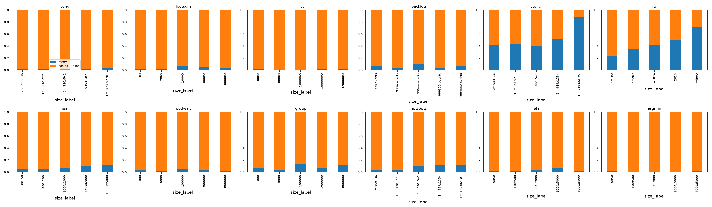
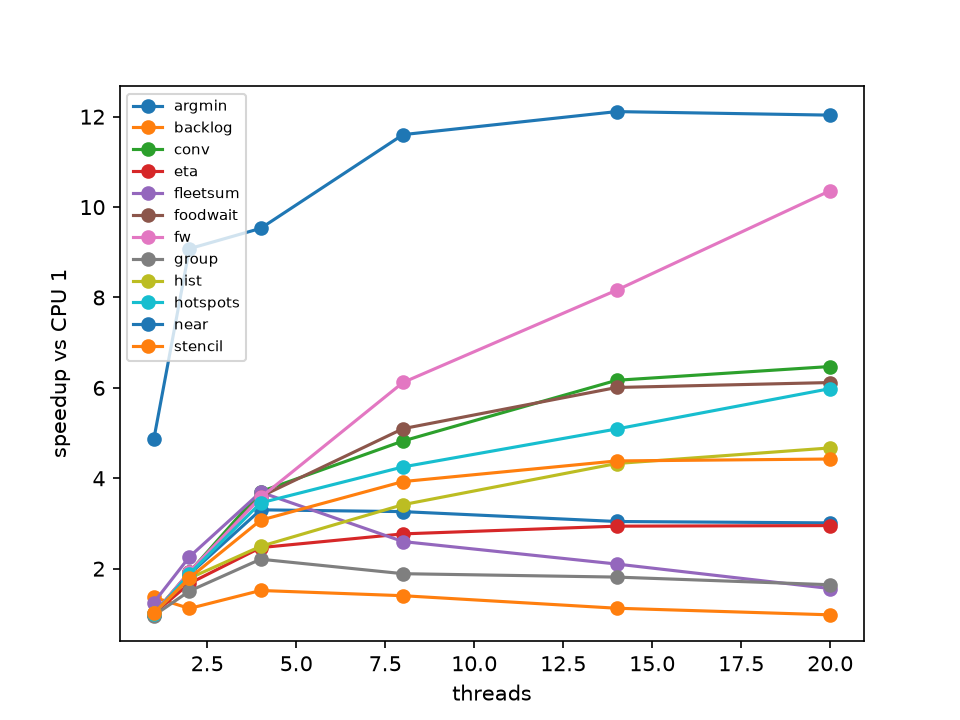
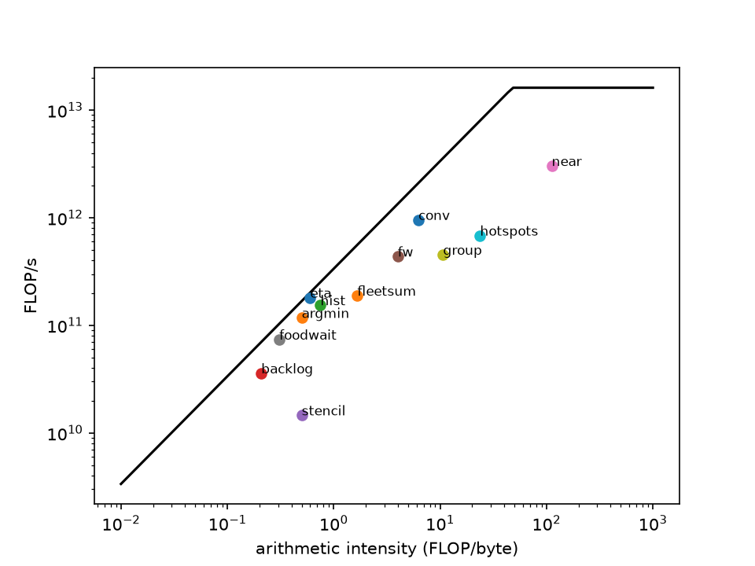

# Informe EC2: aplicaciones GPU en Equipetrol Delivery

## 3.1 Aplicación 1: tabla de distancias con Floyd–Warshall por tiles (03_memory_tiling)

### Tarea y por qué es data-parallel
- Cada ETA necesita la distancia entre dos intersecciones.
- El programa guarda una tabla all-pairs de n² entradas, en decímetros enteros.
- Referencia en CPU: Dijkstra desde cada nodo.
- En GPU: Floyd–Warshall. En la ronda k, cada par (i, j) se actualiza solo:
  `d[i][j] = min(d[i][j], d[i][k] + d[k][j])`.
- Cada ronda tiene n² actualizaciones independientes: es data-parallel.
- Las n rondas son secuenciales. La ronda k usa el resultado de la ronda k − 1.

### Dónde se usa en el programa
- El `Graph` calcula la tabla una sola vez, al arrancar.
- Con `EQ_GPU=1`, se calcula en la GPU a través del único hilo dueño de la GPU (commit de integración).

### Diseño
- **Datos.** Matriz densa de `int`, rellenada hasta un múltiplo de 32 con `kInf = 0x3fffffff`.
  Así `kInf + kInf` no desborda un `int`.
- **Movimiento.** La matriz se sube una vez. Todas las rondas corren en la GPU. Se baja una vez.
- **Block.** 32 × 32 = 1024 threads, un thread por celda. 32 es el ancho de un warp: cada fila del tile es un warp.
- **Grid por ronda k.** Tres kernels:
  - `diagonalTile`: 1 bloque, el tile (k, k).
  - `pivotRowAndColumn`: grid (bloques, 2), la fila y la columna k.
  - `remainingTiles`: grid (bloques, bloques), el resto.
- **Shared memory.** Cada bloque carga sus tiles una vez y reusa cada valor 32 veces (data reuse, sesión 13).
- **Tamaño.** Con n = 4900, N = 4928: 154 rondas × 3 = 462 launches. La fase 3 tiene 154 × 154 = 23 716 bloques por ronda.
- **CPU N threads.** `parallelFor` reparte los nodos origen en rangos contiguos. Cada thread corre Dijkstra para sus orígenes y escribe solo sus filas. No hay escrituras compartidas.

### Correctitud
- Los valores son enteros: la tabla GPU debe ser **exactamente igual** a `dijkstraOne`. Sin tolerancia.
- Los 5 tamaños dan `correct=yes` en las 450 filas del CSV.
- El grafo de prueba tiene calles de un solo sentido (una fila de cada tres). La tabla no es simétrica y se compara como grafo dirigido.
- Los pares sin camino quedan en `kInf`.
- compute-sanitizer (`results/sanitizer_laptop_fw.txt`): memcheck 0 errors, racecheck 0 hazards, synccheck 0 errors.
- En las fases 1 y 2 el tile se actualiza en el mismo lugar. Un `__syncthreads()` separa la lectura de la escritura.

### Resultados
Laptop: Intel i9-12900H (6P + 8E cores, 20 threads), RTX 3060 Laptop GPU, WSL2, Release (-O3).
Mediana de 10 repeticiones intercaladas, después de un warm-up. Tiempos en ms.
Fuente: `results/bench_laptop_fw.csv`, tabla de `analysis/report.ipynb`.

| size | CPU 1 | mejor CPU N | GPU kernel | GPU end to end | speedup kernel | speedup e2e | correct |
|---|---|---|---|---|---|---|---|
| n=100 | 0.518 | 0.376 (N=4) | 0.238 | 0.995 | 1.58 | 0.38 | yes |
| n=289 | 4.804 | 1.244 (N=14) | 0.638 | 1.798 | 1.95 | 0.69 | yes |
| n=1024 | 67.217 | 7.926 (N=20) | 4.458 | 10.617 | 1.78 | 0.75 | yes |
| n=2025 | 282.140 | 22.726 (N=20) | 26.838 | 52.956 | 0.85 | 0.43 | yes |
| n=4900 | 1791.033 | 172.834 (N=20) | 549.199 | 760.344 | 0.32 | 0.23 | yes |


**Copies vs kernel.** Parte del tiempo end to end que es kernel: 24 % (n=100), 35 % (n=289), 42 % (n=1024), 51 % (n=2025), 72 % (n=4900). En tamaños chicos dominan las copias y la preparación.



**Thread sweep (n = 4900, mediana).** 1 thread: 1791 ms · 2: 927 · 4: 501 · 8: 293 · 14: 220 · 20: 173 ms.
Speedup de 10.4× con 20 threads (eficiencia 52 %). No es lineal: 8 de los 14 cores son E-cores y solo 6 tienen hyper-threading.



### Profiler (Nsight Compute, `remainingTiles`, n = 1024)
| Métrica | Valor |
|---|---|
| Theoretical occupancy | 66.67 % |
| Achieved occupancy | 63.2–63.8 % |
| Registers per thread | 25 |
| Block limit: warps / shared mem / registers / SM | 1 / 1 / 2 / 16 bloques |
| Memory throughput (unidad más cargada) | 74.6–75.6 % |
| DRAM throughput | 81–82 GB/s (24 % de 336 GB/s) |

- Un bloque de 1024 threads son 32 warps. El SM admite 48 warps: solo cabe 1 bloque. Por eso la ocupación teórica es 32/48 = 66.67 %.
- El límite son los warps y la shared memory, no los registros (25 por thread permitirían 2 bloques).
- La achieved occupancy (63–64 %) está cerca de la teórica: los warps casi no se quedan esperando.
- La DRAM solo usa el 24 % de su ancho de banda. El 75 % viene de la memoria on-chip (shared/L1). Es el efecto buscado: los tiles leen de shared, no de la global.

### Roofline
- Conteo: 2 operaciones enteras (suma y min) por celda y ronda. Tráfico global: 2 tiles de 32 × 32 por bloque y ronda.
- Intensidad aritmética: **4.0 op/byte**. Rendimiento alcanzado con n = 4900: **4.36 × 10¹¹ op/s**.
- Ridge point de la RTX 3060 Laptop: 16.1 TFLOP/s ÷ 336 GB/s ≈ 48 op/byte. Con 4 op/byte el kernel queda a la izquierda: **memory-bound**.
- El techo de memoria en 4 op/byte es 4 × 336 GB/s = 1.34 × 10¹² op/s. El kernel llega al 32 % de ese techo.
- Son operaciones enteras, no FLOPs de punto flotante.



### Análisis
- **Paralelismo.** Con n = 100 la matriz es de 128 × 128: solo 16 bloques en la fase 3, menos que los 30 SMs de la GPU. La GPU no se llena. Con n = 4900 hay 23 716 bloques por ronda: sobra trabajo por launch, pero son 462 launches dependientes.
- **Overheads.** Con n = 4900, end to end − kernel = 760 − 549 = 211 ms. Incluye armar la matriz con relleno en la CPU, copiar unos 97 MB en cada sentido (4928² × 4 B) y quitar el relleno. En el programa se paga una sola vez, al arrancar.
- **Divergencia.** No hay divergencia dentro de un warp en la fase 3. Los bloques con `bi == k` o `bj == k` salen como bloque completo.
- **Contención y sincronización.** No hay atomics: cada thread es dueño de su celda. La fase 3 solo lee tiles que la fase 2 ya terminó. Por eso no necesita barreras dentro del bucle.
- **Correctitud en paralelo.** `min` entre enteros es exacto y no depende del orden. El resultado es determinista.
- **Algoritmo.** Floyd–Warshall hace N³ ≈ 1.2 × 10¹¹ actualizaciones con n = 4900. Dijkstra en una grilla de calles (m ≈ 4n aristas) hace unas n · m · log n ≈ 1.2 × 10⁹: unas 100 veces menos trabajo. Por eso la CPU con 20 threads (173 ms) le gana incluso al kernel solo (549 ms).

### Veredicto
- **Crossover end to end: nunca.** La GPU no le gana a la mejor CPU en ningún tamaño medido.
- El kernel solo gana hasta n = 1024 (1.6–1.9×). Desde n = 2025 pierde también.
- **Decisión: mantener la CPU** (Dijkstra multithread) para esta tabla. Se calcula una vez al arrancar y tarda milisegundos, tanto a la escala del brief (32 nodos) como en la ciudad (1600 nodos).

### Threats to validity
- **Dispersión de la GPU.** Con n = 4900, el end to end fue de 642 a 801 ms y el kernel de 404 a 562 ms.
- **Un valor atípico.** Con n = 2025 hubo una repetición de 233 ms end to end, contra una mediana de 53 ms. Por eso se reporta la mediana y no el promedio.
- La CPU va estable: con n = 4900 y 20 threads, de 167 a 179 ms.
- La CPU y la GPU de la laptop comparten potencia y temperatura.
- En WSL2 cada launch y cada copia pasa por la capa WDDM de Windows.

### Cómo reproducir
```bash
./build-gpu/delivery_sim config/equipetrol.json --bench results/bench_laptop_fw.csv --machine laptop --threads 1,2,4,8,14,20 --apps fw
for tool in memcheck racecheck synccheck; do
  compute-sanitizer --tool $tool ./build-gpu/delivery_sim config/equipetrol.json --bench /tmp/s.csv --size 0 --reps 1 --threads 2 --apps fw
done
ncu --set full -k regex:"remainingTiles" -c 2 --csv --page details ./build-gpu/delivery_sim config/equipetrol.json --bench /tmp/n.csv --size 2 --reps 1 --threads 2 --apps fw
cd analysis && jupyter nbconvert --to notebook --execute --allow-errors --inplace report.ipynb
```

## 3.2 Aplicación 2: ETA en lote con los repartidores como SoA (04_performance)

### Tarea y por qué es data-parallel
- El Dispatcher necesita el ETA de cada repartidor para cada pedido.
- ETA = el repartidor queda libre, va al restaurante, espera la comida, entrega. Es la misma fórmula del Dispatcher, en enteros.
- Con m pedidos y k repartidores hay m × k pares. Cada par se calcula solo, sin depender de otro: es data-parallel.
- Referencia en CPU: un doble bucle pedido × repartidor.

### Dónde se usa en el programa
- El Dispatcher, al elegir repartidor para un pedido.
- Con `EQ_GPU=1`, la GPU calcula el ETA de todos los repartidores disponibles y la aplicación 3 elige el mejor sin volver a la CPU (commit de integración).

### Diseño
- **Datos SoA.** Los repartidores van como dos arreglos: `freeNode[k]` (4 B) y `freeAtMs[k]` (8 B).
- **Datos AoS (para comparar).** Una ficha `CourierAoS` de 32 bytes por repartidor, con 7 campos. El kernel usa solo 2: 12 de los 32 bytes.
- **Tabla de distancias.** `DeviceTable` la sube una vez y la deja en la GPU. En el bench no se cuenta en el end to end, porque así funciona en el programa.
- **Block.** 256 threads (8 warps), en x sobre los repartidores. 256 es múltiplo de 32 y deja 6 bloques por SM (48 warps): ocupación teórica 100 %.
- **Grid.** (⌈k / 256⌉, m): `x` recorre repartidores, `y` recorre pedidos. Un thread por par.
- **Coalescing.** Los 32 threads de un warp leen 32 repartidores **consecutivos**:
  - SoA: un warp lee 128 B de `freeNode` y 256 B de `freeAtMs`, todo útil.
  - AoS: un warp toca 32 fichas × 32 B = 1 KB para usar 384 B.
- **Lo que no es coalesced en ninguna versión.** `dist[freeNode * n + restaurante]` salta a filas distintas de la tabla (gather). Es igual en SoA y en AoS.
- **Escritura.** `out[i * k + j]`: consecutiva en el warp, coalesced en las dos versiones.
- **CPU N threads.** `parallelFor` reparte los pedidos en rangos. Cada thread escribe solo sus filas.

### Correctitud
- Los ETA son enteros: GPU (SoA y AoS) debe ser **exactamente igual** a `cpuOne`. Sin tolerancia.
- Los 5 tamaños dan `correct=yes` en todas las filas del CSV.
- compute-sanitizer (`results/sanitizer_laptop_eta.txt`): memcheck 0 errors, racecheck 0 hazards, synccheck 0 errors.
- No hay shared memory ni barreras: cada thread lee y escribe solo lo suyo.

### Resultados
Laptop: Intel i9-12900H (6P + 8E cores, 20 threads), RTX 3060 Laptop GPU, WSL2, Release (-O3).
Mediana de 10 repeticiones intercaladas, después de un warm-up. Tiempos en ms. GPU = versión SoA.
Fuente: `results/bench_laptop_eta.csv`, tabla de `analysis/report.ipynb`.

| size (pedidos × repartidores) | CPU 1 | mejor CPU | GPU kernel | GPU end to end | speedup kernel | speedup e2e | correct |
|---|---|---|---|---|---|---|---|
| 10×50 | 0.005 | 0.005 (CPU 1) | 0.011 | 0.577 | 0.42 | 0.01 | yes |
| 100×500 | 0.350 | 0.275 (N=4) | 0.020 | 0.698 | 13.8 | 0.39 | yes |
| 500×2000 | 8.255 | 2.172 (N=14) | 0.080 | 2.209 | 27.2 | 0.98 | yes |
| 1000×5000 | 38.822 | 6.690 (N=20) | 0.341 | 5.321 | 19.6 | 1.26 | yes |
| 2000×5000 | 90.061 | 30.497 (N=20) | 0.665 | 25.748 | 45.9 | 1.18 | yes |

- **Tamaño del problema** = pares pedido × repartidor: de 500 a 10⁷, más de cuatro órdenes de magnitud.
- **Misma máquina.** CPU y GPU son de la misma laptop: esta tabla ya es la comparación «same-machine».


**SoA vs AoS (kernel, mediana).**

| size | SoA kernel (ms) | AoS kernel (ms) | AoS / SoA | ancho de banda efectivo SoA | AoS |
|---|---|---|---|---|---|
| 500×2000 | 0.080 | 0.086 | 1.08 | 250 GB/s | 233 GB/s |
| 1000×5000 | 0.341 | 0.467 | 1.37 | 293 GB/s | 214 GB/s |
| 2000×5000 | 0.665 | 0.878 | 1.32 | 301 GB/s | 228 GB/s |

- Ancho de banda efectivo = bytes útiles por par (20 B: `freeNode` 4 + `freeAtMs` 8 + una entrada de la tabla 4 + la salida 4) ÷ tiempo del kernel.
- Desde 1000×5000, **SoA es 32–37 % más rápido** que AoS.
- En tamaños chicos (10×50, 100×500) los kernels duran 10–20 µs: la diferencia es ruido de medición.

**Copies vs kernel (SoA).** Parte del end to end que es kernel: 2.0 % (10×50), 2.9 %, 3.6 %, 6.4 % (1000×5000), 2.6 % (2000×5000). **Más del 93 % es copia y reserva.**


**Thread sweep (2000×5000, mediana).** 1 thread: 90.1 ms · 2: 53.8 · 4: 36.5 · 8: 32.5 · 14: 30.6 · 20: 30.5 ms.
Speedup de solo 3.0× con 20 threads. Desde 8 threads casi no mejora: la CPU también es memory-bound (escribe 40 MB de salida y lee la tabla al azar).


### Profiler (Nsight Compute, 500×2000, grid (8, 500), block 256)
| Métrica | `etaSoA` | `etaAoS` |
|---|---|---|
| Duration | 76.7 µs | 80.4 µs |
| Theoretical / achieved occupancy | 100 % / 86.5 % | 100 % / 87.3 % |
| Block limit: warps / registers / shared mem | 6 / 8 / 8 bloques | 6 / 8 / 8 bloques |
| Registers per thread | 30 | 30 |
| Waves per SM | 22.2 | 22.2 |
| Compute (SM) throughput | 42.7 % | 40.5 % |
| DRAM throughput | 51.3 % (172 GB/s) | 49.3 % (165 GB/s) |
| L2 throughput · L2 hit rate | 50.1 % · 78.3 % | 70.0 % · 85.4 % |
| L1/TEX throughput · L1 hit rate | 64.7 % · 22.9 % | 67.2 % · 43.4 % |
| Avg. active threads per warp | 23.8 de 32 | 23.7 de 32 |
| Branch efficiency · divergent branches | 88.8 % · 139 | 88.8 % · 139 |

- **Occupancy.** Bloques de 256 threads = 8 warps. Caben 6 bloques por SM (48 warps): teórica 100 %. Limitan los warps. La alcanzada (86–87 %) está cerca.
- **AoS mueve más datos.** La L2 trabaja al 70 % en AoS contra 50 % en SoA, para el mismo trabajo. Son las fichas de 32 B que se traen enteras.
- **La diferencia es moderada** (5 % en este tamaño, 32–37 % en los grandes). El costo grande es el mismo en las dos versiones: el gather a la tabla de distancias y la escritura de la salida.
- **Divergencia.** Branch efficiency 88.8 % y unos 24 de 32 threads activos por warp. Lo más probable es que venga de las dos divisiones de 64 bits (`* 360000 / metersPerHour`): la GPU no tiene una instrucción de división de 64 bits, y el compilador genera una rutina con saltos que dependen de los valores. Además, 2000 repartidores en bloques de 256 dejan 48 threads sin trabajo por fila (2.3 %).

### Roofline
- Conteo por par: unas 12 operaciones (sumas, max, multiplicaciones y divisiones) y 20 bytes útiles.
- Intensidad aritmética: **0.6 op/byte**. Rendimiento alcanzado en 2000×5000: **1.8 × 10¹¹ op/s**.
- Ridge point de la RTX 3060 Laptop ≈ 48 op/byte. Con 0.6 el kernel queda muy a la izquierda: **memory-bound**.
- El techo de memoria en 0.6 op/byte es 0.6 × 336 GB/s = 2.0 × 10¹¹ op/s. El kernel llega al **90 %** de ese techo.


### Análisis
- **Paralelismo.** La GPU tiene 30 SMs × 1536 threads = 46 080 threads residentes. Con 10×50 hay 10 bloques (2560 threads): no llena la GPU. Desde 500×2000 (10⁶ pares) hay 22 waves: la llena de sobra.
- **Overheads.** El kernel es menos del 7 % del end to end. Lo demás es subir los repartidores, reservar la salida y copiar de vuelta la matriz de ETA: 2000 × 5000 × 4 B = 40 MB. De 1000×5000 a 2000×5000 la salida se duplica, pero el end to end crece casi 5× (5.3 → 25.7 ms): la reserva y la copia de 40 MB no escalan lineal.
- **¿Los datos pueden quedarse en la GPU?** Sí, y es lo que hace el programa. La tabla de distancias se sube una vez (`DeviceTable`). La matriz de ETA nunca vuelve: la aplicación 3 la reduce en la GPU y devuelve 8 bytes (el mejor repartidor).
- **Memory-bound.** Pocas operaciones por byte, como muestra el roofline. Por eso importa cómo se leen los datos (SoA contra AoS).
- **Optimización antes/después.** La comparación SoA (después) contra AoS (antes) es la optimización del capítulo: 32–37 % menos tiempo de kernel en los tamaños grandes.
- **Contención y sincronización.** No hay atomics ni barreras: cada thread escribe su propia celda.
- **Correctitud en paralelo.** Aritmética entera: el resultado no depende del orden. Determinista.

### Veredicto
- **Crossover end to end: 1000×5000 (5 × 10⁶ pares).** Desde ahí la GPU le gana a la mejor CPU: 1.26× y 1.18×. En 500×2000 es un empate (0.98×).
- El kernel solo gana desde 100×500 (14–46×). Lo que frena el end to end son las copias.
- **Escala del brief (8 repartidores, un pedido por ranking):** 8 pares. La CPU tarda microsegundos y la GPU paga 0.5 ms solo en copias y lanzamiento. **CPU.**
- **Ciudad (un pedido contra 400 o 2000 repartidores):** de 400 a 2000 pares por ranking, muy por debajo del crossover. **CPU**, salvo que se calculen muchos pedidos juntos.
- **Decisión: GPU solo por encima de un umbral** (unos 5 millones de pares por lote), y sin devolver la matriz: encadenada con la aplicación 3.

### Threats to validity
- **Kernels muy cortos.** En 10×50 y 100×500 el kernel dura 10–20 µs. Ahí la medición tiene ruido (AoS parece más rápido); por eso se compara desde 500×2000.
- **Dispersión.** En 2000×5000: GPU end to end de 25.3 a 28.4 ms; CPU con 20 threads de 27.1 a 32.0 ms. Los rangos casi se tocan: la ventaja de 1.18× es chica.
- **Divergencia sin confirmar en el código fuente.** La causa (división de 64 bits) es la explicación más probable; se puede confirmar en la vista Source de Nsight Compute.
- La CPU y la GPU de la laptop comparten potencia y temperatura. En WSL2 cada launch y cada copia pasa por la capa WDDM de Windows.

### Cómo reproducir
```bash
./build-gpu/delivery_sim config/equipetrol.json --bench results/bench_laptop_eta.csv --machine laptop --threads 1,2,4,8,14,20 --apps eta
for tool in memcheck racecheck synccheck; do
  compute-sanitizer --tool $tool ./build-gpu/delivery_sim config/equipetrol.json --bench /tmp/s.csv --size 0 --reps 1 --threads 2 --apps eta
done
ncu --set full -k regex:"etaSoA|etaAoS" -c 2 --csv --page details ./build-gpu/delivery_sim config/equipetrol.json --bench /tmp/n.csv --size 2 --reps 1 --threads 2 --apps eta
cd analysis && jupyter nbconvert --to notebook --execute --allow-errors --inplace report.ipynb
```

## 3.3 Aplicación 3: el mejor repartidor por pedido con argmin (08_reduction)

### Tarea y por qué es data-parallel
- Después del ETA (aplicación 2), cada pedido tiene una fila con el ETA de cada repartidor.
- Hay que elegir, por fila, el repartidor con el menor ETA: un **argmin** por fila.
- Es una **reducción**: muchos valores se combinan en uno con una operación asociativa (`min`).
- Las filas son independientes entre sí, y dentro de una fila el `min` se puede hacer en árbol: es data-parallel.
- Referencia en CPU: un bucle por fila que guarda el menor.

### Dónde se usa en el programa
- El Dispatcher, justo después del ETA.
- Con `EQ_GPU=1`, `bestCourierGpu` encadena ETA y argmin **en la GPU**: la fila de ETA nunca vuelve a la CPU y solo vuelve el resultado, 8 bytes (commit de integración).

### Diseño
- **Clave empaquetada.** `key = (eta << 32) | id`, un entero de 64 bits. El `min` de la clave da el menor ETA y, si hay empate, el **id menor**. El resultado es determinista y sale igual en CPU y GPU.
- **Block.** 256 threads (8 warps). **Grid.** Un bloque por fila (m bloques).
- **Paso 1, coarsening.** Cada thread recorre varias columnas de su fila (j = t, t + 256, t + 512…) y guarda su mínimo en un registro. Con 5000 repartidores son unas 20 columnas por thread.
- **Lecturas coalesced.** En cada vuelta, los 32 threads de un warp leen 32 ETA consecutivos.
- **Paso 2, árbol en shared memory.** `partial[256]` (2 KB). Stride 128 → 64 → 32, con `__syncthreads()` después de cada paso.
- **Stride decreciente.** Siempre trabajan los primeros threads (t < stride). Los warps que no trabajan quedan enteros sin trabajo: no se parte un warp por la mitad.
- **Paso 3, warp shuffle.** Los últimos 32 valores los reduce el warp 0 con `__shfl_down_sync` (offset 16, 8, 4, 2, 1). Sin shared memory y sin barreras: los threads de un warp se pasan los valores por registros.
- **Salida.** El thread 0 escribe la clave de la fila.
- **CPU N threads.** `parallelFor` reparte las filas. Cada thread escribe solo sus filas.

### Correctitud
- Las claves son enteros: la GPU debe dar **exactamente** la misma clave que `cpuOne`. Sin tolerancia.
- **Empates a propósito.** El bench usa ETA entre 0 y 2000 ms con hasta 5000 repartidores: por fuerza hay empates. Los ids van mezclados, así que gana el id menor y no la primera columna. La GPU coincide en todos.
- El 2 % de los ETA es «inalcanzable» (`kNoEta`): nunca gana mientras haya otro.
- Los 5 tamaños dan `correct=yes` en todas las filas del CSV.
- compute-sanitizer (`results/sanitizer_laptop_argmin.txt`): memcheck 0 errors, racecheck 0 hazards, synccheck 0 errors. Racecheck revisa justamente el árbol en shared memory.

### Resultados
Laptop: Intel i9-12900H (6P + 8E cores, 20 threads), RTX 3060 Laptop GPU, WSL2, Release (-O3).
Mediana de 10 repeticiones intercaladas, después de un warm-up. Tiempos en ms.
Fuente: `results/bench_laptop_argmin.csv`, tabla de `analysis/report.ipynb`.

| size (pedidos × repartidores) | CPU 1 | mejor CPU | GPU kernel | GPU end to end | speedup kernel | speedup e2e | correct |
|---|---|---|---|---|---|---|---|
| 10×50 | 0.001 | 0.001 (CPU 1) | 0.028 | 1.474 | 0.04 | 0.001 | yes |
| 100×500 | 0.062 | 0.062 (CPU 1) | 0.013 | 1.653 | 4.7 | 0.04 | yes |
| 500×2000 | 1.266 | 0.809 (N=2) | 0.024 | 2.995 | 34.3 | 0.27 | yes |
| 1000×5000 | 6.809 | 2.143 (N=4) | 0.089 | 7.772 | 24.1 | 0.28 | yes |
| 2000×5000 | 13.840 | 4.192 (N=4) | 0.170 | 11.484 | 24.6 | 0.37 | yes |

- **Tamaño del problema** = elementos de la matriz de ETA: de 500 a 10⁷, más de cuatro órdenes de magnitud.
- **Misma máquina.** CPU y GPU son de la misma laptop: esta tabla ya es la comparación «same-machine».


**Copies vs kernel.** Parte del end to end que es kernel: 1.9 % (10×50), 0.8 %, 0.8 %, 1.1 %, 1.5 % (2000×5000). **Más del 98 % es subir la matriz y reservar memoria.** En 2000×5000 la matriz pesa 2000 × 5000 × 4 B = 40 MB.


**Thread sweep (2000×5000, mediana).** 1 thread: 13.84 ms · 2: 7.37 · 4: 4.19 · 8: 4.24 · 14: 4.55 · 20: 4.59 ms.
El mejor es **4 threads** (3.3×). Con más threads empeora: la CPU es memory-bound (cada valor se lee una vez y se hace una sola comparación) y con 4 threads ya satura el ancho de banda de la RAM.


### Profiler (Nsight Compute, `rowMin`, 500×2000, grid 500, block 256)
| Métrica | Valor |
|---|---|
| Duration | 23.7 µs |
| Theoretical / achieved occupancy | 100 % / ~100 % |
| Block limit: warps / registers / shared mem | 6 / 10 / 10 bloques |
| Registers per thread · shared por bloque | 18 · 2 KB |
| Waves per SM | 2.8 |
| Compute (SM) throughput | 22.1 % |
| DRAM throughput | 72.0 % (203 GB/s) |
| L1/TEX · L2 throughput | 21.2 % · 17.4 % |
| L2 hit rate | 6.7 % |
| Avg. active threads per warp | 31.7 de 32 |
| Branch efficiency · divergent branches | 99.2 % · 4.2 |

- **Occupancy.** 256 threads = 8 warps; caben 6 bloques por SM (48 warps): teórica 100 %. Limitan los warps; registros y shared memory dejarían 10.
- **Memory-bound claro.** La DRAM trabaja al 72 % y el cómputo al 22 %. El L2 hit rate es 6.7 %: cada ETA se lee una sola vez, no hay reuso que aprovechar.
- **Divergencia casi nula.** 31.7 de 32 threads activos y 99.2 % de branch efficiency. Lo poco que hay viene de la última vuelta del coarsening (2000 columnas no son múltiplo de 256) y del `if` que compara claves.
- **Waves.** 2.8 waves con 500 filas. Con 10 filas solo hay 10 bloques: la GPU casi no se usa.

### Roofline
- Conteo por elemento: empaquetar la clave y comparar (unas 2 operaciones) y 4 bytes leídos de la matriz.
- Intensidad aritmética: **0.5 op/byte**. Rendimiento alcanzado en 2000×5000: **1.17 × 10¹¹ op/s**.
- Ridge point ≈ 48 op/byte. Con 0.5 el kernel queda muy a la izquierda: **memory-bound**.
- El techo de memoria en 0.5 op/byte es 0.5 × 336 GB/s = 1.68 × 10¹¹ op/s. El kernel llega al **70 %** de ese techo.


### Análisis
- **Paralelismo.** La GPU tiene 46 080 threads residentes (30 SMs × 1536). Con 10×50 hay 10 bloques × 256 = 2560 threads, y cada fila tiene solo 50 columnas: 206 de los 256 threads de cada bloque no tienen datos. Desde 500×2000 la GPU se llena (2.8 waves y más).
- **Overheads.** El kernel es menos del 2 % del end to end. Subir la matriz de ETA y reservar memoria cuesta entre 50 y 120 veces más que reducirla.
- **¿Los datos pueden quedarse en la GPU?** Sí, y es la clave de esta aplicación. En el programa la matriz de ETA la genera la aplicación 2 **en la GPU** y la reduce `rowMin` ahí mismo (`bestCourierGpu`). No se sube ninguna matriz y vuelve 1 clave de 8 bytes. El bench mide el peor caso: la matriz viene de la CPU.
- **Memory-bound.** Una lectura y una comparación por elemento. El techo es el ancho de banda, en la GPU y en la CPU.
- **Optimización antes/después.** No se midió una versión sin coarsening ni sin warp shuffle. El diseño ya usa las dos técnicas de la sesión 18.
- **Contención y sincronización.** No hay atomics: un bloque por fila, así que no hay que combinar resultados entre bloques. Dentro del bloque, 4 barreras (`__syncthreads()`): una antes del árbol y una por cada paso (128, 64, 32). Ninguna en el warp shuffle.
- **Correctitud en paralelo.** El orden de las comparaciones cambia entre CPU y GPU, pero el `min` de enteros no depende del orden. La clave `(eta, id)` resuelve los empates igual en los dos lados. Determinista.

### Veredicto
- **Crossover end to end: nunca.** Con la matriz subiendo desde la CPU, la GPU no le gana a la mejor CPU en ningún tamaño (máximo 0.37×).
- **El kernel solo gana desde 100×500: 4.7–34×.** El problema son las copias, no el cálculo.
- **Escala del brief (8 repartidores, un pedido por ranking):** 8 valores. **CPU.**
- **Ciudad (un pedido contra 400 o 2000 repartidores):** una fila, un solo bloque. La GPU casi no trabaja. Por separado, **CPU**.
- **Decisión: usar la GPU solo encadenada con el ETA** (aplicaciones 2 + 3 juntas), para que la matriz no cruce entre CPU y GPU. Por sí sola, sin la matriz ya en la GPU, no conviene. El efecto del encadenado en el programa se mide en la sección 5 (latencia de despacho, `avg_rank_us`).

### Threats to validity
- **Kernels muy cortos.** En 10×50 y 100×500 el kernel dura 13–28 µs, con mucha dispersión (de 6 a 96 µs en 10×50).
- **Dispersión del end to end.** En 2000×5000: GPU de 9.2 a 15.3 ms; CPU con 20 threads de 3.8 a 5.2 ms. La conclusión no cambia: la CPU gana en todo el rango.
- **El bench es el peor caso para la GPU** (sube la matriz entera). En el programa no se sube; por eso el veredicto separa las dos situaciones.
- La CPU y la GPU de la laptop comparten potencia y temperatura. En WSL2 cada launch y cada copia pasa por la capa WDDM de Windows.

### Cómo reproducir
```bash
./build-gpu/delivery_sim config/equipetrol.json --bench results/bench_laptop_argmin.csv --machine laptop --threads 1,2,4,8,14,20 --apps argmin
for tool in memcheck racecheck synccheck; do
  compute-sanitizer --tool $tool ./build-gpu/delivery_sim config/equipetrol.json --bench /tmp/s.csv --size 0 --reps 1 --threads 2 --apps argmin
done
ncu --set full -k regex:"rowMin" -c 2 --csv --page details ./build-gpu/delivery_sim config/equipetrol.json --bench /tmp/n.csv --size 2 --reps 1 --threads 2 --apps argmin
cd analysis && jupyter nbconvert --to notebook --execute --allow-errors --inplace report.ipynb
```

## 3.4 Aplicación 4: histograma de tiempos de entrega con bins privatizados (07_histogram)

### Tarea y por qué es data-parallel
- Al final de la simulación se cuenta cuántas entregas tardaron 0–1 min, 1–2 min, … hasta 119 min.
- Son 120 bins de 1 minuto. El último junta todo lo que pasa de 119 min.
- Cada entrega se clasifica sola (su bin = tiempo ÷ 60 000 ms): es data-parallel.
- La dificultad: muchas entregas caen en el **mismo** bin a la vez. Hay que sumar sin perder cuentas: **atomics**.
- Referencia en CPU: un bucle que suma 1 en el bin de cada entrega.

### Dónde se usa en el programa
- El resumen final (`statsJson`): el histograma de minutos de entrega.
- Con `EQ_GPU=1` se calcula en la GPU a través del único hilo dueño de la GPU (commit de integración).

### Diseño
- **Privatización (la idea de la sesión 17).** Cada bloque tiene su **propia copia** de los 120 bins en shared memory (480 B, `extern __shared__`).
- **Paso 1.** El bloque pone su copia en cero, `__syncthreads()`.
- **Paso 2.** Cada thread recorre muchas entregas (grid-stride loop) y hace `atomicAdd` sobre la copia **en shared**: rápido y solo compiten los 256 threads del bloque.
- **Paso 3.** `__syncthreads()`, y cada bloque vuelca a la memoria global solo sus bins distintos de cero, con un `atomicAdd` por bin.
- **Cuánto baja la contención.** Sin privatización serían 32 millones de `atomicAdd` sobre 120 contadores globales. Con privatización son como mucho 240 bloques × 120 bins = **28 800**, más de 1000 veces menos.
- **Block.** 256 threads (8 warps). **Grid.** Se limita a 8 bloques por SM (30 × 8 = 240): más bloques solo agregarían copias que volcar.
- **Grid-stride loop.** Con 32 millones de entregas, cada thread procesa unas 520. Las lecturas son coalesced: en cada vuelta, el warp lee 32 tiempos consecutivos.
- **Plantilla.** `HistKernels.h` deja el kernel como plantilla sobre «cómo se calcula el bin» (`WidthBin`).
- **CPU N threads.** La misma idea: una copia privada por thread (`privatizedCpu`) y una suma final. Sin atomics ni locks.

### Correctitud
- Son conteos enteros: la GPU debe dar **exactamente** los mismos 120 números que `byWidthOne`. Sin tolerancia.
- Los 5 tamaños dan `correct=yes` en todas las filas del CSV.
- El orden de los `atomicAdd` cambia en cada corrida, pero la suma de enteros no depende del orden: el resultado es determinista.
- compute-sanitizer (`results/sanitizer_laptop_hist.txt`): memcheck 0 errors, racecheck 0 hazards, synccheck 0 errors. Racecheck revisa la copia en shared memory y sus dos barreras.

### Resultados
Laptop: Intel i9-12900H (6P + 8E cores, 20 threads), RTX 3060 Laptop GPU, WSL2, Release (-O3).
Mediana de 10 repeticiones intercaladas, después de un warm-up. Tiempos en ms.
Fuente: `results/bench_laptop_hist.csv`, tabla de `analysis/report.ipynb`.
Entradas: tiempos de entrega sintéticos con semilla fija (distribución gamma, media de unos 28 min).

| size (entregas) | CPU 1 | mejor CPU | GPU kernel | GPU end to end | speedup kernel | speedup e2e | correct |
|---|---|---|---|---|---|---|---|
| 10⁴ | 0.026 | 0.026 (CPU 1) | 0.016 | 0.883 | 1.6 | 0.03 | yes |
| 10⁵ | 0.254 | 0.254 (CPU 1) | 0.008 | 1.301 | 31.0 | 0.20 | yes |
| 10⁶ | 2.625 | 1.117 (N=4) | 0.025 | 2.710 | 45.4 | 0.41 | yes |
| 10⁷ | 28.130 | 7.442 (N=20) | 0.199 | 11.446 | 37.4 | 0.65 | yes |
| 3.2 × 10⁷ | 81.856 | 17.523 (N=20) | 0.624 | 24.560 | 28.1 | 0.71 | yes |

- **Tamaño del problema** = entregas: de 10⁴ a 3.2 × 10⁷, más de tres órdenes de magnitud.
- **Misma máquina.** CPU y GPU son de la misma laptop: esta tabla ya es la comparación «same-machine».


**Copies vs kernel.** Parte del end to end que es kernel: 1.8 % (10⁴), 0.6 %, 0.9 %, 1.7 %, 2.5 % (3.2 × 10⁷). **Más del 97 % es subir los tiempos de entrega.** Con 3.2 × 10⁷ entregas son 4 B × 3.2 × 10⁷ = 128 MB. La salida es mínima: 120 contadores (480 B).


**Thread sweep (3.2 × 10⁷, mediana).** 1 thread: 81.9 ms · 2: 45.8 · 4: 32.8 · 8: 24.0 · 14: 18.9 · 20: 17.5 ms.
Speedup de 4.7× con 20 threads. Sigue mejorando hasta 20 threads, pero lejos de lo lineal: leer 128 MB de la RAM es el límite.


### Profiler (Nsight Compute, `privatized`, 10⁶ entregas, grid 240, block 256)
| Métrica | Valor |
|---|---|
| Duration | 24.5 µs |
| Theoretical / achieved occupancy | 100 % / 83.4 % |
| Block limit: warps / registers / shared mem | 6 / 10 / 10 bloques |
| Registers per thread · shared por bloque | 20 · 480 B (dinámica) |
| Waves per SM | 1.33 |
| Compute (SM) throughput | 26.4 % |
| DRAM throughput | 70.1 % (197 GB/s) |
| L1/TEX · L2 throughput | 15.8 % · 16.4 % |
| L2 hit rate | 3.2 % |
| Avg. active threads per warp | 31.9 de 32 |
| Branch efficiency · divergent branches | 97.6 % · 7.7 |

- **Occupancy.** 256 threads = 8 warps; caben 6 bloques por SM: teórica 100 %. Limitan los warps. La alcanzada es 83 %.
- **Waves 1.33.** Con el límite de 240 bloques y 6 por SM (180 a la vez), la segunda tanda usa solo un tercio de la GPU. Eso explica en parte la diferencia entre ocupación teórica y alcanzada.
- **Memory-bound.** La DRAM trabaja al 70 % y el cómputo al 26 %. Cada tiempo se lee una sola vez (L2 hit rate 3 %).
- **Los atomics en shared no frenan.** El kernel va al ritmo de la DRAM, no de los atomics: la privatización cumple.
- **Divergencia baja.** 31.9 de 32 threads activos y 97.6 % de branch efficiency. Viene de la última vuelta del grid-stride loop y del volcado (`if (local[b] != 0)`).

### Roofline
- Conteo por entrega: una división (el bin), un `min` y un `atomicAdd` (unas 3 operaciones) y 4 bytes leídos.
- Intensidad aritmética: **0.75 op/byte**. Rendimiento alcanzado con 3.2 × 10⁷: **1.54 × 10¹¹ op/s**.
- Ridge point ≈ 48 op/byte. Con 0.75 el kernel queda muy a la izquierda: **memory-bound**.
- El techo de memoria en 0.75 op/byte es 0.75 × 336 GB/s = 2.52 × 10¹¹ op/s. El kernel llega al **61 %** de ese techo.


### Análisis
- **Paralelismo.** La GPU tiene 46 080 threads residentes. Con 10⁴ entregas, 40 bloques × 256 = 10 240 threads: no llena la GPU y cada thread hace 1 entrega. Desde 10⁵ se usa el máximo de 240 bloques.
- **Overheads.** El kernel es menos del 3 % del end to end. Subir los tiempos cuesta 40 a 170 veces más que contarlos.
- **¿Los datos pueden quedarse en la GPU?** En el programa, no: los tiempos de entrega los registra el `EventLog` en la CPU, y el histograma se calcula **una vez**, al final. Habría que subirlos igual.
- **Contención (lo propio del concepto).** Las entregas se concentran alrededor de 20–30 min: muchos threads golpean los mismos pocos bins. En shared memory compiten solo los 256 threads de un bloque, y la memoria global recibe como mucho 28 800 sumas en vez de 32 millones.
- **Optimización antes/después.** No se midió una versión con atomics directos en global. La privatización es el diseño desde el principio.
- **Sincronización.** Dos barreras por bloque (después de poner en cero y antes de volcar). Entre bloques no hay barreras: el volcado con `atomicAdd` en global es seguro en cualquier orden.
- **Correctitud en paralelo.** Suma de enteros: el orden de los atomics no cambia el resultado.

### Veredicto
- **Crossover end to end: nunca.** La GPU no le gana a la mejor CPU en ningún tamaño (máximo 0.71×).
- **El kernel solo gana desde 10⁵: 28–45×.** Lo que frena es subir los datos.
- **Escala del brief:** unas decenas de entregas. **CPU** (1 thread, microsegundos).
- **Ciudad (miles de entregas por hora simulada; el número exacto sale en la sección 5):** del orden de 10⁴. La CPU con 1 thread tarda unos 0.03 ms. **CPU.**
- **Decisión: mantener la CPU.** La GPU solo convendría si los tiempos ya estuvieran en la GPU. Con la subida incluida, no gana en ningún tamaño medido.

### Threats to validity
- **Kernels muy cortos.** Con 10⁴ y 10⁵ el kernel dura 8–16 µs, con dispersión (de 6 a 77 µs con 10⁴).
- **Dispersión de la CPU multithread.** Con 10⁷ y 20 threads: de 5.9 a 12.6 ms. Por eso se reporta la mediana.
- **Distribución sintética.** Los tiempos de entrega son una gamma con semilla fija, no los de una corrida real. La contención real depende de cuánto se concentren en pocos bins.
- La CPU y la GPU de la laptop comparten potencia y temperatura. En WSL2 cada launch y cada copia pasa por la capa WDDM de Windows.

### Cómo reproducir
```bash
./build-gpu/delivery_sim config/equipetrol.json --bench results/bench_laptop_hist.csv --machine laptop --threads 1,2,4,8,14,20 --apps hist
for tool in memcheck racecheck synccheck; do
  compute-sanitizer --tool $tool ./build-gpu/delivery_sim config/equipetrol.json --bench /tmp/s.csv --size 0 --reps 1 --threads 2 --apps hist
done
ncu --set full -k regex:"privatized" -c 2 --csv --page details ./build-gpu/delivery_sim config/equipetrol.json --bench /tmp/n.csv --size 2 --reps 1 --threads 2 --apps hist
cd analysis && jupyter nbconvert --to notebook --execute --allow-errors --inplace report.ipynb
```

## 3.5 Aplicación 5: entregas agrupadas por restaurante con counting sort y exclusive scan (09_scan)

### Tarea y por qué es data-parallel
- Al final de la simulación se quiere, por restaurante, cuántas entregas tuvo y su tiempo promedio.
- Para eso se **agrupan** las entregas por restaurante: un **counting sort** estable.
- Paso 1: contar cuántas entregas tiene cada restaurante. Paso 2: un **exclusive scan** de esos conteos da dónde empieza cada grupo (`offsets`). Paso 3: cada entrega se copia a su lugar (`order`).
- El scan parece secuencial (cada suma depende de la anterior), pero es asociativo: se hace en árbol, en paralelo.
- Referencia en CPU: `groupOne`, los tres pasos en un bucle cada uno.

### Dónde se usa en el programa
- El resumen final (`statsJson`): la lista `perRestaurant` (entregas y promedio por restaurante).
- Con `EQ_GPU=1` se calcula en la GPU a través del único hilo dueño de la GPU (`Accel::groupByRestaurant`, commit de integración).

### Diseño
- **Chunks.** Las entregas se parten en chunks de 1024. Un bloque por chunk: con 4 × 10⁶ entregas son 3907 bloques.
- **`countChunks`.** El bloque (256 threads) carga su chunk en shared memory (4 KB), 4 claves por thread, coalesced. Después el thread `r` cuenta cuántas veces aparece el restaurante `r` en el chunk. Escribe `counts[r][chunk]`.
- **Sin atomics.** Cada contador tiene un solo dueño (un thread por restaurante y por chunk). No hay contención.
- **Exclusive scan (Blelloch).** Sobre la tabla `counts` en orden restaurante-mayor. `scanBlocks` hace el árbol up-sweep / down-sweep en shared memory: 512 threads, 1024 valores por bloque. Si hay más de un bloque, se hace scan de las sumas de bloque (recursivo) y `addBlockSums` las suma de vuelta.
- **Resultado del scan.** `starts[r][chunk]` = dónde escribe el chunk sus entregas del restaurante `r`. Los restaurantes quedan en orden y, dentro de cada uno, los chunks también: el orden es **estable**.
- **`scatterChunks`.** Vuelve a cargar el chunk y el thread `r` copia, en orden, los índices de su restaurante a `order[pos++]`.
- **`keyOffsets`.** Un bloque copia el inicio de cada restaurante a `offsets`.
- **Por qué 256 threads si hay 64 restaurantes.** Los 256 cargan el chunk; después solo cuentan los primeros 64 (warps 0 y 1). Los otros 6 warps salen **enteros**: no se parte ningún warp, no hay divergencia.
- **CPU N threads.** La misma idea: cada thread cuenta su rango en un arreglo **local**, un scan secuencial de la tabla `counts[restaurante][thread]` y cada thread copia su rango.

### Correctitud
- Son índices enteros: la GPU debe dar **exactamente** los mismos `offsets` y el mismo `order` que `groupOne`. Sin tolerancia.
- El orden dentro de cada restaurante también tiene que coincidir: la comparación revisa que el sort sea estable.
- Los 5 tamaños dan `correct=yes` en todas las filas del CSV.
- No hay atomics ni carreras: cada posición de `order` la escribe un solo thread. El resultado es determinista.
- compute-sanitizer (`results/sanitizer_laptop_group.txt`): memcheck 0 errors, racecheck 0 hazards, synccheck 0 errors. Racecheck revisa el chunk en shared memory y el árbol del scan, con sus barreras.

### Resultados
Laptop: Intel i9-12900H (6P + 8E cores, 20 threads), RTX 3060 Laptop GPU, WSL2, Release (-O3).
Mediana de 10 repeticiones intercaladas, después de un warm-up. Tiempos en ms.
Fuente: `results/bench_laptop_group.csv`, tabla de `analysis/report.ipynb`.
Entradas: 64 restaurantes, semilla fija. La mitad de las entregas va a 8 restaurantes «populares»: grupos desparejos, como en la ciudad.

| size (entregas) | CPU 1 | mejor CPU | GPU kernel | GPU end to end | speedup kernel | speedup e2e | correct |
|---|---|---|---|---|---|---|---|
| 10³ | 0.004 | 0.004 (CPU 1) | 0.090 | 1.404 | 0.05 | 0.003 | yes |
| 10⁴ | 0.021 | 0.021 (CPU 1) | 0.046 | 1.190 | 0.45 | 0.02 | yes |
| 10⁵ | 0.211 | 0.211 (CPU 1) | 0.189 | 1.377 | 1.1 | 0.15 | yes |
| 10⁶ | 2.426 | 1.695 (N=4) | 0.333 | 5.273 | 5.1 | 0.32 | yes |
| 4 × 10⁶ | 9.362 | 4.237 (N=4) | 1.131 | 9.721 | 3.7 | 0.44 | yes |

- **Tamaño del problema** = entregas: de 10³ a 4 × 10⁶, más de tres órdenes de magnitud.
- **Misma máquina.** CPU y GPU son de la misma laptop: esta tabla ya es la comparación «same-machine».
- La columna «GPU kernel» suma los 6 launches: `countChunks`, el scan (2 o 3 launches), `scatterChunks` y `keyOffsets`.


**Copies vs kernel.** Parte del end to end que es kernel: 6.4 % (10³), 3.9 %, 13.7 %, 6.3 %, 11.6 % (4 × 10⁶). **Más del 86 % es copiar y reservar memoria.** Con 4 × 10⁶ entregas se suben 16 MB de claves y se bajan 16 MB de `order`.


**Thread sweep (4 × 10⁶, mediana).** 1 thread: 9.36 ms · 2: 6.22 · 4: 4.24 · 8: 4.96 · 14: 5.16 · 20: 5.69 ms.
El mejor es **4 threads** (2.2×). Con más empeora: la escritura de `order` salta por toda la memoria y con 4 threads ya satura la RAM. Con menos de 10⁵ entregas gana 1 thread: crear los threads cuesta más que el trabajo.


### Profiler (Nsight Compute, 10⁵ entregas, grid 98, block 256)
| Métrica | `countChunks` | `scatterChunks` |
|---|---|---|
| Duration | 12.0 µs | 21.7 µs |
| Theoretical / achieved occupancy | 100 % / 26.0 % | 100 % / 17.9 % |
| Block limit: warps / registers / shared mem | 6 / 10 / 12 bloques | 6 / 6 / 12 bloques |
| Registers per thread · shared por bloque | 18 · 4 KB | 34 · 4 KB |
| Waves per SM | 0.54 | 0.54 |
| Compute (SM) throughput | 42.1 % | 56.0 % |
| DRAM throughput | 13.6 % | 9.9 % |
| L1/TEX · L2 throughput | 25.7 % · 6.4 % | 61.3 % · 29.3 % |
| L1/TEX · L2 hit rate | 10.8 % · 42.3 % | 77.1 % · 88.6 % |
| Avg. active threads per warp | 32 de 32 | 32 de 32 |
| Branch efficiency · divergent branches | 100 % · 0 | 100 % · 0 |

- **Occupancy baja, por diseño.** La teórica es 100 % (limitan los warps), pero la alcanzada es 18–26 %. Después de cargar el chunk, 6 de los 8 warps terminan. Además 98 bloques son solo 0.54 waves: la GPU no se llena con 10⁵.
- **Ni memory-bound ni compute-bound.** DRAM al 10–14 % y cómputo al 42–56 %. Lo que frena es el bucle de cada thread: recorre las 1024 claves del chunk una por una, y hay pocos warps para esconder la latencia.
- **Shared memory sin bank conflicts.** En cada vuelta los 32 threads de un warp leen la **misma** clave `s[i]`: es un broadcast.
- **Escrituras dispersas en `scatterChunks`.** Cada thread escribe en la zona de su restaurante: los 32 threads de un warp escriben en 32 lugares distintos (no coalesced). Por eso sube el tráfico de L1/L2 (61 % / 29 %).
- **Divergencia nula.** 32 de 32 threads activos y 100 % de branch efficiency: los warps sobrantes salen enteros, y el `if (s[i] == r)` dentro del bucle no aparece como rama divergente (probablemente el compilador lo resuelve con predicación).

### Roofline
- Conteo por entrega: 64 comparaciones en `countChunks` y 64 en `scatterChunks` (128 operaciones). Bytes: la clave se lee 2 veces y se escribe el índice (12 bytes).
- Intensidad aritmética: **10.7 op/byte**. Rendimiento alcanzado con 4 × 10⁶: **4.53 × 10¹¹ op/s**.
- Ridge point ≈ 48 op/byte. Con 10.7 queda a la izquierda: el techo es la memoria, 10.7 × 336 GB/s = 3.58 × 10¹² op/s.
- El kernel llega solo al **13 %** de ese techo. Coincide con ncu: no lo limita ningún techo, lo limitan la latencia y la poca occupancy.


### Análisis
- **Paralelismo.** La GPU tiene 46 080 threads residentes. Con 10³ entregas hay 1 bloque: 64 threads trabajan. Con 10⁵, 98 bloques (0.54 waves). Recién con 10⁶ (977 bloques) y 4 × 10⁶ (3907) hay varias waves.
- **Overheads.** El kernel es 4–14 % del end to end. Además son 6 launches: con tamaños chicos pesa más lanzar que calcular (10⁴: 0.046 ms de kernel para 0.021 ms de trabajo en la CPU).
- **¿Los datos pueden quedarse en la GPU?** En el programa, no: las entregas las registra el `EventLog` en la CPU y la agrupación se hace **una vez**, al final. Hay que subir las claves y bajar `order`.
- **Contención.** No hay atomics: el scan da a cada thread su propio rango de salida. Es la alternativa al histograma con atomics de la aplicación 4.
- **Optimización antes/después en la GPU (probada y descartada).** Probé bloques de 64 threads (un thread por restaurante, sin warps sobrantes). Con 10⁵ entregas, en ncu, cada kernel salió **más lento**: `countChunks` 12.0 → 17.0 µs y `scatterChunks` 21.7 → 27.0 µs. Con 64 threads cada uno carga 16 claves en vez de 4, y la achieved occupancy bajó a 12–13 %. En el bench con 4 × 10⁶ la diferencia quedó dentro de la dispersión (1.09 contra 1.13 ms). Me quedé con 256.
- **Optimización antes/después en la CPU (false sharing).** La primera versión de `groupMulti` sumaba directo en `counts[restaurante × threads + id]`: los contadores de threads distintos quedan juntos, en la misma cache line. Con 4 × 10⁶ entregas y 20 threads tardaba **63.6 ms**, 6 veces más que 1 thread. Con un arreglo local por thread bajó a **5.7 ms** (prueba rápida de 3 repeticiones). La tabla usa la versión corregida.
- **Sincronización.** `countChunks` y `scatterChunks`: una barrera, después de cargar el chunk. El scan: una barrera por nivel del árbol (10 de subida y 10 de bajada). Entre kernels, el orden de los launches en el mismo stream hace de barrera global.
- **Correctitud en paralelo.** Sumas de enteros y un dueño por posición: el resultado no depende del orden de los threads.

### Veredicto
- **Crossover end to end: nunca.** La GPU no le gana a la mejor CPU en ningún tamaño (máximo 0.44×).
- **El kernel gana desde 10⁶: 3.7–5.1×.** Menos que en las otras aplicaciones: la occupancy es baja y hay 6 launches.
- **Escala del brief:** unas decenas de entregas y pocos restaurantes. **CPU** (1 thread, microsegundos).
- **Ciudad (miles de entregas por hora simulada; el número exacto sale en la sección 5):** del orden de 10³ a 10⁴. La CPU con 1 thread tarda 0.004–0.021 ms. **CPU.**
- **Decisión: mantener la CPU.** Agrupar es barato en la CPU y la GPU paga la copia de ida y de vuelta.

### Threats to validity
- **Kernels muy cortos.** Con 10³ y 10⁴ el kernel dura 46–90 µs, con dispersión (de 36 a 197 µs con 10³).
- **Dispersión de la CPU multithread.** Con 10⁶ y 20 threads: de 3.4 a 7.9 ms. Por eso se reporta la mediana.
- **Distribución sintética.** 64 restaurantes y la mitad de las entregas en 8 de ellos. Con más de 256 restaurantes este diseño no sirve (un thread por restaurante en un bloque): `groupGpu` lo rechaza.
- **ncu con 10⁵ entregas** (0.54 waves). Con 4 × 10⁶ la occupancy alcanzada debería ser mayor; no se perfiló ese tamaño.
- La CPU y la GPU de la laptop comparten potencia y temperatura. En WSL2 cada launch y cada copia pasa por la capa WDDM de Windows.

### Cómo reproducir
```bash
./build-gpu/delivery_sim config/equipetrol.json --bench results/bench_laptop_group.csv --machine laptop --threads 1,2,4,8,14,20 --apps group
for tool in memcheck racecheck synccheck; do
  compute-sanitizer --tool $tool ./build-gpu/delivery_sim config/equipetrol.json --bench /tmp/s.csv --size 0 --reps 1 --threads 2 --apps group
done
ncu --set full -k regex:"countChunks|scatterChunks" -c 4 --csv --page details ./build-gpu/delivery_sim config/equipetrol.json --bench /tmp/n.csv --size 2 --reps 1 --threads 2 --apps group
cd analysis && jupyter nbconvert --to notebook --execute --allow-errors --inplace report.ipynb
```

## 3.6 Aplicación 6: mapa de calor de demanda con una convolución gaussiana (05_conv)

### Tarea y por qué es data-parallel
- El mapa de Equipetrol se divide en una grilla de celdas. Cada celda cuenta las entregas recientes y los pedidos pendientes que caen en ella.
- Ese conteo es «ruidoso» (muchas celdas en 0). Se suaviza con un **filtro gaussiano 5×5** (radio 2): cada celda pasa a ser el promedio ponderado de sus 25 vecinas.
- Es una **convolución**: cada celda de salida se calcula sola, leyendo solo la entrada. No hay dependencias entre celdas: es data-parallel.
- Referencia en CPU: `cpuOne`, cuatro bucles (celda y, celda x, filtro y, filtro x).

### Dónde se usa en el programa
- La ventana: el overlay `demand heatmap`, que se recalcula cada 30 frames.
- Lo pide la ventana a través de `Accel::smooth`. Con `EQ_GPU=1` lo ejecuta el único hilo dueño de la GPU (commit de integración). La ventana no se bloquea: recibe un `std::future` y lo dibuja cuando está listo.

### Diseño
- **Un thread por celda de salida.** Block 16×16 (256 threads, 8 warps). Grid 2D que cubre la grilla.
- **Filtro en `__constant__` memory.** Los 25 coeficientes (hasta 169 con radio 6) van a la memoria constante. En cada paso del bucle los 32 threads de un warp leen el **mismo** coeficiente: la constant cache lo reparte de una vez (broadcast).
- **Radio como parámetro de plantilla** (`convolve<R>`). El compilador conoce el tamaño del filtro y desenrolla los dos bucles (`#pragma unroll`): 25 multiplicaciones y sumas sin control de bucle.
- **Bordes.** Las vecinas que caen fuera del mapa se saltan (`continue`). Solo afecta a los threads del borde.
- **Lecturas coalesced.** Los threads vecinos en x leen celdas vecinas en memoria. Las 25 lecturas de una celda se solapan con las de sus vecinas: las sirve la caché L1.
- **Sin tiling en shared memory.** Para un filtro 5×5 la L1 ya da el reuso (hit rate 92 %, ver Profiler).
- **CPU N threads.** `parallelFor` reparte las filas de la grilla. Cada thread escribe solo sus filas.

### Correctitud
- Son números `float`. La GPU usa **FMA** (multiplicar y sumar en una sola instrucción, con un solo redondeo) y la CPU no siempre. Los resultados difieren en los últimos bits.
- Tolerancia: error relativo al máximo de la grilla **≤ 10⁻⁵** (`maxRelativeError`). El orden de la suma es el mismo en CPU y GPU (mismos bucles).
- Los 5 tamaños dan `correct=yes` en todas las filas del CSV.
- compute-sanitizer (`results/sanitizer_laptop_conv.txt`): memcheck 0 errors, racecheck 0 hazards, synccheck 0 errors. Memcheck revisa justamente los accesos en los bordes.

### Resultados
Laptop: Intel i9-12900H (6P + 8E cores, 20 threads), RTX 3060 Laptop GPU, WSL2, Release (-O3).
Mediana de 10 repeticiones intercaladas, después de un warm-up. Tiempos en ms.
Fuente: `results/bench_laptop_conv.csv`, tabla de `analysis/report.ipynb`.
Entradas: el mapa de Equipetrol con celdas de 20 m a 1 m. Puntos sintéticos con semilla fija (una celda de cada 50 tiene un punto).

| size (celda, grilla) | celdas | CPU 1 | mejor CPU | GPU kernel | GPU end to end | speedup kernel | speedup e2e | correct |
|---|---|---|---|---|---|---|---|---|
| 20 m, 95×136 | 1.3 × 10⁴ | 0.260 | 0.260 (CPU 1) | 0.015 | 0.691 | 17 | 0.38 | yes |
| 10 m, 190×271 | 5.1 × 10⁴ | 1.030 | 0.465 (N=4) | 0.016 | 0.770 | 28 | 0.60 | yes |
| 5 m, 380×542 | 2.1 × 10⁵ | 4.270 | 1.402 (N=4) | 0.015 | 1.397 | 91 | 1.00 | yes |
| 2 m, 949×1354 | 1.3 × 10⁶ | 25.806 | 4.978 (N=20) | 0.079 | 3.537 | 63 | 1.41 | yes |
| 1 m, 1898×2707 | 5.1 × 10⁶ | 102.811 | 15.884 (N=20) | 0.269 | 7.793 | 59 | 2.04 | yes |

- **Tamaño del problema** = celdas: de 1.3 × 10⁴ a 5.1 × 10⁶, más de dos órdenes de magnitud.
- **Misma máquina.** CPU y GPU son de la misma laptop: esta tabla ya es la comparación «same-machine».


**Copies vs kernel.** Parte del end to end que es kernel: 2.2 % (20 m), 2.1 %, 1.1 %, 2.2 %, 3.5 % (1 m). **Más del 96 % es copiar y reservar memoria.** Con 1 m se suben 5.1 × 10⁶ × 4 B = 20.5 MB y se bajan otros 20.5 MB.


**Thread sweep (1 m, mediana).** 1 thread: 102.8 ms · 2: 53.5 · 4: 27.8 · 8: 21.3 · 14: 16.7 · 20: 15.9 ms.
Speedup de **6.5×** con 20 threads. Casi lineal hasta 4 (cores P); después crece menos, porque los cores E son más lentos. A diferencia de las aplicaciones anteriores, la CPU escala: hay 25 operaciones por celda leída, no 1.


### Profiler (Nsight Compute, `convolve<2>`, 5 m 380×542, grid 24×34, block 16×16)
| Métrica | Valor |
|---|---|
| Duration | 13.4 µs |
| Theoretical / achieved occupancy | 100 % / 77.6 % |
| Block limit: warps / registers / shared mem | 6 / 10 / 8 bloques |
| Registers per thread · shared por bloque | 17 · 0 B |
| Waves per SM | 4.53 |
| Compute (SM) throughput | 66.2 % |
| Memory throughput | 68.9 % |
| DRAM throughput | 27.9 % |
| L1/TEX · L2 throughput | 76.7 % · 19.7 % |
| L1/TEX · L2 hit rate | 91.8 % · 69.1 % |
| Avg. active threads per warp | 31.7 de 32 |
| Branch efficiency · divergent branches | 99.85 % · 0.40 |

- **Occupancy.** 256 threads = 8 warps; caben 6 bloques por SM: teórica 100 %. Limitan los warps. La alcanzada es 78 %.
- **El reuso lo da la L1.** Hit rate de 92 %: de cada 25 lecturas de una celda, casi todas ya están en L1 porque las leyó un thread vecino. Por eso la DRAM trabaja solo al 28 %.
- **Balanceado.** Cómputo al 66 % y memoria (sobre todo L1) al 69 %. No está saturado ni en DRAM ni en cómputo: está cerca de la mitad del roofline.
- **Divergencia casi nula.** 31.7 de 32 threads activos y 99.85 % de branch efficiency. Viene de los bordes: el `continue` en las vecinas de afuera y la última columna de bloques (380 no es múltiplo de 16: 24 bloques, el último a medias).

### Roofline
- Conteo por celda: 25 multiplicaciones y 25 sumas (**50 operaciones**). Bytes: se lee la celda 1 vez de DRAM (las otras 24 lecturas las da la caché) y se escribe 1 vez (**8 bytes**).
- Intensidad aritmética: **6.25 op/byte**. Rendimiento alcanzado con 1 m: **9.54 × 10¹¹ op/s**, el más alto de las 7 aplicaciones.
- Ridge point ≈ 48 op/byte. Con 6.25 queda a la izquierda: el techo es la memoria, 6.25 × 336 GB/s = 2.10 × 10¹² op/s.
- El kernel llega al **45 %** de ese techo.


### Análisis
- **Paralelismo.** La GPU tiene 46 080 threads residentes. Con 20 m hay 12 920 celdas: la GPU no se llena. Desde 5 m (816 bloques, 4.5 waves) sí.
- **Overheads.** El kernel es menos del 4 % del end to end. La copia de ida y vuelta es lo que se paga.
- **Por qué aquí la GPU sí gana.** Es la aplicación con más trabajo por byte copiado: 50 operaciones por cada 8 bytes. En la CPU con 1 m son 103 ms con 1 thread y 16 ms con 20; la GPU hace el cálculo en 0.27 ms y le alcanza aunque copie 41 MB.
- **¿Los datos pueden quedarse en la GPU?** En el programa, no: la grilla de demanda la arma la ventana en la CPU cada 30 frames. Hay que subirla y bajarla.
- **Optimización antes/después.** No se midió una versión con tiling en shared memory. Con hit rate de L1 del 92 % el margen es chico; sería la siguiente prueba si se usara un filtro más grande.
- **Contención y sincronización.** Ninguna: cada thread escribe una sola celda y la entrada solo se lee. No hay atomics ni `__syncthreads()`.
- **Correctitud en paralelo.** Ningún thread depende de otro. La única diferencia con la CPU es el redondeo de FMA, dentro de la tolerancia.

### Veredicto
- **Crossover end to end: unas 2 × 10⁵ celdas (5 m).** Ahí la GPU empata (1.00×). Con 2 m gana 1.41× y con 1 m **2.04×**.
- **El kernel gana desde la grilla más chica: 17–91×.**
- **Escala del brief:** una grilla gruesa, pocas celdas. **CPU.**
- **Ciudad (la ventana usa celdas de 25 m: 76 × 109 ≈ 8 300 celdas):** está por debajo de la grilla más chica medida. La CPU con 1 thread tarda unos 0.2 ms. **CPU.**
- **Decisión: CPU en el programa tal como está.** La GPU convendría con un mapa de calor de 2 m o más fino (más de 10⁶ celdas), o con un filtro más grande.

### Threats to validity
- **Kernels muy cortos.** Con 20 m a 5 m el kernel dura unos 15 µs, igual en los tres tamaños: es el costo mínimo del launch, no el cálculo. Con 20 m va de 9 a 62 µs.
- **Dispersión de la CPU multithread.** Con 1 m y 20 threads: de 14.6 a 22.8 ms. El end to end de la GPU: de 7.5 a 12.0 ms. Por eso se reporta la mediana; con la mediana la GPU gana en todos los casos de 1 m.
- **Entrada sintética.** Puntos al azar. El tiempo no depende de los valores (siempre son 25 operaciones por celda), así que la entrada real daría lo mismo.
- **ncu con 5 m.** Con 1 m la occupancy y el uso de DRAM pueden cambiar; no se perfiló ese tamaño.
- La CPU y la GPU de la laptop comparten potencia y temperatura. En WSL2 cada launch y cada copia pasa por la capa WDDM de Windows.

### Cómo reproducir
```bash
./build-gpu/delivery_sim config/equipetrol.json --bench results/bench_laptop_conv.csv --machine laptop --threads 1,2,4,8,14,20 --apps conv
for tool in memcheck racecheck synccheck; do
  compute-sanitizer --tool $tool ./build-gpu/delivery_sim config/equipetrol.json --bench /tmp/s.csv --size 0 --reps 1 --threads 2 --apps conv
done
ncu --set full -k regex:"convolve" -c 2 --csv --page details ./build-gpu/delivery_sim config/equipetrol.json --bench /tmp/n.csv --size 2 --reps 1 --threads 2 --apps conv
cd analysis && jupyter nbconvert --to notebook --execute --allow-errors --inplace report.ipynb
```

## 3.7 Aplicación 7: mapa de cobertura de repartidores con un stencil iterativo (06_stencil)

### Tarea y por qué es data-parallel
- Se quiere saber qué zonas de Equipetrol están **lejos** de todo repartidor.
- La grilla del mapa marca con 1 las celdas donde hay un repartidor (las «fuentes»). Después se repite **100 veces** (sweeps) un **stencil de 5 puntos**: cada celda pasa a ser 0.98 × el promedio de sus 4 vecinas (arriba, abajo, izquierda, derecha). Las fuentes se quedan en 1.
- El valor «se difunde» desde los repartidores: cerca de uno, alto; lejos de todos, casi 0.
- Dentro de un sweep, cada celda se calcula sola leyendo el sweep anterior: es data-parallel. Entre sweeps sí hay dependencia: el sweep `s + 1` necesita el `s` completo.
- Referencia en CPU: `cpuOne`, 100 sweeps de un doble bucle.

### Dónde se usa en el programa
- El resumen final (`statsJson`): `leastCoveredNodes`, los 3 nodos del mapa con menos cobertura. Grilla de 10 m (190 × 271 celdas).
- La ventana: el overlay `coverage`, cada 30 frames, con celdas de 25 m.
- Los dos pasan por `Accel::coverage`. Con `EQ_GPU=1` lo ejecuta el único hilo dueño de la GPU (commit de integración).

### Diseño
- **Un thread por celda, un launch por sweep.** Block 16×16 (256 threads). 100 sweeps = 100 launches de `sweep`, más uno de `seed` para el estado inicial.
- **Double buffering (ping-pong).** Dos grillas en la GPU, `a` y `b`. Cada sweep lee de una y escribe en la otra; después se intercambian los punteros (`std::swap`). Nadie lee una celda mientras otro la escribe.
- **Barrera global = fin del launch.** Todos los launches van al mismo stream: el sweep `s + 1` no empieza hasta que termina el `s`. No hace falta sincronizar dentro del kernel.
- **Los datos se quedan en la GPU** los 100 sweeps. Solo se sube la grilla de fuentes y se baja el resultado final: 2 copias para 100 sweeps.
- **Lecturas coalesced.** Las vecinas izquierda y derecha son celdas contiguas; arriba y abajo son otras filas, también contiguas entre threads vecinos. Las relecturas las da L1/L2.
- **Bordes.** Las vecinas fuera del mapa valen 0.
- **CPU N threads.** Cada thread tiene una franja fija de filas. Después de cada sweep, todos esperan en una `Barrier` (mutex + condition variable): 100 barreras.

### Correctitud
- Son números `float`. La suma se escribe con paréntesis explícitos, `((up + down) + left) + right`, para que CPU y GPU sumen en el mismo orden.
- Tolerancia: error relativo al máximo de la grilla **≤ 10⁻⁶** (`maxRelativeError`), después de los 100 sweeps.
- Los 5 tamaños dan `correct=yes` en todas las filas del CSV.
- compute-sanitizer (`results/sanitizer_laptop_stencil.txt`): memcheck 0 errors, racecheck 0 hazards, synccheck 0 errors. Memcheck revisa los accesos de los bordes (`i - w`, `i + w`, `i - 1`, `i + 1`).
- **Las 7 aplicaciones juntas** (`--size 0`, sin `--apps`): las 7 dan `[correct]` en el mismo binario.

### Resultados
Laptop: Intel i9-12900H (6P + 8E cores, 20 threads), RTX 3060 Laptop GPU, WSL2, Release (-O3).
Mediana de 10 repeticiones intercaladas, después de un warm-up. Tiempos en ms, para los **100 sweeps**.
Fuente: `results/bench_laptop_stencil.csv`, tabla de `analysis/report.ipynb`.
Entradas: el mapa de Equipetrol con celdas de 20 m a 1 m. Una celda de cada 100 es fuente, al azar, con semilla fija.

| size (celda, grilla) | celdas | CPU 1 | mejor CPU | GPU kernel | GPU end to end | speedup kernel | speedup e2e | correct |
|---|---|---|---|---|---|---|---|---|
| 20 m, 95×136 | 1.3 × 10⁴ | 2.379 | 2.379 (CPU 1) | 0.841 | 2.021 | 2.8 | 1.18 | yes |
| 10 m, 190×271 | 5.1 × 10⁴ | 9.331 | 6.552 (N=2) | 0.895 | 2.079 | 7.3 | 3.15 | yes |
| 5 m, 380×542 | 2.1 × 10⁵ | 36.756 | 21.076 (N=2) | 1.404 | 3.506 | 15.0 | 6.01 | yes |
| 2 m, 949×1354 | 1.3 × 10⁶ | 228.675 | 62.466 (N=20) | 5.729 | 10.942 | 10.9 | 5.71 | yes |
| 1 m, 1898×2707 | 5.1 × 10⁶ | 924.235 | 208.815 (N=20) | 211.447 * | 238.362 * | 0.99 * | 0.88 * | yes |

\* **La fila de 1 m está afectada por los clocks de la GPU** (ver abajo). Con la GPU a su clock normal: kernel **21.77 ms** y end to end **33.2 ms**: 9.6× y 6.3× contra la mejor CPU.

- **Tamaño del problema** = celdas: de 1.3 × 10⁴ a 5.1 × 10⁶, más de dos órdenes de magnitud. Cada una se actualiza 100 veces.
- **Misma máquina.** CPU y GPU son de la misma laptop: esta tabla ya es la comparación «same-machine».

**La anomalía de 1 m.** En la corrida oficial, el kernel de 1 m va de 67 a 315 ms. Por escala debería ser unas 4 veces el de 2 m (≈ 23 ms).
- Lo investigué con `nvidia-smi` cada 50 ms (`results/gpu_clocks_laptop_stencil_1m.txt`). En las repeticiones lentas la GPU está ocupada (89 %), pero el clock de SM está en **210–382 MHz** y la memoria en 780 MHz. Con el clock normal (1425 MHz o más) tarda 21.7 ms.
- Es el ahorro de energía de la GPU de la laptop: a veces no sube el clock cuando empieza el trabajo. No es el kernel.
- Una corrida corta solo de 1 m (`results/probe_laptop_stencil_1m_t20.csv`, 10 repeticiones, CPU con 20 threads) dio 8 de 10 repeticiones normales (21.7–28.6 ms) y 2 lentas (211 ms). Mediana: kernel 21.77 ms, end to end 33.2 ms.
- **El archivo se llama `probe_…`** para que el notebook no lo mezcle con la tabla oficial.


**Copies vs kernel.** Parte del end to end que es kernel: 41.6 % (20 m), 43.1 %, 40.0 %, 52.4 % (2 m). Con 1 m: 88.7 %, pero inflado por el clock bajo. Aquí las copias pesan poco: **una subida y una bajada para 100 sweeps**. Lo demás es reservar memoria y lanzar los 101 kernels.


**Thread sweep (1 m, mediana).** 1 thread: 924.2 ms · 2: 515.2 · 4: 300.8 · 8: 235.3 · 14: 210.8 · 20: 208.8 ms.
Speedup de **4.4×** con 20 threads. Mejora hasta 14 y después se estanca: cada sweep lee y escribe toda la grilla (41 MB) y la RAM es el límite.
**Con grillas chicas, más threads es peor.** Con 20 m: 2.4 ms con 1 thread y 22.4 ms con 20. Son 100 barreras, y en cada una 20 threads se duermen y se despiertan (unos 0.2 ms por barrera). El trabajo de un sweep es mucho menor que eso.


### Profiler (Nsight Compute, `sweep`, 5 m 380×542, grid 24×34, block 16×16)
| Métrica | Valor |
|---|---|
| Duration (un sweep) | 10.3 µs |
| Theoretical / achieved occupancy | 100 % / 83.7 % |
| Block limit: warps / registers / shared mem | 6 / 16 / 8 bloques |
| Registers per thread · shared por bloque | 16 · 0 B |
| Waves per SM | 4.53 |
| Compute (SM) throughput | 27.4 % |
| DRAM throughput | 62.9 % (211 GB/s) |
| L1/TEX · L2 throughput | 39.7 % · 33.4 % |
| L1/TEX · L2 hit rate | 51.6 % · 53.5 % |
| Avg. active threads per warp | 31.0 de 32 |
| Branch efficiency · divergent branches | 73.3 % · 14.5 |

- **Occupancy.** 256 threads = 8 warps; caben 6 bloques por SM: teórica 100 %. Limitan los warps. La alcanzada es 84 %.
- **Memory-bound.** La DRAM trabaja al 63 % y el cómputo al 27 %. 6 operaciones por celda contra 12 bytes movidos.
- **Reuso parcial.** Hit rate de L1 52 % y de L2 54 %: cada celda la leen sus 4 vecinas; parte de esas relecturas sale de caché.
- **La divergencia más alta de las 7 aplicaciones.** Branch efficiency 73 % y 31.0 de 32 threads activos. Viene del `if (sources[i] > 0)`: 1 de cada 100 celdas es fuente y termina antes; si un warp tiene una, ese thread toma otro camino. Se suman los `? :` de los bordes. Igual el costo es chico: el thread que diverge hace menos trabajo, no más.

### Roofline
- Conteo por celda y por sweep: 3 sumas y 2 multiplicaciones, más la comparación de la fuente (**6 operaciones**). Bytes: leer la fuente y la celda (más vecinas desde caché) y escribir (**12 bytes**).
- Intensidad aritmética: **0.5 op/byte**. Ridge point ≈ 48 op/byte: muy a la izquierda, **memory-bound**.
- Rendimiento alcanzado con 2 m: 100 × 6 × 1.28 × 10⁶ / 5.729 ms = **1.35 × 10¹¹ op/s**. Con 1 m y clock normal (21.77 ms): **1.42 × 10¹¹ op/s**.
- El techo de memoria en 0.5 op/byte es 0.5 × 336 GB/s = 1.68 × 10¹¹ op/s. El kernel llega al **80–84 %** de ese techo, el más cerca del techo de las 7 aplicaciones.
- **Ojo con el gráfico.** El roofline del notebook usa la mediana oficial de 1 m (1.46 × 10¹⁰ op/s), que está bajada por el clock. El valor con clock normal es el de arriba.


### Análisis
- **Paralelismo.** La GPU tiene 46 080 threads residentes. Con 20 m hay 12 920 celdas por sweep: no la llena, y cada sweep dura unos 8 µs, casi solo el costo del launch. Desde 5 m (4.5 waves) sí la llena.
- **Overheads.** Con 20 m y 10 m, el kernel total (0.84–0.90 ms) es casi igual: son 101 launches de unos 8 µs. El límite es lanzar, no calcular.
- **¿Los datos pueden quedarse en la GPU?** Sí, y es la razón por la que esta aplicación gana. Los 100 sweeps se hacen sin volver a la CPU. Es lo opuesto a las aplicaciones 3 a 5, donde se copiaba todo para un solo paso.
- **Optimización antes/después.** No se midió una versión con tiling en shared memory ni con varios sweeps por launch (temporal blocking). Sería la siguiente prueba para 1 m.
- **Contención.** Ninguna: cada thread escribe una celda, en el buffer que nadie lee en ese sweep. No hay atomics.
- **Sincronización.** En la GPU, 100 barreras globales gratis (el fin de cada launch). En la CPU, 100 `Barrier` que con muchos threads cuestan más que el trabajo en grillas chicas. **Aquí se ve la diferencia más clara entre los dos modelos de sincronización.**
- **Correctitud en paralelo.** El double buffering evita las carreras; el mismo orden de suma da el mismo resultado dentro de 10⁻⁶.

### Veredicto
- **Crossover end to end: desde la grilla más chica (20 m, 1.18×).** La GPU gana en todos los tamaños con clock normal: 3.2× (10 m), 6.0× (5 m), 5.7× (2 m) y 6.3× (1 m, corrida corta).
- **Escala del brief:** una grilla gruesa. Cerca del empate; **CPU 1 thread** (no se midió por debajo de 20 m).
- **Ciudad: `leastCoveredNodes` usa celdas de 10 m (51 490 celdas).** CPU 6.55 ms contra GPU 2.08 ms: **3.2× a favor de la GPU. Usar la GPU.**
- **Overlay de la ventana (25 m, unas 8 300 celdas):** por debajo de lo medido; cerca del empate. Por ser asíncrono (`std::future`), cualquiera de los dos sirve sin trabar la ventana.
- **Decisión: GPU para la cobertura en el programa.** Es la única de las 7 aplicaciones que conviene en la GPU al tamaño real de la ciudad, porque los 100 sweeps se quedan en la GPU.

### Threats to validity
- **Clocks de la GPU de la laptop.** La fila de 1 m de la tabla oficial está afectada por el clock bajo (210–382 MHz). Se reporta tal cual y, aparte, la corrida corta. También hubo una repetición lenta con 2 m (131 ms; la mediana es 5.73 ms).
- **Kernels muy cortos.** Con 20 m un sweep dura unos 8 µs: la medida es casi el costo del launch en WSL2.
- **Dispersión de la CPU multithread.** Con 10 m y 20 threads: de 22.4 a 43.5 ms. Por eso se reporta la mediana.
- **Entrada sintética.** Fuentes al azar (1 %). El tiempo casi no depende de los valores; solo la divergencia depende de cuántas fuentes hay.
- **ncu con 5 m.** Con 5 m los buffers (0.8 MB cada uno) entran en la L2 de 3 MB; con 1 m no. Con 1 m el DRAM throughput debería ser mayor; no se perfiló ese tamaño.
- La CPU y la GPU de la laptop comparten potencia y temperatura. En WSL2 cada launch y cada copia pasa por la capa WDDM de Windows.

### Cómo reproducir
```bash
./build-gpu/delivery_sim config/equipetrol.json --bench results/bench_laptop_stencil.csv --machine laptop --threads 1,2,4,8,14,20 --apps stencil
./build-gpu/delivery_sim config/equipetrol.json --apps stencil --size 4 --bench results/probe_laptop_stencil_1m_t20.csv --machine laptop --threads 20 --reps 10
nvidia-smi --query-gpu=timestamp,clocks.sm,clocks.mem,pstate,power.draw,utilization.gpu --format=csv -lms 50   # en otra terminal, durante el bench
for tool in memcheck racecheck synccheck; do
  compute-sanitizer --tool $tool ./build-gpu/delivery_sim config/equipetrol.json --bench /tmp/s.csv --size 0 --reps 1 --threads 2 --apps stencil
done
ncu --set full -k regex:"sweep" -c 2 --csv --page details ./build-gpu/delivery_sim config/equipetrol.json --bench /tmp/n.csv --size 2 --reps 1 --threads 2 --apps stencil
./build-gpu/delivery_sim config/equipetrol.json --bench /tmp/all.csv --reps 1 --size 0   # las 7 aplicaciones juntas
cd analysis && jupyter nbconvert --to notebook --execute --allow-errors --inplace report.ipynb
```

## 3.8 Aplicación 8 (2ª de 03_memory_tiling): repartidores cerca de cada esquina, con tiles en shared memory

### Tarea y por qué es data-parallel
- Para cada esquina del mapa se cuenta **cuántos repartidores están a menos de 500 m**. Sirve para encontrar las esquinas sin repartidores cerca.
- Cada esquina se calcula sola: es data-parallel. En la ciudad (`city_60`) son 3600 esquinas × 2000 repartidores = **7.2 millones de comparaciones**.
- **Por qué es tiling (patrón de la sesión 13).** Es como el producto de matrices: todas las esquinas necesitan **los mismos** repartidores. Sin tiles, cada thread lee los 2000 repartidores de la memoria global. Con tiles, el bloque los carga una vez en shared memory y todos sus threads los reusan.
- Posiciones en **metros enteros** y la comparación `dx² + dy² ≤ 500²`: el resultado es un conteo exacto.
- Referencia en CPU: `cpuOne`, cada esquina contra cada repartidor.

### Dónde se usa en el programa
- El resumen final: las esquinas sin repartidores cerca. Las esquinas son los nodos del grafo y nunca cambian; las posiciones de los repartidores cambian en cada consulta.
- Con `EQ_GPU=1` se calcula a través del único hilo dueño de la GPU (commit de integración).

### Diseño
- **Un thread por esquina.** Block de **128 threads**: con 3600 esquinas son 29 bloques, casi uno por SM (la GPU tiene 30).
- **Tiles de repartidores (`countTiled`).** El bloque recorre los repartidores de a 128:
  1. cada thread copia **un** repartidor a shared memory (`tileX`, `tileY`, 1 KB);
  2. `__syncthreads()`;
  3. cada thread compara su esquina con los 128 del tile;
  4. `__syncthreads()` antes de cargar el siguiente tile.
- **Reuso.** Cada repartidor se lee de la memoria global **una vez por bloque**, no una vez por thread: 128 veces menos lecturas.
- **Bordes (como `04_tiled_matmul_boundary.cu`).** 3600 no es múltiplo de 128: los threads que sobran en el último bloque igual cargan su repartidor y llegan a las dos barreras, pero no guardan resultado.
- **Lectura sin bank conflicts.** En cada paso, los 32 threads de un warp leen el **mismo** `tileX[k]`: es un broadcast.
- **Datos que se quedan en la GPU.** Las esquinas no cambian, así que se suben **una vez** (`DeviceCorners`, como la tabla del ETA en la aplicación 2). En cada consulta solo se suben los repartidores: 2000 × 8 B = 16 KB. Se baja un conteo por esquina (14 KB).
- **Versiones para comparar.** `gpu_naive`: el mismo cálculo sin tiles. `gpu_upload`: con tiles, pero sube esquinas y repartidores en cada llamada.
- **CPU N threads (la mejor CPU).** No compara contra todos: reparte los repartidores en una **grilla de celdas de 500 m**, y cada esquina solo mira las 3 × 3 celdas de alrededor (un repartidor a menos de 500 m está como mucho a una celda). `parallelFor` reparte las esquinas; cada thread escribe solo las suyas.

### Correctitud
- Son conteos enteros: la GPU (las 3 versiones) y la CPU con grilla deben dar **exactamente** lo mismo que `cpuOne`. Sin tolerancia.
- Los 5 tamaños dan `correct=yes` en todas las filas del CSV.
- No hay atomics: cada thread escribe solo el conteo de su esquina. Determinista.
- compute-sanitizer (`results/sanitizer_laptop_near.txt`): memcheck 0 errors, racecheck 0 hazards, synccheck 0 errors. Racecheck revisa el tile en shared memory y sus dos barreras.

### Resultados
Laptop: Intel i9-12900H (6P + 8E cores, 20 threads), RTX 3060 Laptop GPU, WSL2, Release (-O3).
Mediana de 10 repeticiones intercaladas, después de un warm-up. Tiempos en ms.
Fuente: `results/bench_laptop_near.csv`, tabla de `analysis/report.ipynb`.
Entradas: esquinas y repartidores al azar sobre el mapa de Equipetrol (1898 × 2707 m), semilla fija. Radio 500 m.

| size (esquinas × repartidores) | pares | CPU 1 | mejor CPU | GPU kernel | GPU end to end | speedup kernel | speedup e2e | correct |
|---|---|---|---|---|---|---|---|---|
| 100 × 50 | 5 × 10³ | 0.007 | 0.007 (CPU 1) | 0.013 | 0.263 | 0.5 | 0.03 | yes |
| 400 × 200 | 8 × 10⁴ | 0.092 | 0.092 (CPU 1) | 0.011 | 0.208 | 8.2 | 0.44 | yes |
| 1600 × 1000 | 1.6 × 10⁶ | 1.781 | 0.361 (N=4) | 0.020 | 0.314 | 17.6 | 1.15 | yes |
| **3600 × 2000 (ciudad)** | 7.2 × 10⁶ | 8.195 | 0.771 (N=4) | 0.030 | 0.311 | 25.9 | **2.48** | yes |
| 10000 × 5000 | 5 × 10⁷ | 55.701 | 4.599 (N=14) | 0.116 | 0.903 | 39.7 | 5.09 | yes |

- **Tamaño del problema** = pares esquina × repartidor: de 5 × 10³ a 5 × 10⁷, cuatro órdenes de magnitud.
- **Misma máquina.** CPU y GPU son de la misma laptop: esta tabla ya es la comparación «same-machine».
- **«mejor CPU» con N ≥ 1 usa la grilla.** La grilla sola, con 1 thread, ya es 4.3× (ciudad) a 4.9× (10000 × 5000) más rápida que `cpuOne`.

**Repetición del bench completo (speedup e2e contra la mejor CPU).** El end to end de la GPU varía entre corridas, así que corrí el bench completo 3 veces (`results/probe_laptop_near_run2.csv` y `run3.csv`):

| pares | corrida oficial | corrida 2 | corrida 3 |
|---|---|---|---|
| 1.6 × 10⁶ | 1.15 | 0.72 | 0.78 |
| **7.2 × 10⁶ (ciudad)** | **2.48** | **1.28** | **1.21** |
| 5 × 10⁷ | 5.09 | 3.98 | 3.45 |

La corrida oficial es la más favorable. **En las 3, la GPU gana a la escala de la ciudad.**


**Copies vs kernel.** Parte del end to end que es kernel: 4.8 % (100 × 50), 5.4 %, 6.5 %, 9.6 % (ciudad), 12.8 % (10000 × 5000). Aun con solo 16 KB de subida, **casi todo el end to end es el costo fijo de reservar, copiar y lanzar**: entre 0.2 y 0.3 ms.


**Thread sweep (10000 × 5000, mediana).** `cpuOne` (1 thread, sin grilla): 55.7 ms. Con grilla: 1 thread 11.45 ms · 2: 6.14 · 4: 5.85 · 8: 4.80 · 14: 4.60 · 20: 4.63 ms.
Con grilla, 20 threads son 2.5× más rápidos que 1. Se estanca desde 8 threads. Con la ciudad, el mejor es 4 threads (0.77 ms); con 20 threads tarda 1.63 ms, porque crear los threads cuesta más que el trabajo.


### Optimización antes/después: con tiles y sin tiles
Kernel solo, mediana en ms (mismo CSV):

| pares | sin tiles (`gpu_naive`) | con tiles (`gpu`) | mejora |
|---|---|---|---|
| 1.6 × 10⁶ | 0.039 | 0.020 | 2.0× |
| 7.2 × 10⁶ (ciudad) | 0.069 | 0.030 | 2.3× |
| 5 × 10⁷ | 0.195 | 0.116 | 1.7× |

En Nsight Compute (ciudad): **30.0 µs con tiles contra 106.6 µs sin tiles (3.5×)**.
- Sin tiles, la caché L1 ya da parte del reuso (hit rate 96.5 %), pero cada thread igual hace su propia lectura de los 2000 repartidores.
- Con tiles, cada repartidor se lee de global una vez por bloque y después todo sale de shared memory por broadcast. Además usa menos registros (31 contra 40).
- Con 100 × 50 y 400 × 200 no hay diferencia: hay un solo tile y el kernel dura unos 12 µs, que es casi el costo del launch.

### Profiler (Nsight Compute, `countTiled`, 3600 × 2000, grid 29, block 128)
| Métrica | `countTiled` (con tiles) | `countNaive` (sin tiles) |
|---|---|---|
| Duration | 30.0 µs | 106.6 µs |
| Theoretical / achieved occupancy | 100 % / 8.3 % | 100 % / 8.1 % |
| Block limit: warps / registers / shared mem | 12 / 16 / 16 bloques | 12 / 12 / 16 bloques |
| Registers per thread · shared por bloque | 31 · 1 KB | 40 · 0 B |
| Waves per SM | 0.08 | 0.08 |
| Compute (SM) throughput | 37.6 % | 19.9 % |
| DRAM throughput | 0.7 % | 0.2 % |
| L1/TEX · L2 throughput | 21.1 % · 1.8 % | 20.9 % · 0.8 % |
| L1/TEX · L2 hit rate | 0 % · 90.4 % | 96.5 % · 87.8 % |
| Avg. active threads per warp | 32 de 32 | 31.9 de 32 |
| Branch efficiency · divergent branches | 100 % · 0 | 100 % · 0 |

- **El límite es el paralelismo, no la memoria.** Hay solo 3600 threads (29 bloques × 4 warps = 116 warps) en una GPU que admite 1440 warps residentes. Por eso la occupancy alcanzada es 8 % aunque la teórica sea 100 %, y hay 0.08 waves.
- **La DRAM casi no trabaja (0.7 %).** Los datos son 45 KB y viven en L2 (hit rate 90 %). Con tiles, las lecturas globales son tan pocas que L1 no tiene nada que reusar (hit rate 0 %): el reuso pasa a shared memory.
- **Con tiles el cómputo sube de 20 % a 38 %**: los warps pasan más tiempo comparando y menos esperando lecturas.
- **Sin divergencia.** 32 de 32 threads activos y 100 % de branch efficiency: el `? 1 : 0` no aparece como rama divergente (probablemente el compilador lo resuelve sin salto), y todos los threads de un warp recorren el mismo tile.

### Roofline
- Conteo por par: 2 restas, 2 multiplicaciones, 1 suma, 1 comparación y 1 suma al contador (**7 operaciones enteras**).
- Bytes de memoria global: con tiles, cada repartidor (8 B) se lee una vez por bloque de 128 esquinas: 8 / 128 = 1/16 B por par. Las esquinas y la salida son despreciables.
- Intensidad aritmética: 7 × 16 = **112 op/byte**. **Es la única de las 8 aplicaciones a la derecha del ridge point (≈ 48): compute-bound en el roofline.** Sin tiles serían 8 B por par: 0.9 op/byte, muy memory-bound. **Los tiles mueven el kernel de un lado al otro del roofline.**
- Rendimiento alcanzado con 10000 × 5000: **3.03 × 10¹² op/s**, el más alto de las 8 aplicaciones. Es el 19 % del pico de cómputo (16.1 × 10¹², que es de float; el de enteros es más bajo).
- No llega al techo por la occupancy baja: pocas esquinas = pocos threads.


### Análisis
- **Paralelismo.** Es el límite de esta aplicación. Con 100 esquinas hay 1 bloque; con la ciudad, 29 bloques para 30 SMs, y cada uno con solo 4 warps. Una mejora posible: repartir también los repartidores entre bloques (grid 2D) para tener más threads, sumando los conteos parciales con `atomicAdd`. No se midió.
- **Overheads.** El kernel es menos del 13 % del end to end. El costo fijo (reservar, copiar 16 KB, lanzar, bajar 14 KB) es de 0.2–0.3 ms. Por eso la GPU necesita al menos ~1.6 × 10⁶ pares para empatar.
- **¿Los datos pueden quedarse en la GPU?** Las esquinas sí (`DeviceCorners`): se suben una vez. Pero a este tamaño casi no se nota: con 3600 × 2000, `gpu_upload` (que sube todo, 45 KB) y `gpu` (que sube 16 KB) tardan lo mismo dentro del ruido. Lo que pesa es el costo fijo de cada llamada, no la cantidad de bytes.
- **La CPU con grilla es un rival fuerte.** Cada esquina solo mira 3 × 3 celdas de 500 m (unos 2.25 km² de los 5.1 km² del mapa): se salta más de la mitad de las comparaciones, y en la práctica es 4.3–4.9× más rápida que `cpuOne`. Aun así, la GPU hace **todas** las comparaciones y gana, porque 7.2 millones de comparaciones con tiles le toman 30 µs.
- **Contención y sincronización.** Sin atomics: cada thread es dueño de su esquina. Dos `__syncthreads()` por tile: uno para no leer el tile antes de que esté cargado y otro para no pisarlo mientras alguien lo lee.
- **Correctitud en paralelo.** Enteros: el orden de las comparaciones no cambia el conteo.

### Veredicto
- **Crossover end to end: entre 1.6 × 10⁶ y 7.2 × 10⁶ pares.** Con 1600 × 1000 empata o pierde según la corrida (0.72–1.15×).
- **Ciudad (`city_60`, 3600 esquinas × 2000 repartidores): la GPU gana en las 3 corridas, 1.2× a 2.5×. Usar la GPU.**
- **Escala del brief (25 esquinas, unos pocos repartidores):** microsegundos en la CPU con 1 thread. **CPU.**
- **Decisión: GPU desde unos 2 × 10⁶ pares** (la ciudad), CPU por debajo. Con 10000 × 5000 gana de 3.5× a 5.1×.

### Threats to validity
- **El end to end de la GPU varía entre corridas.** En la ciudad: 0.31 ms en la oficial y 0.65–0.67 ms en las otras dos. Por eso se muestran las 3 corridas. En pruebas anteriores, con una versión previa del código (que subía todo en 4 copias), el end to end llegó a ~1 ms y la CPU ganaba en la ciudad.
- **El orden de las versiones influye.** La primera versión de GPU después de las de CPU paga unos 0.15–0.2 ms extra. Lo comprobé invirtiendo el orden (`results/probe_laptop_near_order.csv`): con el orden invertido, `gpu` bajó de 0.311 a 0.189 ms y `gpu_upload` subió de 0.153 a 0.362 ms. El kernel no cambia. En la tabla, `gpu` va primera: es el número **pesimista** para la GPU.
- **Posiciones al azar.** En la ciudad real los repartidores se juntan cerca de los restaurantes. Eso ayuda o perjudica a la grilla de la CPU (celdas más llenas), pero no a la GPU, que compara todo.
- **Radio fijo de 500 m.** Con un radio más chico la grilla de la CPU descarta más y puede ganar; con uno más grande, menos.
- La CPU y la GPU de la laptop comparten potencia y temperatura. En WSL2 cada launch y cada copia pasa por la capa WDDM de Windows.

### Cómo reproducir
```bash
./build-gpu/delivery_sim config/equipetrol.json --bench results/bench_laptop_near.csv --machine laptop --threads 1,2,4,8,14,20 --apps near
./build-gpu/delivery_sim config/equipetrol.json --bench results/probe_laptop_near_run2.csv --machine laptop --threads 1,2,4,8,14,20 --apps near   # y run3
for tool in memcheck racecheck synccheck; do
  compute-sanitizer --tool $tool ./build-gpu/delivery_sim config/equipetrol.json --bench /tmp/s.csv --size 0 --reps 1 --threads 2 --apps near
done
ncu --set full -k regex:"countTiled|countNaive" -c 4 --csv --page details ./build-gpu/delivery_sim config/equipetrol.json --bench /tmp/n.csv --size 3 --reps 1 --threads 2 --apps near
cd analysis && jupyter nbconvert --to notebook --execute --allow-errors --inplace report.ipynb
```
La prueba del orden (`probe_laptop_near_order.csv`) se hizo invirtiendo temporalmente el orden de los tres `addGpu` en `BenchNearby.cpp` y corriendo `--size 3 --threads 4`.

## 3.9 Aplicación 9 (2ª de 04_performance): comida esperando, con los pedidos de las bolsas como SoA

### Tarea y por qué es data-parallel
- Cada repartidor lleva una bolsa con pedidos. Un pedido de la bolsa que todavía no se recogió puede estar **listo** (la comida ya está preparada) y esperar al repartidor.
- Para cada pedido se calcula **cuánto tiempo lleva listo sin recogerse**: `ahora − readyAtMs`. Vale `0` si ya se recogió o si todavía no está listo.
- Es un dato de calidad de una operación de delivery: la comida lista que espera se enfría. El programa todavía no lo muestra.
- Cada pedido se evalúa solo: es data-parallel.
- **Patrón del curso (sesión 14, coalescing y SoA vs AoS).** Es el mismo patrón de la aplicación 2, con otra tarea y **casi sin cálculo**: se ve el efecto del layout de los datos solo.
- Referencia en CPU: `cpuOne`, un bucle sobre los pedidos.

**Definición y límites (en palabras simples):**
- «Esperando» = listo y **todavía no está en la mochila** del repartidor.
- **Solo cuenta pedidos que ya tienen repartidor.** Los que esperan en el `OrderBook` o se están asignando no aparecen: el programa no deja leer su hora de listo.
- **Cuenta también la comida que el repartidor ya está recogiendo.** La vista del repartidor expone `pickedUp` pero no `pickupStarted`, así que mientras la recoge sigue figurando como «sin recoger».

### Dónde se usa en el programa
- Los pedidos de las bolsas salen de `Courier::view().bag`, con `restaurantNode`, `deliveryNode`, `readyAtMs` y `pickedUp`. El `Dispatcher` ya usa esos mismos campos para calcular el ETA.
- No hace falta ningún método ni atributo nuevo en las clases del programa.
- El resumen final muestra «comida esperando». Con `EQ_GPU=1` se calcula a través del único hilo dueño de la GPU (commit de integración, que junta las bolsas de todos los repartidores en un arreglo).

### Diseño
- **Datos SoA.** Solo los dos campos que el chequeo lee, cada uno en su arreglo: `readyAtMs[i]` (8 B) y `pickedUp[i]` (1 B). La salida es 1 `int` por pedido (4 B).
- **Datos AoS (para comparar).** Una ficha `ItemAoS` de **24 bytes** con los mismos cuatro campos que `Courier::View::Item`. El kernel usa 2: **9 de los 24 bytes**.
- **Block y grid.** 256 threads (8 warps), grid de `ceil(n / 256)` bloques. Un thread por pedido, un solo launch.
- **Coalescing, SoA:** los 32 threads de un warp leen 32 `long long` seguidos (256 B) y 32 bytes seguidos, y todo se usa.
- **Coalescing, AoS:** un warp toca 32 fichas × 24 B = **768 B** para usar 288 B.
- **Sin shared memory, sin barreras, sin atomics.**
- **CPU N threads.** `parallelFor` reparte rangos contiguos de pedidos. Cada thread escribe solo su rango.

### Correctitud
- Son enteros: las dos versiones de GPU y la CPU con N threads deben dar **exactamente** el mismo resultado que `cpuOne`. Sin tolerancia.
- Entrada de prueba: «listo» al azar entre 10 min antes y 10 min después de «ahora», y el 30 % de los pedidos ya recogido. Cerca del 35 % de los pedidos da un valor mayor que 0.
- Los 5 tamaños dan `correct=yes` en todas las filas del CSV.
- compute-sanitizer (`results/sanitizer_laptop_foodwait.txt`): memcheck 0 errors, racecheck 0 hazards, synccheck 0 errors. No hay shared memory, así que racecheck no tiene nada que revisar.
- **Check-then-act.** El resultado es una foto en el instante «ahora». `view()` toma cada repartidor por separado, así que la foto de toda la flota no es atómica. Es solo informativo: no cambia ningún pedido ni toca ningún invariante del brief.

### Resultados
Laptop: Intel i9-12900H (6P + 8E cores, 20 threads), RTX 3060 Laptop GPU, WSL2, Release (-O3).
Mediana de 10 repeticiones intercaladas, después de un warm-up. Tiempos en ms. GPU = versión SoA.
Fuente: `results/bench_laptop_foodwait.csv`, tabla de `analysis/report.ipynb`.
Entradas: pedidos sintéticos con semilla fija. «Ahora» = 2 h simuladas. **6000 pedidos = las bolsas de `city_60` como máximo** (2000 repartidores × bolsa de 3).

| size (pedidos en bolsas) | CPU 1 | mejor CPU | GPU kernel | GPU end to end | speedup kernel | speedup e2e | correct |
|---|---|---|---|---|---|---|---|
| 10³ | 0.008 | 0.008 (CPU 1) | 0.027 | 0.745 | 0.28 | 0.010 | yes |
| **6 × 10³ (ciudad)** | 0.043 | 0.043 (CPU 1) | 0.009 | 0.668 | 4.7 | **0.064** | yes |
| 10⁵ | 0.660 | 0.365 (N=4) | 0.048 | 0.931 | 7.6 | 0.39 | yes |
| 10⁶ | 6.804 | 1.866 (N=14) | 0.125 | 4.149 | 14.9 | 0.45 | yes |
| 4 × 10⁶ | 26.601 | 4.348 (N=20) | 0.217 | 9.925 | 20.0 | 0.44 | yes |

- **Tamaño del problema** = pedidos en bolsas: de 10³ a 4 × 10⁶, 3.6 órdenes de magnitud.
- **Misma máquina.** CPU y GPU son de la misma laptop: esta tabla ya es la comparación «same-machine».
- Los tiempos de CPU y de GPU incluyen reservar y poner en cero el arreglo de salida.


**Copies vs kernel.** Parte del end to end que es kernel: 3.6 % (10³), 1.4 %, 5.1 %, 3.0 %, 2.2 % (4 × 10⁶). **Más del 94 % es copiar y reservar memoria.** Con 4 × 10⁶ pedidos se suben 9 B × 4 × 10⁶ = 36 MB y se bajan 16 MB.


**Thread sweep (4 × 10⁶, mediana).** 1 thread: 26.6 ms · 2: 13.9 · 4: 7.40 · 8: 5.22 · 14: 4.43 · 20: 4.35 ms.
Speedup de **6.1×** con 20 threads (eficiencia 31 %). Mejora hasta 14 threads y después se estanca.
La CPU con 1 thread tarda unos 6.8 ns por pedido (13 MB en 6.8 ms con 10⁶, unos 2 GB/s): **no está limitada por el ancho de banda de la RAM**. Probablemente la frenan las ramas, que se predicen mal con valores al azar, y reservar la salida. No se midió.


### SoA vs AoS (el antes/después del coalescing)
Mediana del kernel y del end to end, en ms. El ancho de banda efectivo cuenta solo los bytes **útiles**: 8 + 1 + 4 = 13 B por pedido.

| size | SoA kernel | AoS kernel | AoS / SoA | SoA e2e | AoS e2e | AoS / SoA | GB/s útiles SoA | AoS |
|---|---|---|---|---|---|---|---|---|
| 10³ | 0.027 | 0.009 | 0.34 | 0.745 | 0.564 | 0.76 | 0.5 | 1.4 |
| 6 × 10³ | 0.009 | 0.040 | 4.3 | 0.668 | 0.554 | 0.83 | 8.5 | 2.0 |
| 10⁵ | 0.048 | 0.044 | 0.92 | 0.931 | 1.294 | 1.39 | 27.2 | 29.7 |
| 10⁶ | 0.125 | 0.136 | 1.09 | 4.149 | 5.050 | 1.22 | 104.2 | 95.3 |
| 4 × 10⁶ | 0.217 | 0.412 | **1.90** | 9.925 | 16.788 | **1.69** | 239.6 | 126.1 |

- **Con 4 × 10⁶, SoA es 1.9× más rápido en el kernel y 1.7× en el end to end.** En el end to end SoA también copia menos bytes (9 contra 24 por pedido).
- **Con 10⁶ la diferencia por eventos es de solo 1.09×, pero en Nsight Compute es 2.2×** (43 µs contra 95 µs, ver abajo). A ese tamaño el kernel dura 125–136 µs por eventos, y una parte es el costo de lanzarlo.
- **Con 10³ a 10⁵ el kernel no sirve para comparar.** Dura 9–48 µs, con mucha dispersión: el kernel SoA de 6000 va de 8 a 463 µs entre repeticiones.
- **El orden de las versiones cambia el end to end con tamaños chicos.** En la tabla, AoS parece ganar con 10³ y 6000. Es un efecto del orden: la primera versión de GPU que corre después de las de CPU paga unos 0.1–0.2 ms extra, y `gpu` (SoA) va primera. Lo comprobé invirtiendo el orden (`results/probe_laptop_foodwait_order.csv`, `--threads 4`):

| size | SoA e2e, orden oficial | SoA e2e, invertido | AoS e2e, orden oficial | AoS e2e, invertido |
|---|---|---|---|---|
| 10³ | 0.745 | 0.568 | 0.564 | 0.558 |
| 6 × 10³ | 0.668 | 0.586 | 0.554 | 0.596 |
| 10⁶ | 4.149 | 3.446 | 5.050 | 5.421 |

  Con el orden invertido, SoA y AoS **empatan** con 10³ y 6000. Con 10⁶ SoA gana en los dos órdenes (1.2× y 1.6×). **En la tabla de resultados SoA va primera: es el número pesimista para SoA.**

### Profiler (Nsight Compute, 10⁶ pedidos, grid 3907, block 256)
| Métrica | `foodWaitSoA` | `foodWaitAoS` |
|---|---|---|
| Duration | 43.4 µs | 94.8 µs |
| Theoretical / achieved occupancy | 100 % / 89.1 % | 100 % / 88.4 % |
| Block limit: warps / registers / shared mem | 6 / 16 / 8 bloques | 6 / 16 / 8 bloques |
| Registers per thread · shared por bloque | 16 · 0 B | 16 · 0 B |
| Waves per SM | 21.7 | 21.7 |
| Compute (SM) throughput | 14.8 % | 6.4 % |
| DRAM throughput | 87.1 % (292 GB/s) | 89.2 % (299 GB/s) |
| L1/TEX · L2 throughput | 19.8 % · 28.9 % | 19.5 % · 46.9 % |
| L1/TEX · L2 hit rate | 0 % · 30.9 % | 46.2 % · 14.4 % |
| Avg. active threads per warp | 32 de 32 | 32 de 32 |
| Divergent branches | 0 | 0 |

- **Memory-bound en las dos versiones.** La DRAM está al 87–89 % y el cómputo al 6–15 %. Las dos usan casi todo el ancho de banda; la diferencia es **cuántos bytes mueven**.
- **SoA mueve unos 13 MB** (9 B leídos y 4 B escritos por pedido): 292 GB/s durante 43 µs.
- **AoS mueve unos 28 MB** (24 B leídos y 4 B escritos): 299 GB/s durante 95 µs. Lee la ficha entera aunque use 9 B, porque los campos que no usa están intercalados en los mismos sectores de 32 B. **2.2 veces más bytes, 2.2 veces más tiempo.**
- **Occupancy.** 256 threads = 8 warps; caben 6 bloques por SM: teórica 100 %. Limitan los warps (los registros y la shared memory permitirían 16 y 8). La alcanzada es 89 % en las dos.
- **Sin divergencia.** 32 de 32 threads activos y 0 ramas divergentes, aunque los valores sean al azar. Probablemente el compilador convirtió el `if` en una selección sin salto. Nsight Compute muestra «branch efficiency 0 %», probablemente porque no hay ramas que contar.
- **L2.** AoS pasa más tráfico por la L2 (47 % contra 29 %) para el mismo trabajo.

### Roofline
- Conteo por pedido: 2 comparaciones, 1 resta y 1 selección con tope (**4 operaciones enteras**). Bytes: 9 leídos y 4 escritos (**13 B**, SoA).
- Intensidad aritmética: **0.31 op/byte**. Ridge point ≈ 48: muy a la izquierda, **memory-bound**.
- Rendimiento alcanzado con 4 × 10⁶, tiempo por eventos (0.217 ms): **7.4 × 10¹⁰ op/s**. El techo de memoria en 0.31 op/byte es 0.3077 × 336 GB/s = 1.03 × 10¹¹ op/s: llega al **71 %**.
- Con el tiempo de Nsight Compute (43 µs con 10⁶): 9.2 × 10¹⁰ op/s, el **89 %** del techo, coherente con la DRAM al 87 %. Son dos medidas distintas: la del gráfico es la de eventos, que incluye el launch.


### Análisis
- **Paralelismo.** Cada pedido es un thread. La GPU tiene 46 080 threads residentes. Con 10³ pedidos hay 4 bloques; con los 6000 de la ciudad, 24; con 10⁵, 391 (2.2 waves); con 10⁶, 3907 (21.7 waves). No se llena hasta 10⁶.
- **Overheads.** El kernel es entre el 1 y el 5 % del end to end. Subir y bajar los datos cuesta entre 19 y 74 veces más que calcular.
- **¿Los datos pueden quedarse en la GPU?** En el programa, no: las bolsas viven en cada `Courier` y hay que juntarlas en un arreglo en cada consulta. Si las bolsas vivieran en la GPU como arreglos SoA, solo habría que bajar el resultado. No se midió.
- **Memory-bound y coalescing.** La respuesta de esta aplicación es SoA contra AoS: **1.9× en el kernel con 4 × 10⁶, 2.2× en ncu con 10⁶ y 1.7× en el end to end con 4 × 10⁶.**
- **Optimización antes/después.** SoA contra AoS es el antes/después del layout. No se midió: memoria pinned para la copia, ni los datos residentes en la GPU.
- **Contención y sincronización.** Ninguna: sin atomics, sin barreras, sin shared memory.
- **Correctitud en paralelo.** Enteros: determinista. El detalle del check-then-act está en Correctitud.

### Veredicto
- **Crossover end to end: nunca.** La GPU no le gana a la mejor CPU en ningún tamaño (máximo 0.45×).
- **El kernel gana desde 6 × 10³: 4.7–20×.** Pero el kernel es menos del 5 % del tiempo total.
- **Escala del brief (8 repartidores × bolsa de 3: como máximo 24 pedidos):** menos de 1 µs. **CPU.**
- **Ciudad (`city_60`, unos 6000 pedidos en bolsas como máximo):** la CPU con 1 thread tarda 0.043 ms y la GPU 0.67 ms end to end (0.064×). **CPU.**
- **Decisión: mantener la CPU.** Lo que sí deja esta aplicación: **si algún día se calcula en la GPU, SoA es el layout correcto,** de 1.7 a 1.9× más rápido que AoS con 4 × 10⁶.

### Threats to validity
- **Kernels muy cortos.** Con 10³ a 10⁵ el kernel dura 9–48 µs, con dispersión (SoA con 6000: de 8 a 463 µs). La comparación SoA contra AoS del kernel solo es confiable desde 4 × 10⁶.
- **Orden de las versiones.** La primera versión de GPU paga 0.1–0.2 ms extra con tamaños chicos (ver arriba). La tabla de resultados pone SoA primera.
- **Eventos contra ncu.** Con 10⁶ el kernel SoA mide 125 µs por eventos y 43 µs en ncu. El tiempo por eventos incluye el launch y el estado de reloj de la GPU de la laptop, que varía (ver la sección 3.7).
- **Dispersión de la CPU multithread.** Con 4 × 10⁶ y 20 threads: de 3.9 a 5.3 ms. Por eso se reporta la mediana.
- **Entrada sintética.** Valores al azar y 30 % recogidos. En el programa, la bolsa de cada repartidor tiene como mucho 3 pedidos, y solo se cuentan pedidos ya asignados.
- La CPU y la GPU de la laptop comparten potencia y temperatura. En WSL2 cada launch y cada copia pasa por la capa WDDM de Windows.

### Cómo reproducir
```bash
./build-gpu/delivery_sim config/equipetrol.json --bench results/bench_laptop_foodwait.csv --machine laptop --threads 1,2,4,8,14,20 --apps foodwait
for tool in memcheck racecheck synccheck; do
  compute-sanitizer --tool $tool ./build-gpu/delivery_sim config/equipetrol.json --bench /tmp/s.csv --size 0 --reps 1 --threads 2 --apps foodwait
done
ncu --set full -k regex:"foodWaitSoA|foodWaitAoS" -c 4 --csv --page details ./build-gpu/delivery_sim config/equipetrol.json --bench /tmp/n.csv --size 3 --reps 1 --threads 2 --apps foodwait
cd analysis && jupyter nbconvert --to notebook --execute --allow-errors --inplace report.ipynb
```
La prueba del orden (`probe_laptop_foodwait_order.csv`) se hizo invirtiendo temporalmente el orden de los dos `addGpu` en `BenchFoodWait.cpp` y corriendo `--size 0`, `--size 1` y `--size 3` con `--threads 4`.

## 3.10 Aplicación 10 (2ª de 08_reduction): resumen de la flota en una pasada

### Tarea y por qué es data-parallel
- Se quiere un **resumen del estado de la flota** en un instante: cuántos repartidores hay en cada estado (`Idle`, `ToRestaurant`, `Carrying`, `Broken`), cuántos pueden tomar otro pedido, cuántos pedidos hay en todas las bolsas y cuántos ya se recogieron.
- Además, dos argmax: **quién tiene la bolsa más llena** (a igual valor gana el índice menor) y **a quién le termina más tarde su tramo actual**.
- Son sumas, conteos y dos argmax sobre los mismos datos: una **reducción** con un operador compuesto, en **una sola pasada**.
- **Base en el curso (`ec2/08_reduction`).** `bikeshare_daily_summary.cu` (el cierre del día con varias reducciones en una pasada: bicis devueltas, en reparación y fuera, que es el mismo patrón de estados que los repartidores), `bikeshare_kpis.cu` (un struct con `combine` campo por campo y cada campo por shuffle) y `bikeshare_bike_totals.cu` (argmax de pares `(valor, índice)` con prueba de empates). La viñeta del README «dos reducciones independientes que deben coincidir» da la verificación cruzada.
- **Datos.** Lo que ya da `Courier::view()` de cada repartidor. No hace falta ningún atributo ni método nuevo en el programa.
- Referencia en CPU: `cpuOne`, un recorrido con un `Summary`.

### Dónde se usa en el programa
- El resumen final: un panel con el estado de la flota.
- Solo **lee** `Courier::view()` (a través de `Simulation::fleet()`). No modifica ninguna clase existente.
- Con `EQ_GPU=1` se calcula a través del único hilo dueño de la GPU. La llamada va en la función del resumen final que el capítulo 8 ya escribe para las demás aplicaciones: esta aplicación no agrega ninguna modificación propia.

### Diseño
- **Datos (SoA).** `state[i]`, `available[i]`, `items[i]` y `picked[i]` (1 byte cada uno, viajan en un solo buffer) y `legEndMs[i]` (8 B). 12 B por repartidor.
- **Operador.** `combine` suma los conteos y, para los argmax, usa `beats`: gana el mayor valor y, a igual valor, el índice menor. Es asociativo y conmutativo y tiene identidad (ceros e índice `0xffffffff`), como en el curso.
- **Block y grid.** 256 threads (8 warps). Cada thread recorre unos 4 repartidores (coarsening) en un bucle con salto de grilla, así que el grid tiene `ceil(K / 1024)` bloques, con un tope de 1024.
- **Reducción en dos etapas por warp.** Cada warp reduce con shuffles (cada campo por separado), la lane 0 guarda el resumen del warp, **una barrera**, y el warp 0 reduce los resúmenes de los warps.
- **Entre bloques, sin atomics.** Cada bloque escribe un resumen parcial. Un **segundo kernel** de 1 bloque los combina en un orden fijo: es la segunda opción de `bikeshare_kpis.cu` y da el mismo resultado en cada corrida.
- **Dos versiones del kernel (sesión 12, diapositiva 21: versiones «divergente» y «sin ramas» del mismo trabajo).** `fleetBranchFree` (la final: cada estado suma un 0 o un 1 y los argmax son selecciones) y `fleetBranchy` (un `switch` y `if` por repartidor).
- **CPU N threads.** Cada thread resume su rango en un `Summary` local y después se combinan en orden de thread.

### Correctitud
- Son enteros: las dos versiones de GPU y la CPU con N threads deben dar **exactamente** lo mismo que `cpuOne`, campo por campo. Sin tolerancia.
- **Empates a propósito.** Tres repartidores tienen exactamente el mismo `legEnd`, el más grande: debe ganar el de índice menor. Además, muchísimos repartidores comparten la bolsa más llena (3 pedidos): también debe ganar el menor.
- **Dos reducciones que deben coincidir** (README del curso): los cuatro conteos de estado suman exactamente el tamaño de la flota.
- Los 5 tamaños dan `correct=yes` en todas las filas del CSV.
- compute-sanitizer (`results/sanitizer_laptop_fleetsum.txt`): memcheck 0 errors, racecheck 0 hazards, synccheck 0 errors. Racecheck revisa los resúmenes de warp en shared memory y su barrera.
- **Check-then-act.** El resultado es una foto de un instante. `view()` toma cada repartidor por separado, así que la foto de toda la flota no es atómica. Es solo informativo: no cambia ningún pedido ni toca ningún invariante del brief.

### Resultados
Laptop: Intel i9-12900H (6P + 8E cores, 20 threads), RTX 3060 Laptop GPU, WSL2, Release (-O3).
Mediana de 10 repeticiones intercaladas, después de un warm-up. Tiempos en ms. GPU = versión sin ramas.
Fuente: `results/bench_laptop_fleetsum.csv`, tabla de `analysis/report.ipynb`.
Entradas: flotas sintéticas con semilla fija. Estados al azar (40 % `Idle`, 30 % `ToRestaurant`, 25 % `Carrying`, 5 % `Broken`) y bolsas de 1 a 3 pedidos. **2000 = la flota de `city_60`.**

| size (repartidores) | CPU 1 | mejor CPU | GPU kernel | GPU end to end | speedup kernel | speedup e2e | correct |
|---|---|---|---|---|---|---|---|
| 100 | 0.0005 | 0.0005 (CPU 1) | 0.015 | 0.623 | 0.03 | 0.001 | yes |
| **2000 (ciudad)** | 0.004 | 0.004 (CPU 1) | 0.015 | 0.641 | 0.28 | **0.007** | yes |
| 10⁴ | 0.021 | 0.021 (CPU 1) | 0.042 | 0.635 | 0.49 | 0.033 | yes |
| 10⁵ | 0.198 | 0.177 (N=2) | 0.050 | 0.874 | 3.5 | 0.20 | yes |
| 10⁶ | 1.966 | 0.532 (N=4) | 0.106 | 3.157 | 5.0 | 0.17 | yes |

- **Tamaño del problema** = repartidores: de 10² a 10⁶, 4 órdenes de magnitud.
- **Misma máquina.** CPU y GPU son de la misma laptop: esta tabla ya es la comparación «same-machine».


**Copies vs kernel.** Parte del end to end que es kernel: 2.5 % (100), 2.4 %, 6.6 %, 5.7 %, 3.4 % (10⁶). **Más del 93 % es copiar, reservar memoria y lanzar los dos kernels.** Con 10⁶ repartidores se suben 12 MB (4 B + 8 B por repartidor) y vuelven 72 bytes: un solo `Summary`.


**Thread sweep (10⁶, mediana).** 1 thread: 1.97 ms · 2: 0.87 · 4: 0.53 · 8: 0.76 · 14: 0.94 · 20: 1.26 ms.
El mejor es **4 threads (3.7×)**. Con más threads empeora: la CPU resume un repartidor en unos 2 ns, y crear y juntar 20 threads cuesta más que el trabajo.


### Con ramas contra sin ramas (el antes/después de divergencia, sesión 12)
Mediana del kernel y del end to end, en ms.

| size | kernel sin ramas | kernel con ramas | con ramas / sin ramas | e2e sin ramas | e2e con ramas |
|---|---|---|---|---|---|
| 100 | 0.015 | 0.016 | 1.03 | 0.622 | 0.469 |
| 2000 | 0.015 | 0.017 | 1.13 | 0.641 | 0.521 |
| 10⁴ | 0.042 | 0.039 | 0.93 | 0.635 | 0.527 |
| 10⁵ | 0.050 | 0.047 | 0.95 | 0.874 | 0.751 |
| 10⁶ | 0.106 | 0.104 | 0.98 | 3.157 | 2.961 |

- **El kernel tarda lo mismo con y sin ramas** (la relación va de 0.93 a 1.13, dentro del ruido).
- **El end to end «con ramas» parece mejor, pero es el orden de las versiones.** La primera versión de GPU que corre paga unos 0.1–0.2 ms extra, y en la tabla `gpu` (sin ramas) va primera. Lo comprobé invirtiendo el orden (`results/probe_laptop_fleetsum_order.csv`, `--threads 4`):

| size | sin ramas, orden oficial | sin ramas, invertido | con ramas, orden oficial | con ramas, invertido |
|---|---|---|---|---|
| 2000 | 0.641 | 0.559 | 0.521 | 0.513 |
| 10⁵ | 0.874 | 0.756 | 0.751 | 0.940 |
| 10⁶ | 3.157 | 3.090 | 2.961 | 3.209 |

  Con el orden invertido el que va primero es el que paga: con 10⁵ y 10⁶, «con ramas» pasa a ser el más lento. **No hay diferencia real en el end to end.**

### Profiler (Nsight Compute, 10⁶ repartidores, grid 977, block 256)
| Métrica | `fleetBranchFree` | `fleetBranchy` |
|---|---|---|
| Duration | 60.8 µs | 59.0 µs |
| Theoretical / achieved occupancy | 83.3 % / 76.6 % | 83.3 % / 75.0 % |
| Block limit: warps / registers / shared mem | 6 / 5 / 9 bloques | 6 / 5 / 9 bloques |
| Registers per thread · shared por bloque | 48 · 576 B | 48 · 576 B |
| Waves per SM | 6.51 | 6.51 |
| Compute (SM) throughput | 74.6 % | 75.7 % |
| DRAM throughput | 64.0 % (215 GB/s) | 66.4 % (223 GB/s) |
| L1/TEX · L2 throughput | 77.7 % · 19.4 % | 78.5 % · 20.0 % |
| L1/TEX · L2 hit rate | 1.6 % · 1.8 % | 1.5 % · 1.9 % |
| Avg. active threads per warp | 31.1 de 32 | 29.3 de 32 |
| Branch efficiency · divergent branches | 84.5 % · 73 | 60.8 % · 594 |

- **Occupancy (método de la sesión 12).** 256 threads son 8 warps. El SM admite 6 bloques por warps y 9 por shared memory, pero solo **5 por registros**: 48 registros × 256 threads = 12 288 de los 65 536 del SM. **El límite son los registros:** 5 × 8 = 40 de 48 warps = 83.3 %. La alcanzada es 75–77 %.
- **Divergencia: 8 veces menos ramas divergentes sin ramas** (594 → 73), la branch efficiency sube de 60.8 % a 84.5 % y los threads activos de 29.3 a 31.1. No llega a 100 %: probablemente queda la comparación de los argmax y la última vuelta del bucle. No se midió por separado.
- **Pero el tiempo no cambia** (59.0 µs contra 60.8 µs). El kernel no está limitado por los threads que se apagan, sino por la cantidad de instrucciones: el cómputo está al 75 %.
- **Ni memory-bound ni compute-bound puro:** SM al 75 %, DRAM al 64–66 % y L1/TEX al 78 %. Cada repartidor son solo 12 B, pero `combine` mueve unos 11 campos por shuffle en cada uno de los 5 pasos de cada warp. Que L1/TEX esté tan alto probablemente viene de esos shuffles. No se midió.

### Roofline
- Conteo por repartidor: 4 comparaciones y 4 sumas de estado, 3 sumas (`available`, `items`, `picked`) y 2 argmax de unas 4 operaciones cada uno: **unas 20 operaciones enteras**. Bytes: 12 leídos (**12 B**).
- Intensidad aritmética: **1.67 op/byte**. Ridge point ≈ 48: a la izquierda del ridge.
- Rendimiento alcanzado con 10⁶, tiempo por eventos (0.106 ms): **1.9 × 10¹¹ op/s**. El techo de memoria en 1.67 op/byte es 1.67 × 336 GB/s = 5.6 × 10¹¹ op/s: llega al **34 %**.
- Con el tiempo de Nsight Compute (60.8 µs): 3.3 × 10¹¹ op/s, el **59 %**.
- **Ojo:** las 20 operaciones son un conteo abstracto. Las instrucciones reales son más (los shuffles del struct), y por eso el SM está al 75 % aunque el roofline lo ubique lejos del techo.


### Análisis
- **Paralelismo.** Cada thread resume unos 4 repartidores. El grid tiene 1 bloque con 100, 2 con 2000, 10 con 10⁴, 98 con 10⁵ y 977 con 10⁶. Caben 5 bloques por SM, 150 a la vez: con 10⁶ son 6.5 waves. Hasta 10⁴ la GPU está casi vacía.
- **Overheads.** El kernel es entre el 2 y el 7 % del end to end. Hay que subir 12 B por repartidor y lanzar dos kernels.
- **¿Los datos pueden quedarse en la GPU?** En el programa, no: la flota se lee de cada `Courier` con `view()` (un mutex y una copia por repartidor) en cada consulta. No se midió cuánto cuesta esa lectura.
- **Memory-bound o compute-bound.** Ni uno ni otro puro (ver el profiler).
- **Optimización antes/después.** Con ramas contra sin ramas es el antes/después de divergencia: 8 veces menos ramas divergentes y el mismo tiempo.
- **Contención y sincronización.** Sin atomics. Una barrera por bloque (la reducción en dos etapas) y el segundo kernel hace de barrera global, con los parciales combinados en orden fijo: determinista.
- **Correctitud en paralelo.** Todo es entero: la suma es exacta en cualquier orden (el curso lo muestra con enteros contra `float` en `bikeshare_kpis.cu`) y los empates los resuelve el índice, no el orden de los threads.

### Veredicto
- **Crossover end to end: nunca.** La GPU no le gana a la mejor CPU en ningún tamaño (máximo 0.20×).
- **El kernel gana desde 10⁵: 3.5–5.0×.** Pero el kernel es menos del 7 % del tiempo total.
- **Escala del brief (8 repartidores):** menos de 1 µs. **CPU.**
- **Ciudad (`city_60`, 2000 repartidores):** la CPU con 1 thread tarda 0.004 ms y la GPU 0.64 ms end to end (0.007×). **CPU.**
- **Decisión: mantener la CPU.** Lo que sí deja esta aplicación: un operador compuesto con argmax y desempate por índice, la verificación cruzada y la comparación divergente contra sin ramas.

### Threats to validity
- **Kernels muy cortos.** Con 100 a 2000 repartidores el kernel dura unos 15 µs, casi el costo de lanzarlo.
- **Orden de las versiones.** La primera versión de GPU paga 0.1–0.2 ms extra en el end to end (ver arriba). La tabla pone `gpu` primera. Para comparar con y sin ramas es más confiable Nsight Compute que el end to end.
- **Eventos contra ncu.** Con 10⁶ el kernel mide 106 µs por eventos y 60.8 µs en ncu: el tiempo por eventos incluye el launch de los dos kernels.
- **Dispersión de la CPU multithread.** Con 10⁶ y 20 threads: de 1.18 a 1.59 ms. Por eso se reporta la mediana.
- **Entrada sintética.** Estados al azar y bolsas de 1 a 3. En el programa hay como mucho unos 2000 repartidores.
- La CPU y la GPU de la laptop comparten potencia y temperatura. En WSL2 cada launch y cada copia pasa por la capa WDDM de Windows.

### Cómo reproducir
```bash
./build-gpu/delivery_sim config/equipetrol.json --bench results/bench_laptop_fleetsum.csv --machine laptop --threads 1,2,4,8,14,20 --apps fleetsum
for tool in memcheck racecheck synccheck; do
  compute-sanitizer --tool $tool ./build-gpu/delivery_sim config/equipetrol.json --bench /tmp/s.csv --size 0 --reps 1 --threads 2 --apps fleetsum
done
ncu --set full -k regex:"fleetBranchFree|fleetBranchy" -c 4 --csv --page details ./build-gpu/delivery_sim config/equipetrol.json --bench /tmp/n.csv --size 4 --reps 1 --threads 2 --apps fleetsum
cd analysis && jupyter nbconvert --to notebook --execute --allow-errors --inplace report.ipynb
```
La prueba del orden (`probe_laptop_fleetsum_order.csv`) se hizo invirtiendo temporalmente el orden de los dos `addGpu` en `BenchFleetSummary.cpp` y corriendo `--size 1`, `--size 3` y `--size 4` con `--threads 4`.

## 3.11 Aplicación 11 (2ª de 09_scan): cola de pedidos sin repartidor y su pico

### Tarea y por qué es data-parallel
- Cada pedido produce dos eventos: **+1** cuando se crea (empieza a esperar un repartidor) y **−1** cuando se asigna a un repartidor o se rechaza (deja de esperar).
- En orden de tiempo, el **scan inclusivo** de esos eventos es cuántos pedidos están esperando después de cada evento. Su máximo es el **pico de la cola**, y el primer evento que lo alcanza dice **a qué hora** ocurrió.
- **Problema de negocio.** En `city_60` (una hora simulada) se crearon 35 452 pedidos y se rechazaron 18 754 (53 %), porque no hubo repartidor dentro del plazo de aceptación de 10 minutos. La cola dice **cuándo y cuánto se acumulan** los pedidos sin repartidor: cuánta capacidad falta en el peor momento.
- **Por qué es un scan.** Una suma acumulada parece serial (cada valor depende del anterior), pero se hace en paralelo en tres fases.
- **Base en el curso.**
  - `ec2/09_scan/bikeshare_rentals_in_progress.cu`: sacar la bici (+1) y devolverla (−1) son aquí crear el pedido (+1) y asignarlo o rechazarlo (−1). Mismo scan inclusivo, `atomicMax` para el pico, `atomicMin` para el primer evento y los mismos controles.
  - `09_task_parallelism/example_54.cpp` y `exercise_9_2.cpp`: el scan paralelo de tres fases en la CPU.
- Referencia en CPU: `cpuOne`, una suma acumulada.

### Dónde se usa en el programa
- El resumen final: el pico de la cola, a qué hora ocurrió y cuántos pedidos quedan esperando al terminar.
- **Solo lee el `events.log` que el programa ya escribe** (`--log`, por defecto `events.log`; cada línea se vacía a disco, así que queda completo al cerrar). Usa tres tipos de líneas: `orderCreated`, `orderAssigned` y `orderRejected`. No hace falta ningún atributo ni método nuevo.
- Con el capítulo 8 corre dentro de la simulación con una llamada después de `sim.stop()` en `main`, con `args.logPath`: `loadLog` → `gpuScan` (o `cpuMulti`) → `summarize`. En el benchmark no se modifica nada del programa.
- No depende de ninguna otra aplicación.

### Diseño
- **Datos.** `deltas[i]` (+1 o −1) y `timesMs[i]`, que solo se usa en la CPU para decir la hora del pico y no se sube a la GPU.
- **Scan por secciones (`backlogScanSections`).** 256 threads × 8 eventos = **2048 eventos por bloque**: carga coalesced, scan de la racha de cada thread, Kogge–Stone sobre los totales de las rachas y suma del total de la izquierda. Usa 9 KB de shared memory por bloque.
- **Cualquier largo.** Scan jerárquico: se escanean las sumas de bloque (recursivo) y `backlogAddOffsets` las suma de vuelta.
- **Pico.** `backlogMaxValue`: `atomicMax` en shared memory dentro del bloque y un `atomicMax` global por bloque.
- **Primer evento.** `backlogFirstIndex`: `atomicMin` del índice, solo para los elementos iguales al pico. El valor del pico se queda en la GPU y el kernel lo lee, así el host no espera entre kernels.
- **CPU N threads (ejercicio 9.2).** Fase 1: cada thread escanea su trozo y guarda su total y su pico local. Fase 2 (tiny, secuencial): scan de los totales y pico global = el mejor pico local más el offset de su trozo (si empatan, el trozo más temprano). Fase 3: cada thread suma el offset de su trozo.
- **Salida.** Se baja la curva completa (4 B por evento) además del pico, para que el panel pueda dibujarla.

### Correctitud
- Son enteros: la GPU y la CPU con N threads deben dar **exactamente** lo mismo que `cpuOne`: cada valor de la curva, el valor del pico y el primer evento del pico. Sin tolerancia.
- **Controles del curso, adaptados.** La curva nunca es negativa y **termina donde dice una suma independiente** de los eventos (una reducción aparte). En el curso termina en 0 porque cada bici vuelve; aquí quedan pedidos abiertos al final.
- **Empates.** El curso pone el +1 antes que el −1 a igual hora. En el log real las líneas ya están en orden causal (0 retrocesos de tiempo y 9 923 pares con el mismo `t` en `city_60`), así que no hace falta ordenar.
- **Con datos reales** (`results/probe_laptop_backlog_citylog.csv`, el log de `city_60`):
  - 65 936 eventos. Pico de **5 002** pedidos esperando a los 1 145 279 ms (19 min 5 s).
  - La curva termina en **4 968**, que es 35 452 − 11 730 − 18 754. Coincide con un cálculo independiente en Python.
  - Con el brief (256 eventos): pico de 15 a los 3 228 884 ms, termina en 10.
- compute-sanitizer (`results/sanitizer_laptop_backlog.txt`): memcheck 0 errors, racecheck 0 hazards, synccheck 0 errors. Racecheck revisa el Kogge–Stone en shared memory y sus barreras.
- Los 5 tamaños dan `correct=yes` en todas las filas del CSV.

### Resultados
Laptop: Intel i9-12900H (6P + 8E cores, 20 threads), RTX 3060 Laptop GPU, WSL2, Release (-O3).
Mediana de 10 repeticiones intercaladas, después de un warm-up. Tiempos en ms.
Fuente: `results/bench_laptop_backlog.csv`, tabla de `analysis/report.ipynb`.
Entradas: un día sintético de 24 h con semilla fija y el perfil de horas del curso (dos horas pico). Como en el log de `city_60`, el 38.5 % de los pedidos se asigna a los pocos segundos y el resto se rechaza justo a los 10 minutos.

| size (eventos) | CPU 1 | mejor CPU | GPU kernel | GPU end to end | speedup kernel | speedup e2e | correct |
|---|---|---|---|---|---|---|---|
| 998 | 0.002 | 0.002 (CPU 1) | 0.117 | 1.652 | 0.02 | 0.001 | yes |
| 9 994 | 0.013 | 0.013 (CPU 1) | 0.050 | 1.429 | 0.26 | 0.009 | yes |
| 99 944 | 0.115 | 0.115 (CPU 1) | 0.178 | 1.789 | 0.65 | 0.064 | yes |
| 999 355 | 1.330 | 1.153 (N=2) | 0.199 | 5.194 | 5.8 | 0.22 | yes |
| 7 994 880 | 9.763 | 6.433 (N=4) | 1.117 | 16.028 | 5.8 | 0.40 | yes |

- **Tamaño del problema** = eventos: de 998 a casi 8 millones (el curso usa 8 M en la GPU), casi 4 órdenes de magnitud.
- **Misma máquina.** CPU y GPU son de la misma laptop: esta tabla ya es la comparación «same-machine».
- **Con el log real** de `city_60` (65 936 eventos, una hora simulada): CPU 1 thread **0.077 ms**, GPU kernel 0.311 ms y GPU end to end 1.830 ms.


**Copies vs kernel.** Parte del end to end que es kernel: 7.1 % (998), 3.5 %, 10.0 %, 3.8 %, 7.0 % (8 M). **Más del 90 % es copiar, reservar memoria y lanzar los kernels.** Con 8 M eventos se suben 32 MB y se baja la curva de 32 MB.


**Thread sweep (7 994 880 eventos, mediana).** 1 thread: 9.76 ms · 2: 8.72 · 4: 6.43 · 8: 6.96 · 14: 8.68 · 20: 9.97 ms.
El mejor es **4 threads (1.5×)**. Con 20 threads es peor que con 1.
- **Por qué el paralelo gana tan poco.** El scan de tres fases hace el doble de trabajo que el secuencial, así que necesita al menos 2 threads para empatar (pregunta 3 del ejercicio 9.2), y con 4 threads la RAM ya está saturada.
- **Cuándo gana el scan paralelo de CPU** (pregunta 4 del ejercicio 9.2): entre 10⁵ y 10⁶ eventos. Con 99 944 gana 1 thread (0.115 contra 0.395 ms con 2) y con 999 355 ya gana el paralelo (1.153 contra 1.330 ms).


### Profiler (Nsight Compute, 999 355 eventos, grid 488, block 256)
| Métrica | scan por secciones | sumar offsets | máximo | primer evento |
|---|---|---|---|---|
| Duration | 37.8 µs | 32.4 µs | 21.0 µs | 20.6 µs |
| Theoretical / achieved occupancy | 100 % / 88.3 % | 100 % / 98.6 % | 100 % / ~100 % | 100 % / ~100 % |
| Block limit: warps / registers / shared mem | 6 / 8 / 6 bloques | 6 / 16 / 8 | 6 / 6 / 14 | 6 / 16 / 8 |
| Registers per thread · shared por bloque | 27 · 9 KB | 16 · 0 | 40 · 4 B | 16 · 0 |
| Waves per SM | 2.71 | 2.71 | 5.69 | 5.69 |
| Compute (SM) throughput | 43.2 % | 11.8 % | 23.3 % | 18.3 % |
| DRAM throughput | 70.2 % | 81.6 % | 78.0 % | 79.8 % |
| L1/TEX · L2 throughput | 80.3 % · 20.5 % | 24.9 % · 23.8 % | 18.5 % · 18.7 % | 17.4 % · 18.9 % |
| Avg. active threads per warp | 31.9 | 32.0 | 31.8 | 32.0 |
| Branch efficiency · divergent branches | 87.5 % · 4.1 | 100 % · 0.01 | 100 % · 0.02 | 100 % · 0.02 |

- **Occupancy (método de la sesión 12).** El scan usa 9 216 B de shared memory por bloque (6 bloques por SM), 27 registros por thread (8 bloques) y 8 warps por bloque (6 bloques): **tres límites empatan en 6 bloques**, así que la teórica es 100 %. La alcanzada es 88 %.
- ncu muestra 104 % y 100.1 % de achieved occupancy en el máximo y el primer evento: es un artefacto de cómo promedia, y lo reporto como «~100 %».
- **Memory-bound.** La DRAM trabaja al 70–82 % en los cuatro kernels. El scan además tiene L1/TEX al 80 % y el cómputo al 43 %, por el tráfico de shared memory del Kogge–Stone.
- **Divergencia baja.** El scan tiene 87.5 % de branch efficiency y 4 ramas divergentes (la última sección, que queda a medias, y el `if (t >= stride)` del Kogge–Stone). Los otros tres kernels casi no tienen.
- **Tráfico de memoria por evento: 24 B.** Scan 8 B (leer y escribir), offsets 8 B, máximo 4 B y primer evento 4 B. Es el «unas 4n lecturas y escrituras, cuando el mínimo es 2n» que explica el README del curso para el scan jerárquico.

### Roofline
- Conteo por evento: 3 sumas del scan (una por fase), 1 comparación del máximo y 1 del primer evento: **5 operaciones enteras**. Bytes: **24 B**.
- Intensidad aritmética: **0.21 op/byte**. Ridge point ≈ 48: muy a la izquierda, **memory-bound**.
- Rendimiento alcanzado con 8 M eventos, tiempo por eventos (1.117 ms): **3.6 × 10¹⁰ op/s**. El techo de memoria en 0.21 op/byte es 0.2083 × 336 GB/s = 7.0 × 10¹⁰ op/s: llega al **51 %**.
- Con Nsight Compute (los cuatro kernels suman unos 112 µs con 10⁶ eventos): 4.5 × 10¹⁰ op/s, el **64 %**.


### Análisis
- **Paralelismo.** Cada thread del scan toma 8 eventos, así que hay `N / 2048` bloques: 1 con 998 eventos, 5 con 9 994, 49 con 99 944, 488 con un millón y 3 904 con 8 M. Caben 6 bloques por SM, 180 a la vez: con un millón son 2.7 waves y con 8 M, 21.7. Por debajo de 10⁵ eventos la GPU está casi vacía.
- **Overheads.** El kernel es entre el 3.5 y el 10 % del end to end. Cada llamada sube 4 B por evento, baja 4 B por evento y lanza de 5 a 6 kernels (scan, niveles, offsets, inicio, máximo y primer evento).
- **¿Los datos pueden quedarse en la GPU?** En el programa, no: los eventos salen del log y el análisis se hace **una vez**, al cerrar. Si la curva se quedara en la GPU, solo volverían 8 bytes (pico y primer evento). No se midió.
- **Memory-bound.** Ver el profiler: los cuatro kernels están limitados por la DRAM.
- **Optimización antes/después.** No se midió otra variante de scan. El curso compara Kogge–Stone, Brent–Kung y el coarsened; aquí uso el coarsened porque es el que crea menos sumas de bloque.
- **Contención y sincronización.** Los atomics están solo en el pico: `atomicMax` en shared memory (privatizado por bloque, como el histograma de la aplicación 4) y uno global por bloque. `atomicMin` solo lo hacen los elementos iguales al pico, que son pocos. El Kogge–Stone usa dos barreras por paso, y entre niveles del scan el orden de los launches en el mismo stream hace de barrera global.
- **Correctitud en paralelo.** Enteros y `atomicMin` del índice: el primer evento del pico no depende del orden de los threads.
- **Check-then-act.** El análisis lee el log **cuando la simulación ya paró**: no hay nadie escribiendo, así que no hay ventana entre leer y decidir. Es solo informativo.

### Veredicto
- **Crossover end to end: nunca.** La GPU no le gana a la mejor CPU en ningún tamaño (máximo 0.40×).
- **El kernel gana desde un millón de eventos: 5.8×.** Pero el kernel es menos del 10 % del tiempo total.
- **Escala del brief (256 eventos):** menos de 1 µs. **CPU.**
- **Ciudad (`city_60`, una hora simulada, 65 936 eventos):** la CPU con 1 thread tarda 0.077 ms y la GPU 1.83 ms end to end (0.04×). **CPU.** Un día entero serían unos 1.6 millones de eventos, cerca de la fila de un millón de la tabla: el kernel ganaría unas 5 veces, pero el end to end seguiría perdiendo (0.2×).
- **Decisión: mantener la CPU** (`cpuOne`): analizar el log al cerrar tarda menos de 0.1 ms con una hora de `city_60`.
- **Lo que sí aporta a la operación:** en `city_60` la cola llega a **5 002 pedidos esperando a los 19 minutos** y termina en **4 968**, casi igual que el pico. La capacidad no alcanza desde los primeros 20 minutos, y eso es consistente con el 53 % de pedidos rechazados.

### Threats to validity
- **Kernels muy cortos.** Con 998 a 99 944 eventos el kernel dura 50–180 µs, con dispersión (con 998, de 22 a 304 µs).
- **Entrada sintética.** Un día de 24 h con el perfil de horas del curso. El log real de `city_60` dura una hora y llega a un ritmo distinto. Las proporciones de asignados (38.5 %) y rechazados vienen de ese log.
- **Eventos contra ncu.** Con un millón de eventos el kernel mide 199 µs por eventos y unos 112 µs sumando los cuatro kernels en ncu: el tiempo por eventos incluye el launch de 5 a 6 kernels.
- **Una sola versión de GPU.** En las aplicaciones 9 y 10 medí que la primera versión de GPU que corre paga unos 0.1–0.2 ms extra en el end to end. Aquí no hay una segunda versión para invertir el orden, así que el end to end de los tamaños chicos puede ser pesimista.
- **Dispersión de la CPU multithread.** Con 8 M eventos y 4 threads: de 5.6 a 7.2 ms. Por eso se reporta la mediana.
- **Leer y convertir el log es trabajo de CPU fuera del tiempo medido,** igual que el curso arma sus eventos antes de medir.
- La CPU y la GPU de la laptop comparten potencia y temperatura. En WSL2 cada launch y cada copia pasa por la capa WDDM de Windows.

### Cómo reproducir
```bash
./build-gpu/delivery_sim config/equipetrol.json --bench results/bench_laptop_backlog.csv --machine laptop --threads 1,2,4,8,14,20 --apps backlog
for tool in memcheck racecheck synccheck; do
  compute-sanitizer --tool $tool ./build-gpu/delivery_sim config/equipetrol.json --bench /tmp/s.csv --size 0 --reps 1 --threads 2 --apps backlog
done
ncu --set full -k regex:"backlog(Scan|Add|Max|First)" -c 8 --csv --page details ./build-gpu/delivery_sim config/equipetrol.json --bench /tmp/n.csv --size 3 --reps 1 --threads 2 --apps backlog
cd analysis && jupyter nbconvert --to notebook --execute --allow-errors --inplace report.ipynb
```
La prueba con datos reales (`probe_laptop_backlog_citylog.csv`) usa el log de una corrida de `city_60`:
```bash
python3 tools/make_city_config.py 60 2000 40 100 3600 /tmp/city_60.json
./build/delivery_sim /tmp/city_60.json --log /tmp/ov_city_60.log --headless
EQ_BACKLOG_LOG=/tmp/ov_city_60.log ./build-gpu/delivery_sim config/equipetrol.json --bench results/probe_laptop_backlog_citylog.csv --machine laptop --threads 1,2,4,8,14,20 --apps backlog
```

## 3.12 Aplicación 12 (2ª de 05_conv): zonas con más pedidos pendientes y su repartidor más cercano

### Tarea y por qué es data-parallel
- Los pedidos sin resolver caen en celdas del mapa (en `city_60` quedan 4 968 al terminar la hora simulada). Se cuentan por celda. Con 5 000 pedidos sobre miles de celdas el conteo es muy ralo: casi todo 0 y un máximo de 7 pedidos en una celda.
- El conteo se suaviza con un **filtro gaussiano de 13 × 13, σ = 3 celdas** (169 pesos): cada celda pasa a ser el promedio ponderado de sus 169 vecinas. Sale un mapa continuo de demanda.
- Sobre ese mapa se sacan las **5 zonas más fuertes** (separadas por más de 15 celdas), cada una con su **repartidor más cercano**. Si ese repartidor está a más de 500 m, la zona queda **sin cobertura**.
- **Problema de negocio.** Dónde mandar o reubicar repartidores: zonas donde se acumula demanda y no hay nadie cerca.
- **Por qué es data-parallel.** El conteo es un thread por pedido. El suavizado es una convolución: cada celda de salida se calcula sola y la entrada solo se lee.
- **Base en el curso.**
  - `ec2/05_conv/bikeshare_demand_heatmap.cu`: el filtro de 13 × 13 con σ = 3 celdas, los 169 pesos en `__constant__`, el tile de 32 × 32 en shared memory (entran 32 × 32 y salen 20 × 20), las zonas más fuertes con separación de 15 celdas y la regla «new station here» a más de 500 m, que aquí es «sin cobertura».
  - `ec2/07_histogram`: contar con `atomicAdd`.
- **Datos.** Lo que el programa ya da: los destinos de los pedidos pendientes (`OrderBook::deliveryNodes()`), las posiciones de los repartidores (`Courier::view()`) y `MapGrid`. No hace falta ningún atributo ni método nuevo.
- Referencia en CPU: `cpuOne` (conteo y cuatro bucles de suavizado).

### Dónde se usa en el programa
- El resumen final: una lista con las 5 zonas con más demanda pendiente, su repartidor más cercano y si están sin cobertura.
- Solo **lee**. `Simulation::book().deliveryNodes()` da los pedidos pendientes y `Graph::lat/lon` + `MapGrid::cellOf` los pasan a celdas. `Simulation::fleet().couriers()` + `Courier::view()` da dónde está cada repartidor. `Simulation::stop()` cierra el `OrderBook` pero no lo vacía: los pedidos pendientes siguen ahí.
- Con el capítulo 8 corre dentro de la simulación con una llamada después de `sim.stop()` en `main`: conteo y suavizado (`cpuMulti`, o `gpuDirect` con `EQ_GPU=1`) y `rank`. En el benchmark no se modifica nada del programa.
- No depende de ninguna otra aplicación. Solo usa `MapGrid.h`, el encabezado común de `accel`.

### Diseño
- **Datos.** `cells[i]` = número de celda (`y · w + x`) de cada pedido, 4 B. La conversión de lat/lon a celda la hace `MapGrid::cellOf` en la CPU, con la misma llamada que usa el programa, y es igual para todas las versiones: no se mide.
- **Conteo (`countOrders`).** Un thread por pedido, 256 por bloque. `atomicAdd` de `1.0f` en su celda. Sumar `1.0f` es exacto y no depende del orden.
- **Suavizado con tile (`smoothTiled`).** Block de **32 × 32 = 1 024 threads**. Cada bloque carga a shared memory (4 KB) un tile de 32 × 32 celdas, con un halo de 6 celdas por lado. Solo los **20 × 20 threads del centro** calculan (400 de 1 024, el 39 %): cada uno hace 169 multiplicaciones y sumas leyendo de shared. Los 12 threads de cada borde solo cargan. Los 169 pesos están en `__constant__`: los 32 threads de un warp leen el mismo peso en cada paso (broadcast). Bucles desenrollados y `__launch_bounds__(1024)`.
- **Suavizado directo (`smoothDirect`).** Block de 16 × 16, todos los threads escriben y leen la grilla de memoria global (la L1 reparte los datos). Es la versión contra la que se compara el tile.
- **Bordes.** Las celdas fuera del mapa valen 0 en el tile y se saltan en la CPU y en la directa: la misma suma.
- **CPU N threads.** El conteo es secuencial (5 000 pedidos). El suavizado reparte las filas con `parallelFor`.
- **Zonas (`rank`).** En la CPU, igual para todas las versiones: 5 veces «máximo de la grilla, y se apaga un cuadrado de 15 celdas alrededor». A igual valor gana la celda menor. No se mide.

### Correctitud
- Son números `float`. El conteo es **exacto** (enteros pequeños). El suavizado difiere en los últimos bits por la FMA de la GPU. Tolerancia: error relativo al máximo del mapa **≤ 10⁻⁵** (`maxRelativeError`). El orden de la suma es el mismo en CPU y GPU; las celdas de afuera del mapa suman ceros que no cambian el resultado.
- La CPU con N threads da el mismo resultado que `cpuOne` bit a bit (probado con 2, 7 y 20 threads en los 5 tamaños con un test chico aparte, que no se sube).
- `rank`, con el mismo test aparte: el orden es decreciente, dos zonas nunca están a menos de 16 celdas, el desempate es la celda menor, sin repartidores todas las zonas quedan sin cobertura, sin demanda la lista sale vacía, y un pedido fuera de la grilla se ignora.
- compute-sanitizer con 10 m (`results/sanitizer_laptop_hotspots.txt`): memcheck 0 errors, racecheck 0 hazards, synccheck 0 errors. Racecheck revisa la carga del tile y su barrera; memcheck, los bordes y los accesos al halo.
- Los 5 tamaños dan `correct=yes` en todas las filas del CSV, en las dos versiones de GPU.

### Resultados
Laptop: Intel i9-12900H (6P + 8E cores, 20 threads), RTX 3060 Laptop GPU, WSL2, Release (-O3).
Mediana de 10 repeticiones intercaladas, después de un warm-up. Tiempos en ms.
Fuente: `results/bench_laptop_hotspots.csv`, tabla de `analysis/report.ipynb`.
Entradas: 5 000 pedidos pendientes sintéticos con semilla fija, los mismos en los cinco tamaños. El 60 % cae alrededor de 6 centros de demanda (σ = 150 m) y el 40 % se reparte parejo sobre el mapa. Cambia solo el tamaño de la celda, de 20 m a 1 m.

**GPU con tile de 32 × 32 (`gpu`)**

| size (celda, grilla) | celdas | CPU 1 | mejor CPU | GPU kernel | GPU end to end | speedup kernel | speedup e2e | correct |
|---|---|---|---|---|---|---|---|---|
| 20 m, 95×136 | 1.3 × 10⁴ | 2.875 | 1.131 (N=4) | 0.049 | 1.465 | 23 | 0.77 | yes |
| 10 m, 190×271 | 5.1 × 10⁴ | 7.532 | 2.274 (N=4) | 0.061 | 1.473 | 37 | 1.54 | yes |
| 5 m, 380×542 | 2.1 × 10⁵ | 28.741 | 7.388 (N=14) | 0.157 | 1.580 | 47 | 4.67 | yes |
| 2 m, 949×1354 | 1.3 × 10⁶ | 175.323 | 36.404 (N=20) | 0.836 | 7.210 | 44 | 5.05 | yes |
| 1 m, 1898×2707 | 5.1 × 10⁶ | 715.402 | 119.557 (N=20) | 2.546 | 21.628 | 47 | 5.53 | yes |

**GPU directa de 16 × 16 (`gpu_direct`) contra el tile**

| celda | kernel tile | kernel directa | tile / directa | e2e tile | e2e directa | speedup e2e directa |
|---|---|---|---|---|---|---|
| 20 m | 0.049 | 0.042 | 1.17 | 1.465 | 1.505 | 0.75 |
| 10 m | 0.061 | 0.055 | 1.11 | 1.473 | 1.248 | 1.82 |
| 5 m | 0.157 | 0.102 | 1.54 | 1.580 | 1.542 | 4.79 |
| 2 m | 0.836 | 0.475 | 1.76 | 7.210 | 7.053 | 5.16 |
| 1 m | 2.546 | 1.675 | 1.52 | 21.628 | 20.454 | 5.85 |

- **Tamaño del problema** = celdas: de 1.3 × 10⁴ a 5.1 × 10⁶, más de dos órdenes de magnitud.
- **Misma máquina.** CPU y GPU son de la misma laptop: esta tabla ya es la comparación «same-machine».
- **Dispersión con 1 m (mínimo – máximo).** CPU 1: 696 – 747 ms. CPU con 20 threads: 110 – 161 ms. End to end del tile: 20.2 – 30.2 ms; de la directa: 18.7 – 37.7 ms. El kernel es estable: 2.31 – 2.90 ms el tile y 1.45 – 4.26 ms la directa.


**Copies vs kernel.** Parte del end to end que es kernel (tile): 3.3 % (20 m), 4.1 %, 9.9 %, 11.6 %, 11.8 % (1 m). **Entre el 88 % y el 97 % es reservar memoria, copiar y lanzar.** Se suben solo 20 KB (los 5 000 pedidos) y se baja el mapa: de 52 KB (20 m) a 20.5 MB (1 m).


**Thread sweep (1 m, mediana).** 1 thread: 715.4 ms · 2: 379.2 · 4: 207.0 · 8: 168.3 · 14: 140.5 · 20: 119.6 ms.
Speedup de **6.0×** con 20 threads. Casi lineal hasta 4 (cores P, 3.5×); después crece menos porque los cores E son más lentos. Con 20 m, 20 threads no ayudan (2.88 ms contra 2.88 con 1 thread): el mejor es 4 (1.13 ms).


### Profiler (Nsight Compute, 1 m 1898×2707)
| Métrica | `smoothTiled` | `smoothDirect` | `countOrders` |
|---|---|---|---|
| Grid · block | 95×136 · 32×32 | 119×170 · 16×16 | 20 · 256 |
| Elapsed cycles | 3.44 M | 1.91 M | 4 748 |
| Executed instructions (warp) | 99.8 M | 151.0 M | 2 687 |
| IPC (active) · issue slots busy | 0.99 · 24.2 % | 2.64 · 65.8 % | 0.07 · 0.7 % |
| Theoretical / achieved occupancy | 66.7 % / 43.9 % | 100 % / 87.4 % | 100 % / 15.2 % |
| Block limit: warps / registers / shared mem | 1 / 2 / 1 bloque | 6 / 10 / 8 bloques | 6 / 16 / 8 bloques |
| Registers per thread · shared por bloque | 26 · 4 KB | 22 · 0 B | 16 · 0 B |
| Waves per SM | 430.7 | 112.4 | 0.11 |
| Compute (SM) throughput | 88.1 % | 96.5 % | 1.4 % |
| Memory throughput | 88.1 % | 96.5 % | 32.5 % |
| DRAM throughput | 6.0 % | 4.7 % | 32.5 % |
| L1/TEX throughput | 90.1 % | 98.1 % | 8.6 % |
| L1/TEX · L2 hit rate | 0.4 % · 76.9 % | 98.0 % · 79.9 % | 0 % · 12.9 % |
| FMA pipe activa | 11.5 % | 16.1 % | 0.5 % |
| Avg. active threads per warp | 21.4 de 32 | 31.9 de 32 | 31.9 de 32 |
| Branch efficiency · divergent branches | 97.9 % · 72.1 | 99.97 % · 5.95 | 0 % · 0 |

- **Ncu no fijó el reloj**: la frecuencia del SM fue 1.42 GHz con el tile y 0.61 GHz con la directa. Por eso los **ciclos** comparan mejor que los tiempos: la directa usa 1.91 M ciclos y el tile 3.44 M (1.8 veces más).
- **Occupancy.** El tile usa 1 024 threads = 32 warps: caben 32 de los 48 que admite un SM, o sea **un solo bloque por SM** (límite de warps 1, y de shared memory 1 con la configuración de 8 KB). Teórica 66.7 %, alcanzada 43.9 %. La directa usa 8 warps por bloque y caben 6: 100 % y 87.4 %.
- **Warps y divergencia.** En el tile solo escriben 20 × 20 de 32 × 32 threads, así que cada warp tiene **21.4 de 32 threads activos** y 72 ramas divergentes. En la directa son 31.9 de 32 y 6 ramas, de los bordes del mapa.
- **Qué limita.** No es la DRAM (6 % y 4.7 %) ni la FMA (11.5 % y 16.1 %): es la **tubería de carga de L1 y shared memory** (88 % y 96 %). Cada FMA necesita una carga y son 169 por celda.
- **El tile ejecuta menos instrucciones y tarda más.** 99.8 M contra 151 M, de las cuales 43.5 M son lecturas de shared. Pero con un solo bloque por SM y una barrera, mientras los warps esperan la carga del tile no hay otro bloque que llene el SM: 24 % de issue slots contra 66 %.
- **`countOrders`.** 3.4 µs con 20 bloques para 30 SMs. Con 5 000 pedidos no pesa.

### Roofline
- Conteo por celda: 169 multiplicaciones y 169 sumas (**338 operaciones**). Bytes del tile: por cada 20 × 20 salidas se lee un tile de 32 × 32 (4 · 1024 / 400 = 10.24 B por celda) y se escribe 1 vez (4 B): **14.24 B**.
- Intensidad aritmética: **23.7 op/byte** (el curso da 23.7). Rendimiento alcanzado con 1 m, por eventos (2.546 ms): **6.8 × 10¹¹ op/s**. La directa llega a 1.0 × 10¹² op/s.
- Ridge point ≈ 48 op/byte. Con 23.7 queda a la izquierda: el techo de memoria es 23.7 × 336 GB/s = 8.0 × 10¹² op/s. El tile llega al **8.6 %** de ese techo.
- **Ese techo no es el que limita.** La DRAM trabaja al 6 %. Los 169 accesos por celda los sirve shared memory (el tile) o la L1 (la directa): el límite real es esa tubería, al 88–96 %. El roofline de DRAM no lo ve.


### Análisis
- **Paralelismo.** El tile cubre la grilla con bloques de 20 × 20 salidas: 35 con 20 m, 140, 532, 3 264 y 12 920 con 1 m. Entra un bloque por SM, o sea 30 a la vez: con 20 m son 1.2 waves y la GPU no se llena; con 1 m son 430 waves.
- **Overheads.** El kernel es entre el 3 y el 12 % del end to end. Lo que se paga es reservar memoria en la GPU, bajar el mapa y lanzar los tres kernels.
- **¿Los datos pueden quedarse en la GPU?** El mapa se baja porque `rank` y el panel lo leen en la CPU. Los pedidos pendientes cambian con cada consulta (20 KB). En el programa, no.
- **Memory-bound o compute-bound.** Ninguno puro: limita la carga de L1/shared (ver profiler y roofline).
- **Optimización antes/después.** La directa es el antes y el tile el después. Occupancy alcanzada: 87.4 % → 43.9 %. Threads activos por warp: 31.9 → 21.4. Branch efficiency: 99.97 % → 97.9 %. Ciclos: 1.91 M → 3.44 M. Con un filtro de 13 × 13 la L1 ya da el reuso (98 % de hits). El tile agrega la copia a shared, el halo (1 024 cargas para 400 salidas) y una barrera, y ocupa un solo bloque por SM.
- **Contención y sincronización.** `countOrders`: `atomicAdd` sobre 5 000 pedidos, con un máximo de 7 por celda con 20 m, 4 con 10 m y 5 m, y 2 con 2 m y 1 m. Dura 3.4 µs. El suavizado tiene una barrera por bloque y ningún atomic.
- **Correctitud en paralelo.** Sumar `1.0f` es exacto en cualquier orden. En el suavizado ningún thread depende de otro; la única diferencia con la CPU es el redondeo de FMA, dentro de la tolerancia.

### Veredicto
- **Crossover end to end: unas 5 × 10⁴ celdas (10 m).** Ahí la GPU gana 1.54× (tile) y 1.82× (directa). Con 5 m gana 4.7×, con 2 m 5.1× y con 1 m **5.5×** (tile) y 5.9× (directa).
- **El kernel gana desde la grilla más chica: 23–47× el tile y 27–77× la directa.**
- **Tile contra directa.** La directa es 1.1–1.8 veces más rápida en el kernel. En el end to end quedan casi iguales porque pesa copiar y reservar memoria.
- **Escala del brief (133 pedidos creados):** pocas celdas y casi sin pedidos. **CPU.**
- **Ciudad (la ventana usa celdas de 25 m: 76 × 109 ≈ 8 300 celdas):** está por debajo de la grilla más chica medida. La CPU tarda 1–2 ms con 1 thread y menos de 1 ms con 4; la GPU, unos 1.5 ms end to end. **CPU.**
- **Decisión.** En el programa tal como está, la CPU. La GPU conviene desde celdas de unos 10 m (más de 5 × 10⁴ celdas), y ahí la variante directa. El tile queda como el diseño del curso medido y explicado.

### Threats to validity
- **Entrada sintética.** 5 000 pedidos (como los 4 968 sin resolver de `city_60`), el 60 % en 6 centros y el resto parejo. Los pedidos reales caen en nodos del grafo: varios pedidos por celda, más contención del `atomicAdd`. Con 5 000 atomics sigue costando microsegundos.
- **Celdas finas.** Con celdas de 1–2 m el filtro (σ = 3 celdas = 3–6 m) casi no junta pedidos. Esos tamaños miden la escala de la GPU; el mapa útil es el de 20–25 m.
- **La CPU hace el mismo algoritmo** (169 pesos por celda, como el curso). Un filtro gaussiano es separable: dos pasadas de 13 pesos son 26 en vez de 169, 6.5 veces menos operaciones. No se midió. También achicaría el trabajo de la GPU y la ventaja podría bajar.
- **Calentamiento de la GPU.** La laptop baja la GPU a su estado de reposo mientras la CPU corre las variantes largas (el muestreo con `nvidia-smi` mostró 210–375 MHz). En una corrida de 10 repeticiones con el sweep completo, los kernels de 1 m medían 18.1 ms (tile) y 10.6 ms (directa) en vez de 2.5 y 1.4–1.7 con la GPU caliente. Por eso el benchmark (solo `BenchHotspots.cpp`) mantiene la GPU ocupada 400 ms antes de cada medición y corre antes una vez la misma variante sin medir: el tiempo que va al CSV es el de la segunda corrida. Vale para las dos variantes de GPU y no para la CPU. Una sola llamada al final de la simulación arranca con la GPU en reposo, y su primer kernel sería más lento.
- **Dispersión del end to end.** Con 1 m va de 18.7 a 37.7 ms. En corridas anteriores del mismo tamaño, con los mismos kernels, fue de 9 ms: unos 10 ms dependen del estado de la memoria del host en WSL2 (reservar y tocar 20 MB), no del kernel. Por eso se reporta la mediana y el rango.
- **Ncu.** No fijó el reloj (0.61 GHz en la directa): se compara en ciclos. Se perfiló solo 1 m.
- **`rank` no se mide.** Son 5 búsquedas del máximo en la CPU, igual para todas las versiones.
- La CPU y la GPU de la laptop comparten potencia y temperatura. En WSL2 cada launch y cada copia pasa por la capa WDDM de Windows.

### Cómo reproducir
```bash
./build-gpu/delivery_sim config/equipetrol.json --bench results/bench_laptop_hotspots.csv --machine laptop --threads 1,2,4,8,14,20 --apps hotspots
for tool in memcheck racecheck synccheck; do
  compute-sanitizer --tool $tool ./build-gpu/delivery_sim config/equipetrol.json --bench /tmp/s.csv --size 1 --reps 1 --threads 2 --apps hotspots
done
ncu --set full -k regex:"smooth|countOrders" -c 6 --csv --page details ./build-gpu/delivery_sim config/equipetrol.json --bench /tmp/n.csv --size 4 --reps 1 --threads 2 --apps hotspots
cd analysis && jupyter nbconvert --to notebook --execute --allow-errors --inplace report.ipynb
```
`results/ncu_hotspots_noclock_laptop.csv` es la misma captura con `--clock-control none --page raw` y las métricas `gpu__time_duration`, `smsp__cycles_elapsed.avg.per_second`, `sm__pipe_fma_cycles_active` y `smsp__inst_executed_op_shared_ld`.
